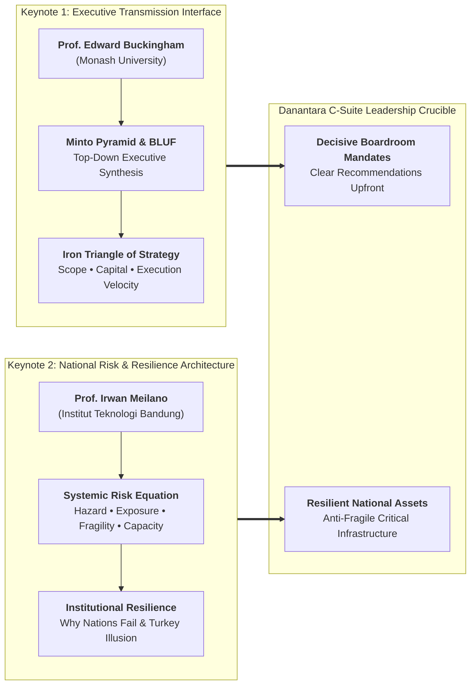
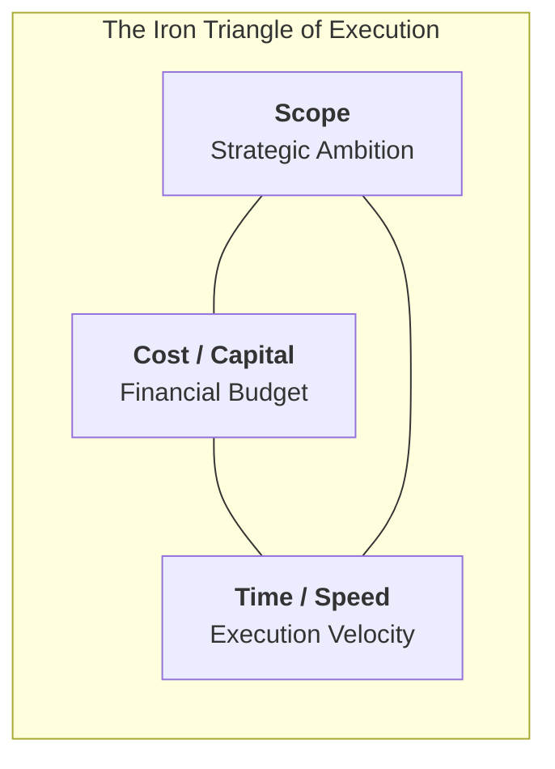
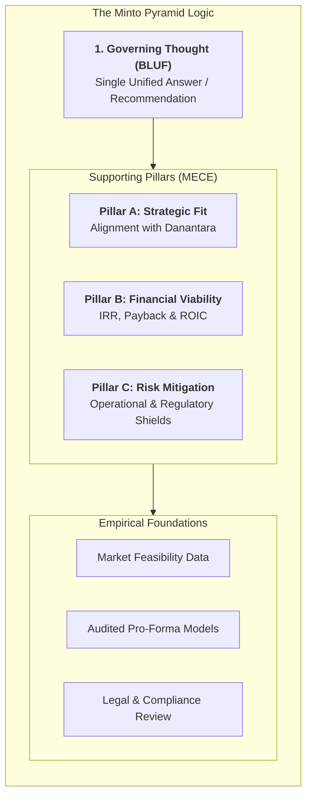
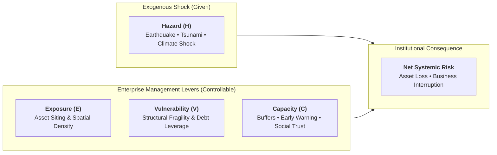
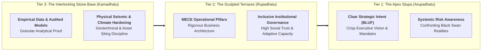

## 🎤 Executive Session Overview: The Dual-Keynote Architecture

On September 30, 2026, the **P3MD Batch I Soedirman** cohort at Kampus DCU Nawasena convened for a high-level **Dual-Keynote Executive Plenary** uniting international corporate strategy with national infrastructure risk governance. The plenary featured two distinguished scholars addressing two complementary dimensions of the senior executive mandate:

1. **Part 1: From Strategy to Execution & Structured Communication** — Delivered by **Prof. Edward Buckingham** (Professor of Management at **Monash Business School** and Director of Engagement at **Monash University Indonesia**).
2. **Part 2: The Shifting Ground: Crisis, Institutions & Systemic Risk Governance** — Delivered by **Prof. Irwan Meilano, S.T., M.Sc., Ph.D.** (Guru Besar Geodesi Gempa Bumi ITB, Dekan Fakultas Ilmu dan Teknologi Kebumian [FITB ITB], and Wakil Rektor ITB).

In large state-owned enterprises (BUMN) and the **Danantara** institutional architecture, future enterprise directors must operate simultaneously as **persuasive strategic communicators** and **resilient risk stewards**. Technical brilliance without top-down structured communication fails in boardroom deliberations; strategic vision without deep awareness of systemic tail-risk leads to catastrophic operational failure.

---

## 💡 Part 1: Strategic Execution & Structured Communication (Prof. Edward Buckingham)

### 1. Bottom Line Up Front (BLUF) and Attention Scarcity

The primary operating constraint of senior governance bodies is **cognitive bandwidth**. Executive directors, commissioners, and ministry officials manage packed schedules and severe information overload.

- **The Chronological Trap**: Traditional presenters construct linear narratives—beginning with historical background, detailing methodology, discussing operational challenges, and only presenting the proposal on the final slide.
- **The BLUF Imperative**: Executive communication requires inverting the pyramid. The core conclusion, strategic recommendation, or requested capital decision must be delivered **in the very first sentence**. This establishes an immediate cognitive anchor, allowing decision-makers to evaluate subsequent supporting data through the lens of that governing answer.

### 2. Efficiency vs. Effectiveness: Doing Things Right vs. Doing the Right Things

Citing Peter Drucker, Professor Buckingham drew a strict operational distinction:

- **Efficiency (_Doing things right_)**: Operational optimization, process speed, and cost discipline.
- **Effectiveness (_Doing the right things_)**: Strategic direction, portfolio selection, and strategic relevance.
- **The Executive Failure Mode**: An enterprise can operate with peak efficiency while executing an obsolete strategy. Efficiency without effectiveness merely accelerates an organization's arrival at the wrong destination.

### 3. "Culture Eats Strategy for Breakfast"

Formulating an analytically perfect strategic plan is merely table stakes. Enterprise performance is governed by execution, and execution is dictated by culture:

$$\mathbf{\text{\ldquo Culture eats strategy for breakfast\rdquo}}$$

- When leaders articulate clear, structured, and empathetic narratives, they reduce institutional anxiety and align divergent stakeholder cultures toward shared strategic execution.

### 4. The Iron Triangle of Project Execution

Project execution operates within an immutable trade-off matrix:

- Expanding project scope inevitably requires additional capital or extends delivery timelines; attempting to compress time while expanding scope without additional capital guarantees quality degradation or operational failure.

### 5. Theoretical Architecture: The Minto Pyramid & SCQA Engine

Structured executive logic requires arranging ideas into a rigid hierarchical pyramid:

- **Top-Down Summarization**: Any statement on a superior tier must actively summarize the grouping below it.
- **The MECE Rule**: Mutually Exclusive, Collectively Exhaustive (zero overlap, zero blind spots).
- **The SCQA Framework**: **Situation** (undisputed shared context), **Complication** (destabilizing challenge), **Question** (core dilemma), **Answer** (governing proposal).

---

## 🌋 Part 2: The Shifting Ground — Crisis, Institutions & Systemic Risk Governance (Prof. Irwan Meilano)

### 1. The Institutional Risk Formula

In national asset management and high-stakes infrastructure planning, Professor Meilano established the fundamental quantitative formula for systemic risk:

$$\mathbf{Risk} = \frac{\mathbf{Hazard} \times \mathbf{Exposure} \times \mathbf{Vulnerability}}{\mathbf{Capacity}}$$

- **Hazard ($H$)**: The intensity and frequency of the physical or economic shock. **Leaders cannot control the hazard**.
- **Exposure ($E$)**: The physical footprint, inventory volume, or personnel situated in the path of the hazard.
- **Vulnerability ($V$)**: The susceptibility to damage (e.g., poor building codes, brittle supply chain nodes, high financial leverage).
- **Capacity ($C$)**: The institutional capability to anticipate, absorb, respond, and rapidly recover.
- **The Executive Control Axiom**: Leaders must stop treating risk as an unpredictable act of fate. Because $H$ is exogenous, risk governance is entirely the discipline of minimizing $E$ and $V$, while maximizing $C$.

### 2. The Two Megatrends of the 21st Century

Professor Meilano identified two macro shifts defining the modern enterprise operating landscape:

1. **Intelligence Becomes Abundant**: Analytical compute, generative AI, and real-time sensor streams are ubiquitous. Raw information no longer confers competitive advantage.
2. **Risk Becomes Systemic**: Global and domestic systems are tightly coupled. A localized disruption in a single power grid, railway junction, or port terminal cascades non-linearly across telecommunications, banking liquidity, and food logistics.

### 3. The Turkey Illusion & Black Swan in Critical Assets

Drawing on Nassim Nicholas Taleb's _The Black Swan_, Professor Meilano warned BUMN leaders against the **Turkey Illusion**:

- A turkey fed every morning for 1,000 consecutive days develops an empirically robust statistical confidence that humans are benevolent protectors. That confidence peaks on Day 1,000—the day before Thanksgiving.
- In BUMN asset management, past operational calm creates an illusory sense of safety (_"we've operated this plant for 30 years without an incident"_). Professor Meilano stresses that **absence of evidence is not evidence of absence**. Extreme tail-risk events do not announce themselves via historical averages.

### 4. Five Simulation Lessons for Strategic Leadership

From extensive empirical disaster simulations conducted across Indonesian infrastructure:

1. **Vulnerability is the Fastest Lever**: Reducing asset fragility yields the quickest drop in catastrophic downside.
2. **Capacity Governs Long-Term Survivability**: Absorption and recovery capacity dictate whether an organization survives the aftermath.
3. **Trust is Institutional Capacity**: In times of systemic breakdown, social capital, transparency, and stakeholder trust are operational assets that prevent institutional paralysis.
4. **Levers are Multiplicative**: Improving exposure, vulnerability, and capacity concurrently produces exponential resilience, not linear addition.
5. **One Strategy for Compound Threats**: A well-designed resilience architecture mitigates multiple distinct hazards simultaneously.

### 5. Institutional Fragility: Extractive vs. Inclusive Institutions (_Why Nations Fail_)

Citing the landmark institutional economics of Daron Acemoglu and James A. Robinson (_Why Nations Fail_), Professor Meilano linked systemic resilience directly to corporate governance:

- **Extractive Institutions**: Characterized by elite rent-seeking, opaque decision-making, and suppression of critical bad news. Extractive organizations become brittle; when external shocks strike, they collapse rapidly.
- **Inclusive Institutions**: Encourage transparency, protect whistleblowers, empower front-line problem-solving, and align incentives with long-term societal resilience.

---

## 🏛️ Part 3: The Cross-Keynote Synthesis — Borobudur as Cognitive and Structural Model

A profound intellectual bridge emerges between Professor Buckingham's and Professor Meilano's lectures: the architectural metaphor of **Candi Borobudur**:

1. **Arupadhatu (The Apex)**: Represents both the governing communication thought (BLUF) and clear strategic intent that acknowledges systemic uncertainty.
2. **Rupadhatu (The Body)**: Represents the MECE pillars of strategic rationale, supported by inclusive institutional governance and high organizational trust.
3. **Kamadhatu (The Bedrock)**: Represents the physical and analytical foundation—uncompromising empirical data, structural engineering integrity, and geological risk mitigation. Without this bedrock, the stupa collapses; without the stupa, the bedrock is merely an aimless pile of stone.

---

## 👥 Part 4: Cohort-Wide Reflection Synthesis Dossier (P3MD Batch I Soedirman)

Following the double-keynote masterclass, **378 participants** across all 4 Groups and 12 Elements submitted individual reflective essays analyzing their personal communication habits, operational vulnerabilities, and risk practices across Indonesia's major state-owned enterprises (including **MIND ID Holding**, **PT Bukit Asam**, **PT Timah**, **PT Aneka Tambang**, **PT Inalum**, **PT Freeport Indonesia**, **PT Vale Indonesia**, **PT Kereta Api Indonesia**, **PT Pertamina**, **PT Semen Indonesia**, **PT Krakatau Steel**, **PT Bank Mandiri**, **PT Bank Rakyat Indonesia**, **PT Bank Negara Indonesia**, **PT Pelabuhan Indonesia**, and **PT Pupuk Indonesia**).

### 1. Full-Census Framework Frequency Matrix ($N = 378$)

A comprehensive automated extraction across all 378 submitted texts establishes the empirical distribution of frameworks referenced by the cohort:

| Plenary Keynote Session                | Theoretical Framework / Model / Quote   | Cohort Submissions ($N = 378$) | Adoption Frequency (%) | Primary Analytical Focus in Reflections                                                               |
| :------------------------------------- | :-------------------------------------- | :----------------------------: | :--------------------: | :---------------------------------------------------------------------------------------------------- |
| **Keynote 1: Prof. Edward Buckingham** | **Prof. Edward Buckingham**             |            **373**             |       **98.7%**        | Strategic execution, communication clarity, leadership demeanor.                                      |
| Keynote 1                              | **The Minto Pyramid Principle**         |            **311**             |       **82.3%**        | Structuring memos, bottom-up vs top-down logic, executive clarity.                                    |
| Keynote 1                              | **The Iron Triangle of Execution**      |            **264**             |       **69.8%**        | Trade-offs between scope, cost, and time in enterprise projects.                                      |
| Keynote 1                              | **SCQA Storytelling Framework**         |            **201**             |       **53.2%**        | Framing business problems, boardroom and ministerial memos.                                           |
| Keynote 1                              | _"Culture eats strategy for breakfast"_ |            **133**             |       **35.2%**        | Organizational culture, change resistance, cultural transmission.                                     |
| Keynote 1                              | **Candi Borobudur Metaphor**            |             **92**             |       **24.3%**        | Architectural hierarchy: stupa (answer) supported by bedrock (data).                                  |
| Keynote 1                              | **Efficiency vs. Effectiveness**        |             **68**             |       **18.0%**        | Doing things right vs. doing the right things (Peter Drucker).                                        |
| **Keynote 2: Prof. Irwan Meilano**     | **Prof. Irwan Meilano**                 |            **341**             |       **90.2%**        | Geological and disaster risk, national infrastructure vulnerability.                                  |
| Keynote 2                              | **The Turkey Illusion & Black Swan**    |            **128**             |       **33.9%**        | Nassim Taleb's Turkey Illusion; overcoming false historical complacency.                              |
| Keynote 2                              | **Systemic Risk Formula**               |             **73**             |       **19.3%**        | $\text{Risk} = (\text{Hazard} \times \text{Exposure} \times \text{Vulnerability}) / \text{Capacity}$. |
| Keynote 2                              | **Why Nations Fail (Acemoglu)**         |             **51**             |       **13.5%**        | Extractive vs. inclusive institutions; governance during national crises.                             |
| Keynote 2                              | **The Two Megatrends**                  |             **24**             |        **6.3%**        | Abundant intelligence vs. systemic, hyper-connected risk.                                             |
| Keynote 2                              | **Multi-Dimensional Innovation**        |             **24**             |        **6.3%**        | Social, educational, and institutional innovation beyond technology.                                  |
| Keynote 2                              | **Five Simulation Lessons**             |             **17**             |        **4.5%**        | Vulnerability as fastest lever, capacity for long-term, trust as capacity.                            |
| Keynote 2                              | **Risk Control Principle**              |             **7**              |        **1.9%**        | Inability to control hazard; focus on exposure, vulnerability, capacity.                              |

---

### 2. Thematic Deep-Dive Across the Cohort

#### A. Overcoming the "Competence Trap" and Deference (_Sungkan_)

- Technical specialists (geologists, mine planners, plant engineers, corporate financiers) widely recognized their vulnerability to the **Competence Trap**: believing that valid calculations excuse disjointed presentations.
- Participants reflected on how Javanese hierarchical deference (_sungkan_) leads presenters to bury bad news or avoid direct recommendations. The cohort recognized that delivering the conclusion upfront (**BLUF**) is not insolence, but the highest demonstration of professional respect for leadership time.

#### B. Deconstructing False Operational Complacency (The Turkey Illusion)

- Multiple participants in capital-intensive sectors linked Nassim Taleb's Turkey Illusion to asset maintenance and safety audits. Operating without a major equipment failure for several years often leads teams to relax preventive inspection cycles, heightening catastrophic tail risk.
- **Cohort Consensus**: Operational history is not safety proof. Resilience requires proactive vulnerability audits and stress-testing under extreme multi-hazard scenarios.

#### C. Operationalizing the Risk Formula in Capital Allocation

- Submissions across infrastructure, power, and logistics BUMNs explored the practical deployment of the $\text{Risk}$ formula:
  - When selecting sites for new smelters, logistics hubs, or data centers, planners must minimize **Exposure** to seismic faults and coastal flooding.
  - Engineering designs must reduce **Vulnerability** through seismic dampening and redundant supply lines.
  - Organizations must build **Capacity** through trained crisis teams, robust balance-sheet liquidity, and community trust.

---

### 3. Personal Commitments: 30-Day Executive Habit Transformation

Across the cohort reflections, participants committed to concrete behavioral adjustments bridging communication and risk stewardship:

| Leadership Dimension            | Previous Unconscious Reflex                                                       | 30-Day Executive Standard Commitment                                                                                   |
| :------------------------------ | :-------------------------------------------------------------------------------- | :--------------------------------------------------------------------------------------------------------------------- |
| **Executive Memos & Emails**    | Lengthy historical preambles spanning several pages before stating the request.   | Leading with **BLUF in Line 1**; using structured SCQA framing; keeping memos under 1 page.                            |
| **Boardroom Presentations**     | Presenting 40 chronological slides; revealing recommendations on the final slide. | Placing the core recommendation and financial ask on **Slide 1**; reserving subsequent slides for MECE validation.     |
| **Risk Reporting & Audits**     | Treating risk reviews as passive compliance checklists; ignoring tail risks.      | Applying the **Risk Formula**: isolating controllable levers ($E, V, C$); actively probing for Turkey Illusions.       |
| **Crisis & Feedback Delivery**  | Vague hints or sugarcoating bad news due to cultural _sungkan_.                   | Structuring feedback with **SCQA**: establishing mutual respect (S), naming the issue (C), and framing next steps (A). |
| **Project Trade-Off Decisions** | Agreeing to scope expansions without adjusting budgets or deadlines.              | Enforcing the **Iron Triangle**: requiring executive sponsors to explicitly re-balance scope, cost, or time.           |

---

## 📂 Archival Staging & Primary Sources

All primary submission artifacts from the cohort have been archived for institutional traceability:

| Archive Repository                                          |    File Count     | Primary Contents                                                          |
| :---------------------------------------------------------- | :---------------: | :------------------------------------------------------------------------ |
| `archive/rabuan/2026-09-30-buckingham-minto-method/Grup 1/` |  77 Submissions   | Individual reflection essays across Elements 1, 2, and 3 (`.pdf`).        |
| `archive/rabuan/2026-09-30-buckingham-minto-method/Grup 2/` |  87 Submissions   | Individual reflection essays across Elements 1, 2, and 3 (`.pdf`).        |
| `archive/rabuan/2026-09-30-buckingham-minto-method/Grup 3/` |  88 Submissions   | Individual reflection essays across Elements 1, 2, and 3 (`.pdf`).        |
| `archive/rabuan/2026-09-30-buckingham-minto-method/Grup 4/` |  126 Submissions  | Individual reflection essays across Elements 1, 2, and 3 (`.pdf`).        |
| **Total Ingested Submissions**                              |   **378 PDFs**    | Complete cohort reflections for P3MD Batch I Soedirman.                   |
| **Extracted Text Corpus**                                   | **378 TXT Files** | Located at `.extracted/texts/` with automated metadata catalog.           |
| **Full-Census Summary**                                     | **JSON Manifest** | Located at `.extracted/cohort-summary.json` with complete census metrics. |

> [!NOTE] Archival Tracking & Inclusion Notice
>
> - **100% Inclusion of MIND ID & Operating Subsidiaries**: All 27 submissions from MIND ID Holding and operating subsidiaries (PT Bukit Asam, PT Timah, PT Aneka Tambang, PT Inalum, PT Vale Indonesia, PT Freeport Indonesia) are extracted, verified, and integrated into the unified cohort text corpus.
> - **Out-of-Scope Isolation**: One anomalous submission from Serdik 296 (`296_Muhammad Ridho_G3E2_ALP1.pdf`, an Action Learning Project submission) was safely isolated and preserved in `inbox/296_Muhammad Ridho_G3E2_ALP1.pdf` for subsequent ALP processing.

---

## 🔗 Knowledge Graph & Curriculum Bridges

- **Featured Keynote Speakers**:
  - [[entities/edward-buckingham|Prof. Edward Buckingham]] (Professor of Management, Monash Business School)
  - [[entities/irwan-meilano|Prof. Irwan Meilano]] (Guru Besar & Dekan FITB, Institut Teknologi Bandung)
- **Compounding Core Concepts**:
  - [[concepts/minto-pyramid-principle|The Minto Pyramid Principle & Structured Communication]]
  - [[concepts/professional-image-framework|Professional Image & Leadership 5C Framework]] (Executive signaling & communication)
  - [[concepts/kepner-tregoe-problem-analysis|Kepner-Tregoe Problem Analysis]] (Systematic problem breakdown & decision trees)
  - [[concepts/capital-capability-synergy|Capital-Capability Synergy in BUMN]] (Asset stewardship & financial discipline)
- **Related Executive Masterclasses (Rabuan Series)**:
  - [[rabuan/2026-09-02-adh-peoplemath|Rabuan 01: PeopleMath — The Financial & Strategic Calculus of Human Capital]] (Agus Dwi Handaya)
  - [[rabuan/2026-09-04-indayati-professional-image|Rabuan 02: Building Professional Image & Executive Communication Skills]] (Indayati Oetomo)
  - [[rabuan/2026-09-23-syamsul-infrastruktur|Rabuan 03: Nation in Motion — Infrastruktur sebagai Penggerak Pertumbuhan]] (Syamsul Bachri Yusuf)
  - [[rabuan/2026-09-23-sahala-financial-discipline|Rabuan 04: Memimpin dengan Financial Discipline]] (Sahala Tua Paulus Situmorang)
  - [[rabuan/2026-10-14-ric-roi-impact-career|Rabuan 06: Making an Impact, Making a Career — The 5 Levels of Impact]] (Dr. Ric Roi)
- **Direct Curricular Synergies**:
  - [[courses/mk1-organizational-behavior-managing-people/index|MK 1: Organizational Behavior & Managing People]] (Organizational culture & psychological safety)
  - [[courses/mk4-operations-supply-chain-management/index|MK 4: Operations & Supply Chain Management]] (Capacity buffers, Little's Law & bottleneck mitigation)
  - [[courses/mk5-decision-making-negotiation/index|MK 5: Problem Solving, Decision Making and Negotiation]] (Decisions under risk, cognitive bias & persuasion)
- Return to **[[rabuan/index|Rabuan Executive Masterclass Hub]]**
