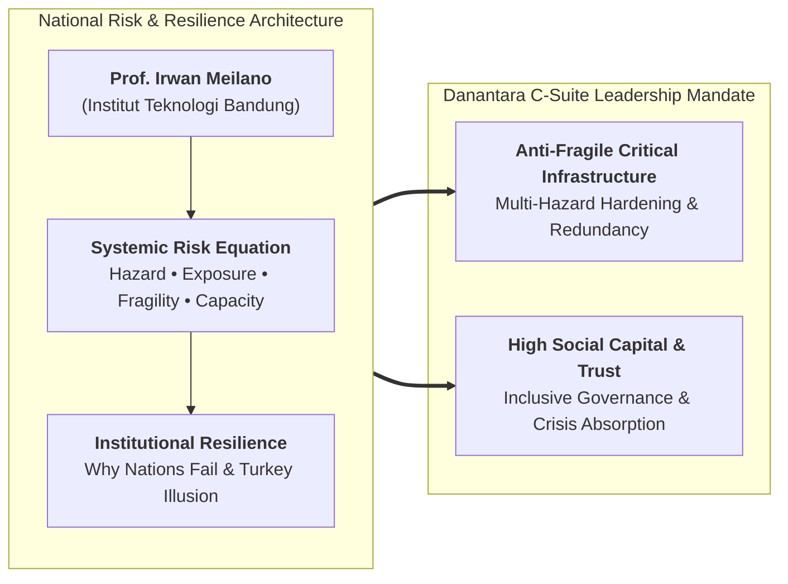
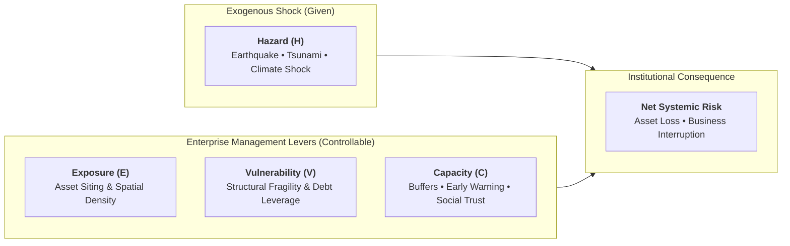
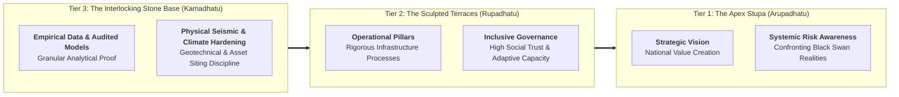

## Executive Plenary Overview

On September 30, 2026, **Prof. Irwan Meilano, S.T., M.Sc., Ph.D.**—Guru Besar Geodesi Gempa Bumi, Dekan Fakultas Ilmu dan Teknologi Kebumian (FITB), and Wakil Rektor Bidang Akademik dan Kemahasiswaan at **Institut Teknologi Bandung (ITB)**—delivered an authoritative national risk governance plenary lecture to the **P3MD Batch I Soedirman** cohort at Kampus DCU Nawasena.

Delivered alongside the corporate strategy plenary by [[rabuan/2026-09-30-buckingham-minto-method|Prof. Edward Buckingham (Monash University)]], Professor Meilano's address challenged emerging state enterprise leaders to re-examine the core operating assumptions behind national infrastructure protection. Moving decisively beyond static compliance checklists, he established that true executive resilience requires confronting non-linear systemic tail-risk, overcoming false operational complacency, and strengthening institutional capacity before exogenous shocks strike.

---

## The Institutional Risk Formula

In national asset management and high-stakes infrastructure planning, Professor Meilano established the fundamental quantitative formula for systemic risk:

$$\mathbf{Risk} = \frac{\mathbf{Hazard} \times \mathbf{Exposure} \times \mathbf{Vulnerability}}{\mathbf{Capacity}}$$

- **Hazard ($H$)**: The intensity and frequency of the physical, geological, or economic shock. **Leaders cannot control the hazard**.
- **Exposure ($E$)**: The physical footprint, inventory volume, or personnel situated directly in the path of the hazard.
- **Vulnerability ($V$)**: The susceptibility to damage (e.g., substandard building codes, brittle single-point supply chain nodes, high financial leverage).
- **Capacity ($C$)**: The institutional capability to anticipate, absorb, respond, and rapidly recover.
- **The Executive Control Axiom**: Leaders must stop treating risk as an unpredictable act of fate. Because $H$ is exogenous, risk governance is entirely the discipline of minimizing $E$ and $V$, while maximizing $C$.

---

## The Two Megatrends of the 21st Century

Professor Meilano identified two macro shifts defining the modern enterprise operating landscape:

1. **Intelligence Becomes Abundant**: Analytical compute, generative AI, and real-time sensor streams are ubiquitous. Raw information no longer confers a proprietary competitive advantage.
2. **Risk Becomes Systemic**: Global and domestic systems are tightly coupled. A localized disruption in a single power grid, railway junction, smelter terminal, or subsea cable cascades non-linearly across telecommunications, banking liquidity, and national food logistics.

---

## The Turkey Illusion & Black Swans in Critical Assets

Drawing on Nassim Nicholas Taleb's _The Black Swan_, Professor Meilano warned BUMN leaders against the **Turkey Illusion**:

- A turkey fed every morning for 1,000 consecutive days develops an empirically robust statistical confidence that humans are benevolent protectors. That confidence peaks on Day 1,000—the day before Thanksgiving.
- In BUMN asset management, past operational calm creates an illusory sense of safety (_"we have operated this refinery or port terminal for 30 years without an incident"_). Professor Meilano stresses that **absence of evidence is not evidence of absence**. Extreme tail-risk events do not announce themselves through historical averages.

---

## Five Simulation Lessons for Strategic Leadership

From extensive empirical disaster simulations conducted across Indonesian critical infrastructure:

1. **Vulnerability is the Fastest Lever**: Reducing asset fragility and structural brittleness yields the quickest drop in catastrophic downside.
2. **Capacity Governs Long-Term Survivability**: Absorption and recovery capacity dictate whether an enterprise survives the aftermath of a shock.
3. **Trust is Institutional Capacity**: In times of systemic breakdown, social capital, transparency, and stakeholder trust are operational assets that prevent institutional paralysis.
4. **Levers are Multiplicative**: Improving exposure, vulnerability, and capacity concurrently produces exponential resilience, not linear addition.
5. **One Strategy for Compound Threats**: A well-designed resilience architecture mitigates multiple distinct hazards simultaneously.

---

## Institutional Fragility: Extractive vs. Inclusive Institutions (_Why Nations Fail_)

Citing the landmark institutional economics of Daron Acemoglu and James A. Robinson (_Why Nations Fail_), Professor Meilano linked systemic resilience directly to corporate governance:

- **Extractive Institutions**: Characterized by elite rent-seeking, opaque decision-making, and suppression of critical bad news. Extractive organizations become brittle; when external shocks strike, they collapse rapidly.
- **Inclusive Institutions**: Encourage transparency, protect whistleblowers, empower frontline problem-solving, and align incentives with long-term societal resilience.

---

## The Structural Foundation: Borobudur's Bedrock (Kamadhatu)

Connecting his engineering discipline to the architectural metaphor of **Candi Borobudur**:

- **Kamadhatu (The Bedrock)**: Represents the physical and analytical foundation—uncompromising empirical data, structural engineering integrity, and geological risk mitigation. Without this bedrock, the upper terraces collapse under seismic stress; with it, national infrastructure endures centuries of environmental turbulence.

---

## Cohort-Wide Reflection Synthesis Dossier (P3MD Batch I Soedirman)

Following the plenary lecture, **378 participants** across all 4 Groups and 12 Elements submitted individual reflective essays analyzing their personal communication habits, operational vulnerabilities, and risk practices across Indonesia's major state-owned enterprises.

### Full-Census Empirical Frequency Matrix ($N = 378$)

A comprehensive automated extraction across all 378 submitted texts establishes the empirical distribution of frameworks referenced by the cohort:

| Plenary Keynote Theme / Model        | Theoretical Anchor / Citation Source                                                                     | Cohort Submissions ($N = 378$) | Adoption Frequency (%) | Primary Analytical Focus in Reflections                                       |
| :----------------------------------- | :------------------------------------------------------------------------------------------------------- | :----------------------------: | :--------------------: | :---------------------------------------------------------------------------- |
| **Prof. Irwan Meilano**              | **Keynote Speaker Citation**                                                                             |            **341**             |       **90.2%**        | Geological and disaster risk, national infrastructure vulnerability.          |
| **The Turkey Illusion & Black Swan** | Nassim Nicholas Taleb (_The Black Swan_)                                                                 |            **128**             |       **33.9%**        | Overcoming false historical complacency; tail-risk audits in capital assets.  |
| **Systemic Risk Formula**            | $\text{Risk} = \frac{\text{Hazard} \times \text{Exposure} \times \text{Vulnerability}}{\text{Capacity}}$ |             **73**             |       **19.3%**        | Decomposing risk into actionable levers; asset siting and buffer design.      |
| **Why Nations Fail (Acemoglu)**      | Daron Acemoglu & James A. Robinson                                                                       |             **51**             |       **13.5%**        | Extractive vs. inclusive institutions; governance during national crises.     |
| **The Two Megatrends**               | Global Systemic Dynamics                                                                                 |             **24**             |        **6.3%**        | Abundant intelligence vs. systemic, hyper-connected operational risk.         |
| **Multi-Dimensional Innovation**     | Social & Institutional Architecture                                                                      |             **24**             |        **6.3%**        | Social, educational, and institutional innovation beyond physical technology. |
| **Five Simulation Lessons**          | Empirical Disaster Simulations                                                                           |             **17**             |        **4.5%**        | Vulnerability as fastest lever, capacity for long-term survival, trust.       |
| **Risk Control Principle**           | Exogenous vs. Endogenous Governance                                                                      |             **7**              |        **1.9%**        | Inability to control hazard; focus on exposure, vulnerability, capacity.      |

---

### Thematic Deep-Dive Across the Cohort

#### 1. Deconstructing False Operational Complacency (The Turkey Illusion)

- Multiple participants in capital-intensive sectors linked Nassim Taleb's Turkey Illusion to asset maintenance and safety audits. Operating without a major equipment failure for several years often leads teams to relax preventive inspection cycles, heightening catastrophic tail risk.
- **Cohort Consensus**: Operational history is not safety proof. Resilience requires proactive vulnerability audits and stress-testing under extreme multi-hazard scenarios.

#### 2. Operationalizing the Risk Formula in Capital Allocation

- Submissions across infrastructure, power, and logistics BUMNs explored the practical deployment of the $\text{Risk}$ formula:
  - When selecting sites for new smelters, logistics hubs, or data centers, planners must minimize **Exposure** to seismic faults and coastal flooding.
  - Engineering designs must reduce **Vulnerability** through seismic dampening and redundant supply lines.
  - Organizations must build **Capacity** through trained crisis teams, robust balance-sheet liquidity, and community trust.

---

### Personal Commitments: 30-Day Executive Standard

Across the cohort reflections, participants committed to concrete behavioral adjustments in enterprise risk management:

| Leadership Dimension         | Previous Unconscious Reflex                                                   | 30-Day Executive Standard Commitment                                                                                   |
| :--------------------------- | :---------------------------------------------------------------------------- | :--------------------------------------------------------------------------------------------------------------------- |
| **Asset Siting & Logistics** | Siting facilities based solely on initial land acquisition cost.              | Mandating multi-hazard exposure screening ($E$) against seismic faults, subsidence, and sea-level rise.                |
| **Risk Reporting & Audits**  | Treating risk reviews as passive compliance checklists; ignoring tail risks.  | Applying the **Risk Formula**: isolating controllable levers ($E, V, C$); actively probing for Turkey Illusions.       |
| **Crisis Management Drills** | Relying on paper crisis manuals without live stress simulation.               | Conducting unannounced multi-hazard operational simulations to test absorptive capacity ($C$) under real stress.       |
| **Whistleblower & Bad News** | Discouraging reports of near-misses to protect divisional safety KPI records. | Cultivating **inclusive governance**: rewarding early bad-news escalation to eliminate systemic vulnerabilities ($V$). |

---

## Archival Staging & Primary Sources

All primary submission artifacts from the cohort have been archived for institutional traceability:

| Archive Repository                                          |    File Count     | Primary Contents                                                          |
| :---------------------------------------------------------- | :---------------: | :------------------------------------------------------------------------ |
| `archive/rabuan/2026-09-30-buckingham-minto-method/Grup 1/` |  77 Submissions   | Individual reflection essays across Elements 1, 2, and 3 (`.pdf`).        |
| `archive/rabuan/2026-09-30-buckingham-minto-method/Grup 2/` |  87 Submissions   | Individual reflection essays across Elements 1, 2, and 3 (`.pdf`).        |
| `archive/rabuan/2026-09-30-buckingham-minto-method/Grup 3/` |  88 Submissions   | Individual reflection essays across Elements 1, 2, and 3 (`.pdf`).        |
| `archive/rabuan/2026-09-30-buckingham-minto-method/Grup 4/` |  126 Submissions  | Individual reflection essays across Elements 1, 2, and 3 (`.pdf`).        |
| **Total Ingested Submissions**                              |   **378 PDFs**    | Complete cohort reflections for P3MD Batch I Soedirman (`REF5`).          |
| **Extracted Text Corpus**                                   | **378 TXT Files** | Located at `.extracted/texts/` with automated metadata catalog.           |
| **Full-Census Summary**                                     | **JSON Manifest** | Located at `.extracted/cohort-summary.json` with complete census metrics. |

---

## Knowledge Graph & Curriculum Bridges

- **Featured Keynote Speaker**:
  - [[entities/irwan-meilano|Prof. Irwan Meilano, S.T., M.Sc., Ph.D.]] (Guru Besar Geodesi Gempa Bumi & Dekan FITB ITB)
- **Accompanying Plenary Session**:
  - [[rabuan/2026-09-30-buckingham-minto-method|Rabuan 05: Strategic Execution, Structured Communication & The Minto Method]] (Prof. Edward Buckingham)
- **Related Executive Masterclasses (Rabuan Series)**:
  - [[rabuan/2026-09-02-adh-peoplemath|Rabuan 01: PeopleMath — Produktivitas Berkualitas & Strategi Tough & Agile Learner]] (Agus Dwi Handaya)
  - [[rabuan/2026-09-04-indayati-professional-image|Rabuan 02: Building Professional Image & Executive Communication Skills]] (Indayati Oetomo)
  - [[rabuan/2026-09-23-syamsul-infrastruktur|Rabuan 03: Nation in Motion — Infrastruktur sebagai Penggerak Pertumbuhan]] (Syamsul Bachri Yusuf)
  - [[rabuan/2026-09-23-sahala-financial-discipline|Rabuan 04: Memimpin dengan Financial Discipline]] (Sahala Tua Paulus Situmorang)
  - [[rabuan/2026-10-14-ric-roi-impact-career|Rabuan 07: Making an Impact, Making a Career — The 5 Levels of Impact]] (Dr. Ric Roi)
- **Direct Curricular Synergies**:
  - [[courses/mk4-operations-supply-chain-management/index|MK 4: Operations & Supply Chain Management]] (Resilient supply chain networks & capacity buffers)
  - [[courses/mk5-decision-making-negotiation/index|MK 5: Problem Solving, Decision Making and Negotiation]] (Decisions under extreme uncertainty & cognitive risk biases)
- Return to **[[rabuan/index|Rabuan Executive Masterclass Hub]]**
