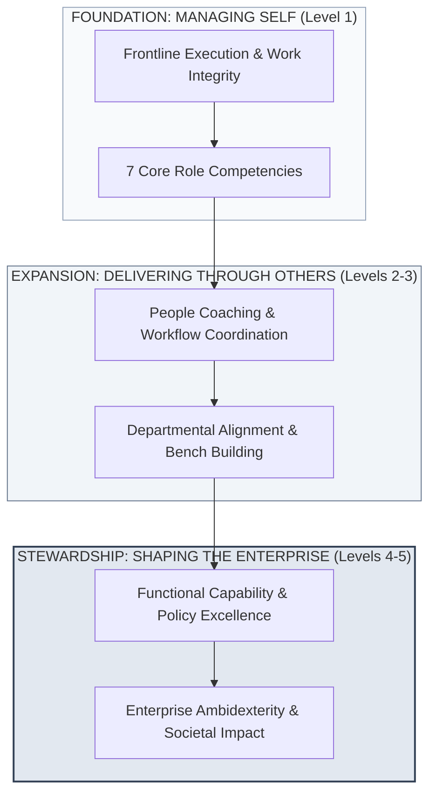
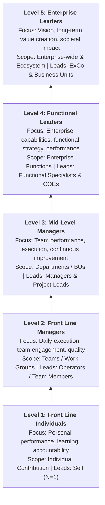
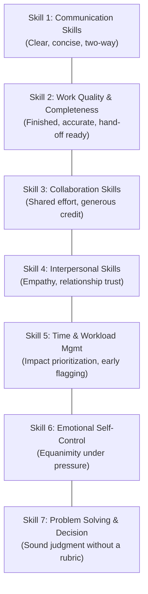
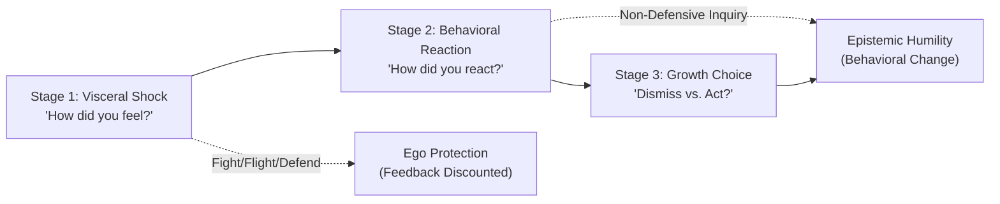
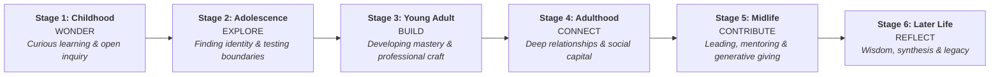

## 🎤 Executive Session Overview

Delivered by **[[entities/ric-roi|Dr. Ric Roi]]** (Professor of Leadership and Organization at **IMD Business School** and Academic Director of the **IMD Strategic Talent Lab**), this plenary masterclass examines the psychological and organizational architecture of long-term executive career development.

Bridging behavioral psychology, corporate governance, and executive succession, Dr. Roi unpacks how high-potential professionals transition from individual task execution to enterprise stewardship. The session establishes that impactful careers are not built through aggressive title acquisition, but through the deliberate compounding of operational credibility, relational trust, emotional self-regulation, and **[[concepts/leadership-ambidexterity|leadership ambidexterity]]**.

---

## 🏛️ Framework 1: The IMD Leadership Hierarchy — 5 Levels of Impact

Dr. Roi introduces IMD's progressive leadership continuum: **One Leadership System, Many Levels of Impact**. Leaders across the enterprise are united by institutional purpose, yet strictly differentiated by cognitive scope, operational focus, and the nature of their accountability.

### The 5 Levels Specification Matrix

| Level | Leadership Tier                                                 | Primary Strategic Focus                                                               | Scope of Impact                                                 | Core Executive Responsibilities                                                                                                                                                                                                                           | Direct Span / Who They Lead                                                         |
| :---: | :-------------------------------------------------------------- | :------------------------------------------------------------------------------------ | :-------------------------------------------------------------- | :-------------------------------------------------------------------------------------------------------------------------------------------------------------------------------------------------------------------------------------------------------- | :---------------------------------------------------------------------------------- |
| **5** | **Enterprise Leaders** _(Shaping the Future)_                | Enterprise vision, long-term economic value creation, and societal impact.            | Enterprise-wide, ecosystem partners, and societal stakeholders. | • Set enterprise direction and corporate strategy. • Steer portfolio architecture and capital allocation. • Build external institutional partnerships and market influence. • Secure multi-stakeholder trust and sustainability.                 | Executive Committee, Business Unit Heads, Functional Directors, Ecosystem Partners. |
| **4** | **Functional Leaders** _(Driving Enterprise Excellence)_     | Enterprise-wide functional capability, domain policy, and cross-silo performance.     | Multiple business units and corporate functional verticals.     | • Define functional strategy, standards, and governance policies. • Drive capability, process, and talent excellence. • Enable seamless cross-functional collaboration. • Manage enterprise risk, compliance, and regulatory affairs.            | Functional Teams, Domain Specialists, Centers of Excellence (COEs).                 |
| **3** | **Mid-Level Managers** _(Delivering Results Through Others)_ | Departmental execution, team performance targets, and continuous process improvement. | Departments, regional branches, and business operating units.   | • Translate high-level strategy into actionable team milestones. • Allocate operating budgets and prioritize daily workloads. • Coach people and systematically build bench strength. • Monitor performance metrics and drive operating results. | Operational Managers, Professional Specialists, Project Leads.                      |
| **2** | **Front Line Managers** _(Leading People & Work)_            | Daily operational execution, team motivation, and output quality.                     | Immediate teams, work crews, and project squads.                | • Plan, schedule, and coordinate daily work packages. • Coach, develop, and support front-line team members. • Ensure operational safety, compliance, and quality standards. • Resolve frontline bottlenecks and remove delivery blockers.       | Frontline Team Members, Technicians, Operators.                                     |
| **1** | **Front Line Individuals** _(Contributing Through Mastery)_  | Personal task performance, learning agility, and behavioral accountability.           | Individual deliverables and immediate project assignments.      | • Execute delegated tasks with technical quality and integrity. • Take personal ownership and demonstrate initiative. • Collaborate transparently and support project peers.                                                                        | Self ($N=1$).                                                                       |

> [!WARNING] The Leadership Transition Trap
> Promotion failures in corporate enterprises typically occur when a professional promoted to Level 2 continues behaving like a Level 1 superstar (hoarding technical work instead of coaching direct reports), or when a Level 4 leader manages through tactical micromanagement rather than functional policy architecture. Progression requires fundamentally redefining how one generates value.

---

## 🧭 Framework 2: Seven Essential Competencies for Early Career Impact

Dr. Roi establishes seven observable, behavioral competencies that govern early-to-mid career velocity. Each competency is learnable and compounds through deliberate practice.

### Competency Breakdown & Monthly Behavioral Architecture

#### 1. Communication Skills: _Clear, Concise, and Two-Way_

- **What Strong Looks Like**:
  - Leads with the bottom-line conclusion first, then layers supporting rationale (Bottom-Line-Up-Front / BLUF).
  - Authors emails, memos, and status updates that drive immediate executive decisions with zero ambiguity.
  - Practices active listening without formulating an internal rebuttal while the other party is speaking.
  - Calibrates narrative altitude to the audience (high-level synthesis for C-suite; technical detail for peers).
- **Build It This Month**:
  - Re-read every email once through the recipient's eyes before sending.
  - Summarize every key meeting in 3 concise bullet points immediately afterward.
  - Ask at least one clarifying question per major project brief.

#### 2. Work Quality & Completeness: _Finished, Accurate, and Ready to Hand Off_

- **What Strong Looks Like**:
  - Rigorously self-audits deliverables before submission, eliminating unforced formula, formatting, or data errors.
  - Fulfills the underlying strategic intent of the brief, not merely the minimum checklist items.
  - Identifies operational discrepancies and data inconsistencies upstream before clients or bosses spot them.
  - Produces modular, transparent work that team members can immediately adopt and build upon.
- **Build It This Month**:
  - Explicitly ask what "done" looks like at project kickoff to lock alignment.
  - Review your finished analysis as if you were the executive receiving it.
  - Be the first person to bring bad news or project variances to your manager.

#### 3. Collaboration Skills: _Better Results Through Shared Effort_

- **What Strong Looks Like**:
  - Transparently shares works-in-progress, templates, and contextual knowledge across team borders.
  - Generously and publicly attributes credit to teammates, cross-functional partners, and support staff.
  - Demonstrates Organizational Citizenship Behavior (OCB) by pitching in when lateral fires break out.
  - Navigates matrix friction without escalating petty territorial disputes.
- **Build It This Month**:
  - Proactively volunteer support on one teammate's deliverable each week.
  - Systematically replace "I" with "We" when presenting project milestones.
  - Interview one neighboring functional team to map what inputs they require from you.

#### 4. Interpersonal Skills: _Building Trust and Relational Capital_

- **What Strong Looks Like**:
  - Demonstrates genuine human curiosity and psychological empathy toward colleagues across all ranks.
  - Solicits and receives critical performance feedback without defensive emotional posturing.
  - Maintains warmth, approachable demeanor, and low interpersonal friction during crisis periods.
  - Develops informal lateral relationships beyond the immediate reporting chain.
- **Build It This Month**:
  - Schedule two informal one-on-one coffees or lunches per month with cross-departmental colleagues.
  - Retain and follow up on personal details shared by teammates (family, hobbies, aspirational goals).
  - Close feedback sessions by asking: _"What is one thing I could do differently to make working with me easier?"_

#### 5. Time and Workload Management: _Prioritizing and Delivering on Schedule_

- **What Strong Looks Like**:
  - Evaluates tasks along an Eisenhower impact-versus-urgency matrix rather than reacting to inbox noise.
  - Anticipates timeline bottlenecks and communicates deadline variance days before the milestone slips.
  - Accurately estimates resource requirements and execution duration, overcoming planning fallacies.
  - Constructively negotiates scope or says "no" with trade-off options when capacity is saturated.
- **Build It This Month**:
  - Draft weekly top-3 priorities on Monday morning and daily top-1 priorities each workday start.
  - Protect 90-minute blocks of uninterrupted deep work on your calendar weekly.
  - Proactively notify your supervisor of milestone risks before delays occur.

#### 6. Emotional Self-Control: _Staying Composed Under Pressure_

- **What Strong Looks Like**:
  - Cultivates an intentional pause between external criticism (stimulus) and personal response (choice).
  - Retains executive composure and professional dignity during charged conflicts.
  - Processes stress internally or through mentors without dumping negative emotional contagion on subordinates.
  - Rebounds rapidly from rejection, failed proposals, or critical executive reviews.
- **Build It This Month**:
  - Take three diaphragmatic breaths before responding to an abrasive email or confrontational question.
  - Enforce a 24-hour draft hold before sending emotionally charged correspondence.
  - Conduct personal post-mortems focused strictly on systemic root causes rather than allocating personal blame.

#### 7. Problem Solving & Decision Making: _Sound Judgment Without a Rubric_

- **What Strong Looks Like**:
  - Invests time defining the precise root dilemma before rushing into reactive execution.
  - Weighs options objectively using hard empirical data, market benchmarks, and contextual realities.
  - Never brings a naked problem to a manager without framing viable solution pathways.
  - Makes timely decisions under imperfect information, extracts feedback loops, and adjusts course.
- **Build It This Month**:
  - Never escalate an operational crisis without presenting two distinct options and a justified recommendation.
  - Document the overarching strategic goal each project task is designed to resolve.
  - Maintain a lightweight personal decision journal recording core assumptions, expected outcomes, and actual results.

---

## 🛠️ Framework 3: Self-Assessment Matrix & Peer Coaching Crucible

Dr. Roi challenged the cohort to benchmark their current professional behaviors across the 7 competencies using a standardized 5-point scale:

$$\text{Maturity Level} \in \{1: \text{Emerging/Low}, \ 2: \text{Developing}, \ 3: \text{Proficient}, \ 4: \text{Advanced}, \ 5: \text{Role Model/High}\}$$

### Cohort Self-Assessment Diagnostic

| Core Competency                       |  Low (1)  |    (2)    |    (3)    |    (4)    | High (5)  | Observable Verification Grounding                                                   |
| :------------------------------------ | :-------: | :-------: | :-------: | :-------: | :-------: | :---------------------------------------------------------------------------------- |
| **Communication Skills**              | $\square$ | $\square$ | $\square$ | $\square$ | $\square$ | Do executives read and act upon your project memos without follow-up questions?     |
| **Work Quality & Completeness**       | $\square$ | $\square$ | $\square$ | $\square$ | $\square$ | Can peers deploy your models and decks without auditing your underlying data?       |
| **Collaboration Skills**              | $\square$ | $\square$ | $\square$ | $\square$ | $\square$ | Do cross-functional teams proactively request you on complex joint initiatives?     |
| **Interpersonal Skills**              | $\square$ | $\square$ | $\square$ | $\square$ | $\square$ | Do colleagues trust you with sensitive organizational dynamics and vulnerabilities? |
| **Time & Workload Management**        | $\square$ | $\square$ | $\square$ | $\square$ | $\square$ | What percentage of your commitments are delivered on or ahead of the promised date? |
| **Emotional Self-Control**            | $\square$ | $\square$ | $\square$ | $\square$ | $\square$ | When blindsided in meetings, do you respond with curiosity or defensiveness?        |
| **Problem Solving & Decision Making** | $\square$ | $\square$ | $\square$ | $\square$ | $\square$ | Do supervisors accept your proposed recommendations with minimal rework?            |

> [!NOTE] 10-Minute Peer Calibration Protocol
> In pairs, cohort participants shared their highest-scoring competency and their lowest-scoring gap. The core analytical test: **"How do you know these are your scores?"** Participants were required to substantiate their self-rating with observable external behaviors rather than internal intentions, eliminating self-serving perceptual biases.

---

## 🧠 Framework 4: Growth Mindset & The Tough Feedback Crucible

Grounding the session in research on **Fixed vs. Growth Mindset** (Carol Dweck / Harvard Business School Online), Dr. Roi emphasized that career plateaus occur when professionals prioritize looking smart (Fixed Mindset) over expanding competence (Growth Mindset).

$$\text{Fixed Mindset: } \text{Failure} = \text{Identity Flaw} \quad \Longrightarrow \quad \text{Defensiveness \& Risk Aversion}$$
$$\text{Growth Mindset: } \text{Failure} = \text{Data Feedback} \quad \Longrightarrow \quad \text{Capability Expansion \& Iteration}$$

> _"Learn continually — there's always one more thing to learn."_  
> — **Steve Jobs**

### 12-Minute Triad Crucible: Processing Tough Feedback

Cohort participants engaged in a 3-person reflective debrief analyzing a recent instance of difficult managerial feedback:

1. **Visceral Experience (_How did you feel?_)**: Recognizing the somatic response—elevated heart rate, ego threat, cognitive shame, or feelings of unfairness.
2. **Behavioral Response (_How did you react?_)**: Evaluating whether the initial response was defensive (explaining away, counter-attacking, emotional shutdown) or exploratory (clarifying questions, active listening).
3. **Integration (_Do you dismiss the feedback or act on it?_)**: Identifying the threshold where an executive separates the messenger's tone from the substantive kernel of operational truth.

---

## 🌟 Framework 5: The Lifespan Maturation Arc & Executive Virtues

Integrating philosophical wisdom into corporate trajectory design, Dr. Roi grounded long-term leadership in Ralph Waldo Emerson's foundational aphorism:

> _“Life is a journey, not a destination.”_  
> — **Ralph Waldo Emerson**

### The 6 Lifespan Stages

1. **Childhood — Wonder**: Unfiltered curiosity, questioning basic premises, learning without status anxiety.
2. **Adolescence — Explore**: Testing personal limits, establishing values, and discovering individual identity.
3. **Young Adult — Build**: The primary MBA inflection stage. Honing technical mastery, proving reliability, and building operational track records.
4. **Adulthood — Connect**: Fostering deep interpersonal bonds, building organizational coalitions, and understanding institutional human dynamics.
5. **Midlife — Contribute**: Pivoting from personal accumulation to generative leadership, mentoring successors, and shaping enterprise culture.
6. **Later Life — Reflect**: Synthesizing career experiences into institutional wisdom, societal contribution, and lasting legacy.

### The Twin Virtues of Executive Leadership

To sustain this lifelong arc, Dr. Roi spotlighted two non-negotiable virtues:

> [!IMPORTANT] The Two Executive Virtues
>
> 1. **Courage**:  
>    _“Courage is not the absence of fear, but rather the judgement that something else is more important than fear.”_  
>    In enterprise leadership, courage is the willingness to deliver inconvenient truths to power, take accountability for team failures, and champion exploratory bets despite political risk.
> 2. **Kindness**:  
>    _“In a world where you can be anything, be kind.”_  
>    In corporate hierarchies, kindness is often mistaken for weakness. Dr. Roi reframes kindness as operational grace—treating colleagues with profound dignity, practicing psychological empathy, and eliminating toxic organizational cruelty.

---

## 🏢 Enterprise & Indonesian BUMN Leadership Context

For high-potential leaders across Indonesia's state-owned enterprises (**BUMN**) and regional conglomerates, Dr. Roi synthesizes four practical axioms:

### 1. The Core Performance Prerequisite

> _“The best way to progress into larger roles in the organization is to deliver consistently in your current role.”_

Young managers often suffer from premature strategic ambition—lobbying for Level 4/5 enterprise strategy assignments while delivering erratic Level 1/2 operational work. High-trust organizations promote professionals who have made their current domain impeccably stable and self-sustaining.

### 2. The Indispensability Paradox

> _“Be easy to work with and hard to replace.”_

- **Hard to replace**: Deep technical domain expertise, differentiated problem-solving capability, and dependable execution quality.
- **Easy to work with**: Low ego drag, high emotional regulation, transparent collaboration, and zero interpersonal toxicity.  
  Possessing one without the other results in either the "brilliant jerk" (technically irreplaceable but culturally toxic) or the "affable passenger" (easy to collaborate with but technically redundant).

### 3. The Relationship-Learning Horizon

> _“Your career is a marathon, not a sprint. Optimize for personal learning and quality relationships, and the career opportunities will naturally follow.”_

In Indonesian business ecosystems characterized by high relational collectivism, social trust compounds faster than technical accomplishments. Short-term political posturing burns bridging capital that takes decades to recover.

### 4. Normalizing Executive Vulnerability

> _“Nobody has it all figured out, including your manager, and the people who look like they have it all figured out.”_

Impostor syndrome is ubiquitous across every leadership tier. Recognizing that senior executives also navigate ambiguity, market volatility, and operational self-doubt liberates emerging leaders from perfection paralysis.

---

## 📂 Primary Source Media & Digital Archives

| Resource Title                                     |             Content Type             | Repository Location / Access                         |
| :------------------------------------------------- | :----------------------------------: | :--------------------------------------------------- |
| **Making an Impact, Making a Career (Slide Deck)** |    Keynote Presentation (`.pdf`)     | `raw/rabuan/2026-10-14-ric-roi-impact-career.pdf`    |
| **IMD Strategic Talent Lab Plenary Session**       | Executive Plenary Recording (`.mp4`) | _P3MD Digital Archives (Internal Stream)_            |
| **5 Levels of Impact Diagnostic Rubric**           |     Executive Worksheet (`.pdf`)     | `content/rabuan/2026-10-14-ric-roi-impact-career.md` |

---

## 🔗 Knowledge Graph & Curriculum Bridges

- **Featured Speaker Profile**: [[entities/ric-roi|Dr. Ric Roi]]
- **Compounding Core Concepts**:
  - [[concepts/leadership-ambidexterity|Leadership Ambidexterity]]
  - [[concepts/talent-density|Talent Density Power Law]]
  - [[concepts/self-awareness|The Self-Awareness Triad]]
  - [[concepts/values-congruence|Values Congruence & Executive Friction]]
  - [[concepts/purpose-to-impact|Purpose-to-Impact Planning]]
- **Related Academic Courses**:
  - [[courses/mk1-organizational-behavior-managing-people/index|MK 1: Organizational Behavior & Managing People]]
  - [[courses/mk5-decision-making-negotiation/index|MK 5: Decision Making & Negotiation]]
- **Return to**: [[rabuan/index|Rabuan Executive Archive]] | [[index|MBA Cohort Portal Home]]
