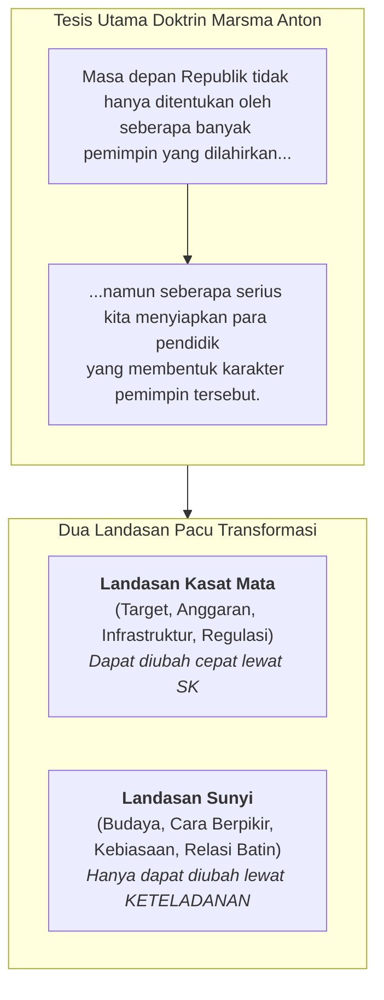
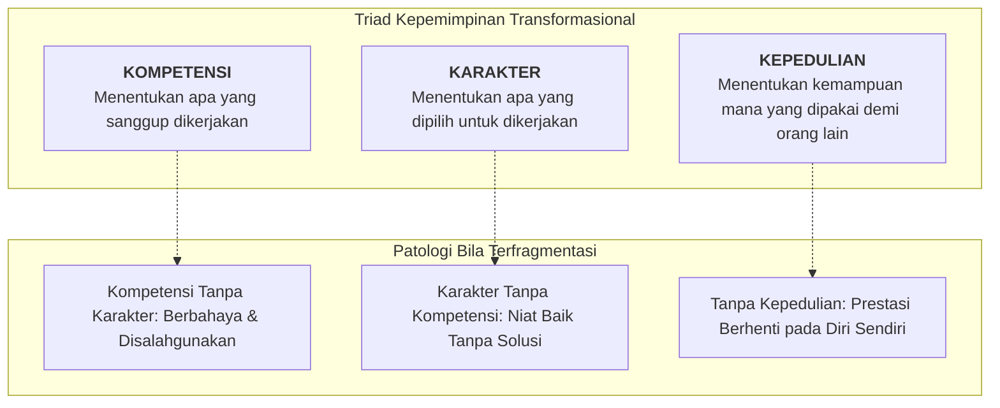
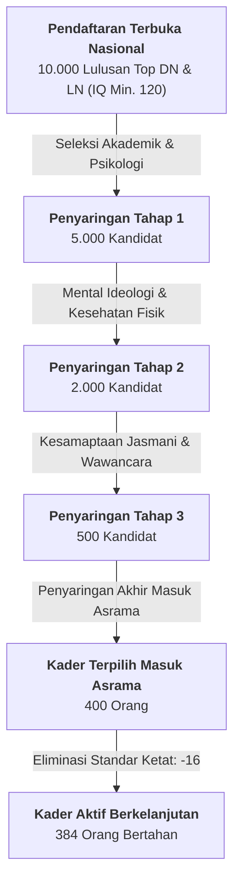

> [!NOTE] Inisiatif Pemantauan Siaran Langsung (Cohort Livestream Briefing)
> **Sesi ini bukan kuliah tamu tatap muka terjadwal di Kampus DCU Nawasena.**
>
> Berkas ini merupakan dokumentasi eksekutif mandiri atas inisiatif kohor **P3MD Batch I Soedirman** dalam memantau siaran langsung Orasi Ilmiah yang dibawakan oleh Komandan Program, **[[entities/anton-palaguna|Marsekal Pertama TNI Dr. Anton 'Sioux' Palaguna]]**, pada Sidang Terbuka Dies Natalis ke-72 Universitas Pendidikan Indonesia (UPI) di Bandung pada Selasa, 20 Oktober 2026 (disiarkan melalui _TVUPI Digital_).
>
> Orasi berdurasi 74 menit 25 detik ini diarsipkan ke dalam repositori Rabuan karena membedah secara gamblang **doktrin operasional P3MD**, arsitektur seleksi nasional ($10.000 \rightarrow 384$ kader), sembilan nilai kejuangan, metodologi pengasuhan 24 jam melalui **[[concepts/behavior-change-engine|Behavior Change Engine]]**, serta analogi penerbangan tempur supersonik yang mendasari pembentukan karakter pemimpin masa depan bangsa.

---

## 🧭 Executive Session Overview: The Commander's Doctrine

Pada 20 Oktober 2026, bertepatan dengan peringatan 72 tahun berdirinya Universitas Pendidikan Indonesia (20 Oktober 1954), Komandan P3MD **[[entities/anton-palaguna|Marsma TNI Dr. Anton Palaguna]]** menerima mandat akademis (_Air Tasking Order_ / ATO) dari Rektor UPI Prof. Dr. H. Didi Sukyadi untuk menyampaikan orasi ilmiah bertajuk:

> **"Mendidik Guru, Menantang Pemimpin: Sinergi Ekosistem Pendidikan sebagai Landasan Pacu Pemimpin Masa Depan yang Melesat dan Berdampak"**

Bagi kohor P3MD Batch I Soedirman, orasi ini merupakan penyingkapan filosofis paling komprehensif mengenai mengapa program ini dirancang dan bagaimana kader-kader terpilih ditempa. Marsma Anton menolak pendekatan pelatihan kepemimpinan konvensional yang berjarak dan sekadar berbasis ruang kelas formal. Melalui refleksi sebagai penerbang tempur F-16, Sukhoi 27/30, dan pilot uji perdana Dassault Rafale, beliau mengartikulasikan bahwa **karakter sejati adalah apa yang dilakukan oleh seorang murid di dalam kokpit ketika instruktur telah melangkah keluar dan berdiri di tepi landasan**.

---

## 🏛️ Theoretical Architecture & Core Frameworks

### 1. The Solo Flight & The Internalized Voice of the Instructor

Dalam tradisi penerbangan tempur militer, terdapat dua peristiwa sakral yang tidak pernah dilupakan oleh seorang penerbang seumur hidupnya:

1. Hari di mana ia melaksanakan **terbang solo perdana** (_first solo flight_).
2. Sosok **instruktur penerbang** yang menyatakan dirinya layak dan mengizinkannya terbang sendirian.

Ketika seorang murid terbang solo, kursi belakang kokpit kosong dan badannya terikat erat di ruang sempit yang melesat melampaui kecepatan suara. Secara kasat mata, ia terbang sendirian. Namun secara hakiki, di setiap pergerakan tangannya mengendalikan tuas _throttle_ dan _flight stick_, di setiap lirikan matanya membaca instrumen avionik, dan di setiap proses otaknya mengambil keputusan kritis di bawah beban gravitasi $8\text{–}10G$, **di sanalah suara sang guru hidup dan bersemayam**.

> [!IMPORTANT]
> **Definisi Karakter Paling Jujur**:
> _"Pendidikan yang berhasil bukan saat siswa patuh di depan gurunya, melainkan di saat suara sang guru masih hidup di dalam diri murid meskipun secara fisik sang guru tidak menyertainya. Karakter adalah apa yang dilakukan oleh murid meskipun sang pengasuh telah keluar dari kokpit."_

---

### 2. Triad Kepemimpinan: Kompetensi, Karakter, dan Kepedulian

Kepemimpinan di kokpit tempur maupun di pucuk pimpinan holding BUMN menuntut keahlian teknis prima. Namun keterampilan tinggi yang didominasi oleh ego, keengganan mematuhi regulasi, dan ilusi merasa tidak pernah salah (_arrogance of infallibility_) merupakan ancaman paling mematikan.

- **Kompetensi tanpa Karakter**: Menghasilkan kepintaran destruktif yang memanipulasi celah regulasi (_white-collar malfeasance_).
- **Karakter tanpa Kompetensi**: Melahirkan kesalehan pasif yang tidak mampu menyelesaikan masalah nyata di lapangan.
- **Kompetensi dan Karakter tanpa Kepedulian**: Melahirkan figur elitis berkinerja tinggi yang mengejar pencapaian pribadi tanpa empati bagi kesejahteraan publik.
- **Sintesis Ketiganya**: Menghasilkan kepemimpinan yang berakar pada nilai kebermanfaatan (_impactful stewardship_).

---

### 3. Mesin Pengubah Perilaku (The 7-Step Behavior Change Engine)

Menjawab tantangan mendasar bahwa **mengetahui belum tentu melakukan, melakukan sekali belum tentu menjadi kebiasaan, dan kebiasaan tanpa prinsip hidup akan luntur saat pengawasan hilang**, Marsma Anton merumuskan **[[concepts/behavior-change-engine|Behavior Change Engine]]** yang dioperasikan selama 24 jam penuh di asrama P3MD:

```mermaid
flowchart LR
    S1["<b>Tahap 1: Keteladanan</b><br/>Kurikulum Berjalan<br/>(4 Peran Pengasuh)"] --> S2["<b>Tahap 2: Latihan & Stakes</b><br/>Simulasi Nyata &<br/>Konsekuensi Terukur"]
    S2 --> S3["<b>Tahap 3: Refleksi Kolb</b><br/>Jurnal Harian &<br/>Napak Tilas Sejarah"]
    S3 --> S4["<b>Tahap 4: Self-Efficacy</b><br/>Tantangan Bertahap &<br/>Small Wins Spesifik"]
    S4 --> S5["<b>Tahap 5: Emosi & Ego</b><br/>Penaklukan Ego &<br/>The Tactical Pause"]
    S5 --> S6["<b>Tahap 6: Kesadaran</b><br/>Mindfulness &<br/>Harmoni Kuantum"]
    S6 --> S7["<b>Tahap 7: Empati Publik</b><br/>Memuliakan Martabat<br/>Kesulitan Sesama"]
```

1. **Keteladanan (_Role Modeling_)**: Perwira terbaik dari pasukan elit 3 matra dipilih khusus dan hadir bukan untuk militerisasi kaku, melainkan mengemban empat peran: orang tua, kakak, teman, dan komandan. _Satu tindakan konsisten menguatkan 100 nasihat; satu inkonsistensi meruntuhkan 100 ceramah._
2. **Latihan & Akuntabilitas (_Drills & Measurable Stakes_)**: Nilai-nilai diterjemahkan ke dalam simulasi berulang dengan sistem konsekuensi yang transparan dan terukur.
3. **Refleksi (_Experiential Reflection - David Kolb Cycle_)**: Pengalaman tanpa refleksi adalah hampa. Diterapkan melalui penulisan jurnal harian, napak tilas rute gerilya Panglima Besar Soedirman (3 hari 3 malam), dan pelayaran KRI menuju Monumen Puputan Margarana I Gusti Ngurah Rai di Bali.
4. **Self-Efficacy (_Keyakinan Diri_)**: Mengikis arogansi rapuh dan inferioritas melalui pemberian persoalan berjenjang dengan batasan waktu ketat (_time constraints_), memanen kemenangan kecil (_small wins_), dan umpan balik jujur spesifik.
5. **Pengendalian Emosi & Penaklukan Ego**: Pemimpin tidak bisa memilih situasi krisis yang datang, tetapi berdaulat memilih responsnya. Kader dilatih mengenali gejala ego dominan dan melatih jeda taktis (_the tactical pause_) sebelum merespons.
6. **Identitas, Mindfulness & Berkesadaran**: Memadukan kesadaran mikrokosmos dan makrokosmos, hukum resonansi dan frekuensi, fisika kuantum, dan anatomi doa spiritualitas agar pikiran dan perasaan selaras menciptakan realitas batin yang tenang.
7. **Kepedulian & Empati**: Kemampuan melihat martabat di balik kesulitan orang lain, meletakkan kepentingan pribadi demi kemaslahatan publik.

---

### 4. Kerangka 4 Peran Pendidik (Qualified Flying Instructor / QFI Framework)

Diadopsi dari kualifikasi instruktur penerbang tempur Angkatan Udara Australia (2009):

- **Role 1: Subject Matter Expert / Role Model** — Menjadi teladan teknis dan moral tertinggi; berintegritas tanpa cela dalam bidangnya.
- **Role 2: As a Teacher** — Mampu mendemistifikasi kerumitan ilmu menjadi pengetahuan praktis yang mudah diserap murid.
- **Role 3: As a Psychologist** — Mampu memetakan potensi unik tiap individu secara tajam (_tidak digebyah-uyah_ atau disamaratakan).
- **Role 4: As a Consultant** — Bertindak sebagai rujukan pemecahan masalah (_problem solver_) saat peserta didik menghadapi jalan buntu.

---

### 5. Tiga Ruang Bertumbuh Human Capital

Marsma Anton mengkritisi ilusi pengembangan SDM di Indonesia yang kerap menyamakan kemajuan dengan sekadar menumpuk jumlah sertifikat pelatihan formal. SDM hanya menjadi bahan bakar inovasi bila organisasi membuka tiga ruang tumbuh:

1. **Learning Space**: Ruang aman bagi pendidik dan talenta untuk menumbuhkan karakter, kompetensi, dan keteladanan.
2. **Trust Space**: Sistem organisasi yang transparan, adil, dan memberikan ruang bagi umpan balik yang jujur tanpa ancaman hukuman bagi kejujuran.
3. **Impact Space**: Ruang pendelegasian wewenang nyata bagi talenta yang telah dilatih untuk mengeksekusi inovasi dan menyelesaikan masalah institusi.

---

## 🔬 Inside the P3MD Blueprint: The Selection Pyramid & 3-Phase Journey

Dalam orasinya, Marsma Anton membuka secara rinci anatomi di balik layar pembinaan **P3MD Batch I Soedirman**:

- **Visi Utama Presiden RI**: Melahirkan pemimpin nasional dengan kriteria **Best Heart, Best Mind, Best Contribution**.
- **Kurikulum Tripartit 11 Bulan**:
  - **Tahap 1 (Core Character & Self-Mastery)**: Di Kodiklat TNI, menempa ketahanan mental, kepatuhan berkesadaran, dan penaklukan ego.
  - **Tahap 2 (Danantara Corporate Junior University)**: Selama 4 bulan, membekali kader dengan manajemen strategis, tata kelola korporasi holding, dan arsitektur investasi negara bersama [[entities/danantara|BP Danantara]].
  - **Tahap 3 (Leadership Apprentice Journey)**: Magang pengabdian masyarakat selama 4 bulan, terjun langsung ke akar rumput untuk menguji empati dan kontribusi nyata.
- **Sembilan Nilai Strategis (38 Sub-Nilai)**: Karakter & Integritas, Kepemimpinan, Komunikasi & Adaptabilitas, Resiliensi Fisik/Mental, Analytical Thinking, Manajemen & Eksekusi, Governance & Etika Publik, Nation Building, serta Kolaborasi Stakeholder.

---

## 🎯 The 72 Character Instructors Challenge & Closing Contemplations

### Tantangan Laboratorium 72 Instruktur Karakter UPI

Bertepatan dengan Dies Natalis ke-72 UPI, Marsma Anton melayangkan tantangan nyata di hadapan Rektor, Majelis Wali Amanat, dan Dewan Guru Besar:

- Mendirikan **Teacher and Leader Formation Laboratory** di UPI.
- Membentuk **72 Instruktur Karakter**.
- **Komitmen Pro Bono**: Marsma Anton mengajukan diri secara sukarela sebagai **Instruktur #1** tanpa menerima kompensasi, honorarium, transportasi, maupun penginapan dari UPI, dan menantang universitas menjaring 71 instruktur karakter berintegritas lainnya dari kalangan tokoh bangsa.

### Tiga Pertanyaan Penjaga Hati

Marsma Anton menitipkan tiga pertanyaan kontemplatif bagi seluruh insan berpendidikan tinggi:

1. _"Apabila ilmu kita semakin bertambah, apakah kerendahan hati kita semakin meluas?"_
2. _"Apabila kedudukan kita semakin meningkat, apakah ada tambahan martabat sesama manusia yang terangkat?"_
3. _"Apabila lembaga kita semakin terkenal, apakah semakin banyak anak bangsa yang memiliki kesempatan hidup yang membesar?"_

### Epilog: Anak di Sudut Ruangan

> _"Bila kita nanti sedang mengajar dan ada anak yang duduk di sudut ruangan dan merasa dirinya inferior, berikan jeda sejenak. Karena bisa jadi si anak itu di dalam dirinya sedang tumbuh seorang penemu, sedang tumbuh seorang pembaharu, sedang tumbuh seorang jenderal kehidupan, sedang tumbuh seorang pemimpin yang kelak akan mengubah jutaan orang. Tugas kita tidak terlalu dini untuk memutuskan masa depan anak, melainkan menjamin kemungkinan terbaik dalam diri anak agar tidak padam sebelum menyala."_

---

## 🔗 Cross-Functional Curriculum Bridges & Boardroom Application

| Ranah Kurikulum MBA                                  | Titik Temu Doktrin Komandan Anton                              | Implikasi Eksekutif pada Proyek BUMN / ALP                                                                                                                                                                                      |
| :--------------------------------------------------- | :------------------------------------------------------------- | :------------------------------------------------------------------------------------------------------------------------------------------------------------------------------------------------------------------------------ | --------------------------------------------------- | ------------------------- | ---------------------------------------------------------------------------------------------------------------------------------------------------------- |
| **MK 1: Organizational Behaviour & Managing People** | [[concepts/behavior-change-engine                              | Behavior Change Engine]], [[concepts/self-awareness                                                                                                                                                                             | Self-Awareness]], [[concepts/emotional-intelligence | Emotional Intelligence]]. | Transformasi budaya kerja BUMN tidak bisa dicapai lewat instruksi birokratis (landasan kasat mata), melainkan keteladanan harian BoD/BoC (landasan sunyi). |
| **Corporate Governance & Danantara Restructuring**   | Triad Kompetensi, Karakter, Kepedulian; Akuntabilitas Terukur. | Skandal korupsi dan inefisiensi BUMN terjadi bukan karena direksi kurang pintar, melainkan defisit karakter dan ego yang tak terkendali.                                                                                        |
| **Action Learning Project (ALP)**                    | Output vs Outcome vs Impact; 6 Rantai Landasan Pacu.           | Evaluasi proyek intervensi di 10 BUMN partner: apakah rekomendasi tim F9 hanya berhenti di dokumen laporan (_output_), mengubah kapabilitas (_outcome_), atau berdampak nyata pada efisiensi operasional dan publik (_impact_)? |

---

<strong>📜 Klik di sini untuk membuka TRANSKRIP LENGKAP & KRONOLOGIS (15 Bagian Verbatim, ~74 Menit)</strong>

## 🎙️ TRANSKRIP LENGKAP & TERSTRUKTUR

### (Verbatim Chronological Transcript)

---

### Pengantar Protokoler & Riwayat Hidup Pembicara (MC)

`[01:18:51,200 → 01:21:46,920]`

> **MC**: Staf Ahli Panglima TNI Bidang Politik Dalam Negeri. Namun sebelumnya, sebagai pengantar, marilah kita saksikan tayangan berikut ini.
>
> _(Penayangan video profil Marsekal Pertama TNI Dr. Anton Palaguna)_
>
> **MC**: Pidato Akademik dalam rangka Dies Natalis ke-72 dan wisuda tahun 2026, dibawakan oleh Marsekal Pertama TNI Doktor Anton Palaguna, S.E., M.M., M.Han., M.M.O.A.S., CSBA, CHRA.
>
> Nama lengkap: Marsekal Pertama TNI Doktor Anton Palaguna, S.E., M.M., M.Han., M.M.O.A.S., CSBA, CHRA. Lahir di Garut, 17 Mei 1979. Lulusan terbaik Sekolah Penerbang TNI AU, lulusan terbaik Sekolah Komando Kesatuan TNI AU (Sekkau), lulusan terbaik Sekolah Staf dan Komando TNI (Sesko TNI), lulusan terbaik Program Doktor Fakultas Ekonomi dan Bisnis Universitas Hasanuddin. Memperoleh 12 tanda jasa kehormatan dari Presiden Republik Indonesia. Memperoleh penghargaan kualifikasi _Lyotchik-Snayper_ (_Flight Sniper_) dari Angkatan Udara Rusia; memperoleh penghargaan _Well Done Award_ atas keberhasilan menyelamatkan pesawat tempur Sukhoi yang mesinnya meledak di udara. Mantan Ajudan Presiden Republik Indonesia. Komandan Badan Pengelola Pendidikan Kebangsaan (BPPK Kemhan RI). Staf Ahli Panglima TNI. Dosen S2 Manajemen Strategi di Universitas Pertahanan. Dosen S2 dan S3 Universitas Hasanuddin, Makassar.
>
> Hadirin yang kami hormati, Marsekal Pertama Doktor Anton Palaguna, S.E., M.M., M.Han., M.M.O.A.S., CSBA, CHRA, kami persilakan.

---

### Bagian 1: Mukadimah, Pantun Pembuka, dan Penghormatan Civitas Academica

`[01:22:21,520 → 01:28:21,120]`

_Salam penghormatan, pantun pembuka untuk Bumi Siliwangi, serta apresiasi mendalam kepada seluruh jajaran pimpinan Majelis Wali Amanat, Senat Akademik, Dewan Guru Besar, Rektorat, para Rektor pendahulu, serta keluarga besar Universitas Pendidikan Indonesia._

`[01:22:21,520 → 01:23:03,440]`

Bismillahirrahmanirrahim. Assalamualaikum warahmatullahi wabarakatuh. Waalaikumsalam Selamat pagi. Salam sejahtera untuk kita semua. Shalom. Om Swastiastu. Namo Budaya, salam kebajikan. Rahayu. Sampurasun. Saya izin berpantun. Pak Rektor. Terlintas begitu saja. Tadi Pak Rektor membuka dengan pantun, rasanya tidak afdol kalau kita tidak berpantun.

`[01:23:03,440 → 01:23:44,880]`

Saya izin undang catoknya. Minyak atsiri harum mewangi. Gula lima manis. Obat campak. Kita datang di bumi Siliwangi. Untuk UPI yang melesat dan berdampak. Yang terhormat dan kami muliakan. Sekretaris Majelis Wali Amanat Universitas Pendidikan Indonesia.

`[01:23:44,880 → 01:24:08,000]`

Bapak Profesor Doktor Rian M.Si. Yang pada kesempatan kali ini mewakili Ketua Majelis Wali Amanat. Beserta seluruh anggota Majelis Wali Amanat. Yang kami hormati Ketua Senat Akademik Universitas Pendidikan Indonesia Bapak Profesor Doktor Yadi Ruyadi S.H. M.Si.

`[01:24:08,000 → 01:24:38,720]`

Beserta seluruh anggota Senat Akademik. Ketua Komite Audit Universitas Pendidikan Indonesia. Bapak Profesor Doktor Disman M.S. Beserta seluruh anggota audit dan tentunya yang kami hormati Rektor Universitas Pendidikan Indonesia Bapak Prof. Dr. H. Didi Sukyadi, M.A.

`[01:24:38,720 → 01:25:08,240]`

Ketua Dewan Guru Besar Universitas Pendidikan Indonesia Bapak Prof. Dr. H. Dadang Sunendar, M.Hum. beserta seluruh anggota Dewan Guru Besar kemudian yang kami hormati Bupati Kuningan Bapak Dr. H. Diah Rahmat Yanuar, M.Si. Selamat datang, Bapak di buminya para pendidik.

`[01:25:08,240 → 01:25:50,920]`

Kemudian yang kami hormati juga Kepala Dinas Pendidikan Kabupaten Kuningan Dr. Aarlan M.Pd. beserta jajaran yang kami muliakan para Rektor terdahulu Universitas Pendidikan Indonesia Bapak Prof. Dr. H. Muhammad Fakry Gaffar M.Ed. Ini beliau adalah Rektor IKIP Bandung periode 95-2000 dan Rektor UPI periode 2000 hingga 2005.

`[01:25:50,920 → 01:26:35,720]`

Bapak Prof. Dr. H. Raden Asep Kadarohman, M.Si. Beliau Rektor UPI pengganti antar waktu periode 2015-2020. Kemudian Bapak Prof. Dr. H. Muhammad Solehudin, M.Pd., M.A. Rektor UPI periode 2020-2025. Para Wakil Rektor Dekan dan Wakil Dekan serta pimpinan Sekolah Pascasarjana di lingkungan UPI para direktur dan wakil direktur kampus UPI di daerah para direktur direktorat, kepala biro kepala kantor serta seluruh unsur pimpinan unit kerja di lingkungan Universitas Pendidikan Indonesia

`[01:26:35,720 → 01:27:21,400]`

ketua umum ikatan alumni Universitas Pendidikan Indonesia Bapak Ami Al Humami MA MED PhD kemudian ketua umum ikatan istri karyawan UPI Ibu Hajah Ainur Jamilah Didi Sukiyadi S.Pd. Para staf khusus rektorat, para profesor, guru besar, dosen, tenaga kependidikan, mahasiswa, alumni serta seluruh civitas akademika Universitas Pendidikan Indonesia dan tentunya yang kami hormati dan muliakan seluruh hadirin serta tamu undangan yang tidak dapat kami sebutkan satu persatu.

`[01:27:22,240 → 01:27:59,440]`

Alhamdulillah puji dan syukur kita panjatkan kehadirat Allah Subhanahu Wa Ta'ala, Tuhan Yang Maha Esa Esa karena atas limpahan kasih sayangnya pada pagi hari ini kita berkumpul di sini dalam keadaan sehat walafiat tidak kurang suatu apapun dan karena kehendaknya juga kita bisa bertemu untuk merayakan ke-72 lembaga yang mendidik para pendidik.

`[01:27:59,520 → 01:28:21,120]`

Tentu perayaan ini bukan hanya sekedar bertambahnya angka namun ini juga adalah sebagai pengingat buat kita semua bahwa kita adalah sosok-sosok yang berkomitmen untuk mendidik manusia, menguatkan peradaban dan menyiapkan Indonesia semakin baik. Selamat

---

### Bagian 2: Resonansi Pendidik & Nilai Pendidikan di Ruang Sempit Melampaui Kecepatan Suara

`[01:28:21,120 → 01:34:44,160]`

_Menghadirkan cerita dunia penerbangan tempur supersonik ke mimbar akademik: Pengujian manuver 10G Sukhoi 27/30 dan Dassault Rafale, dilema masa muda antara menjadi guru atau perwira Akabri, hingga kesadaran akan resonansi frekuensi pendidik dalam darah._

`[01:28:21,120 → 01:28:58,320]`

Dies Natalis ke-72 Universitas Pendidikan Indonesia. Kita berikan tepuk tangan. Hadirin yang kami muliakan, pada kesempatan yang berbahagia ini, perkenankan kami untuk menyampaikan terima kasih yang tak terhingga kepada Bapak Rektor dan seluruh sivitas akademika atas kesempatan dan kehormatan untuk berdiri di sini.

`[01:28:58,320 → 01:29:26,600]`

Saya sepenuhnya menyadari bahwa di ruangan ini hadir para senior, hadir para tokoh, hadir para pejabat, hadir para guru besar yang tentu lebih kompeten, yang tentu lebih paham, tentu lebih berhak untuk berbicara tentang pedagogi.

`[01:29:26,600 → 01:30:01,440]`

Namun nampaknya Bapak Rektor menginginkan sedikit suasana yang berbeda. Menghadirkan cerita tentang nilai pendidikan di atas langit di ruang sempit yang melaju melampaui kecepatan suara. Sayangnya tadi tidak dilanjutkan videonya. Padahal tadi itu setelahnya itu bagaimana pesawat tempur paling canggih di Indonesia itu sedang diuji.

`[01:30:01,560 → 01:30:19,760]`

Pesawat tempur Rafale, boleh tidak diulang lagi? Supaya agak tidak terlalu ngantuk. Ah, boleh ya. Tadi sudah saya beri kode-kode Pak Pandu. Padahal itu yang dimunculkan, malah yang dimunculkan di awal. Tapi setidaknya menjadi identitas kita. Boleh Ibu, Bapak kita lihat sebentar.

`[01:30:20,520 → 01:30:46,840]`

Itu yang di tengah yang membacakan orasi siang hari ini. Ah, ini. Ini adalah pesawat tempur paling canggih milik Indonesia, pesawat tempur Sukhoi 27 dan 30. Dan ini pesawat tempur Rafale, pesawat tempur dari Perancis yang saat ini adalah pesawat tempur tercanggih di dunia.

`[01:30:46,840 → 01:31:10,960]`

Ini kami yang menguji pertama kali di Indonesia di tahun 2018. Yang memerintahkan saat itu Bapak Menteri Pertahanan yang saat ini menjadi Bapak Presiden Republik Indonesia. Bila Ibu, Bapak melihat di kiri kanan sayapnya itu ada seperti turbulen.

`[01:31:10,960 → 01:31:36,560]`

Ada seperti asap. Itu artinya si pesawat sedang menerima gaya gravitasi bumi. Yang besarnya bisa 8 sampai 9 sampai 10 gravitasi bumi. Artinya kita harus menahan 10 kali berat badan kita. Ini kita uji di pantai selatan.

`[01:31:36,560 → 01:32:31,640]`

Dua pesawat melakukan pertempuran. Baik, terima kasih. Kami mohon maaf sebelumnya, kenapa kami tampilkan? Karena minggu kemarin mahasiswa S3 kami dari Timor Leste, kebetulan kami mengajar S3 di Unhas untuk program mahasiswa internasional. Ekonomi bisnis, mengajar tentang strategic policy untuk public sector dan private sector. Mereka tidak percaya bahwa dosennya adalah tentara.

`[01:32:33,160 → 01:33:19,920]`

Kita berbicara tentang public sector, kita berbicara tentang public eh tentang private sector. Sampai mereka berempat datang ke Jakarta untuk membuktikan bahwa dosennya itu tentara. Dan karena ini pula Pak Rektor mengundang kami beliau menyampaikan bagi cerita pendidikan di langit yang ada di ruang sempit dan bergeraknya itu melampaui kecepatan suara yang saat ini kita sedang transformasikan kepemimpinan itu kepada talenta-talenta terbaik calon pimpinan BUMN.

`[01:33:22,000 → 01:33:49,680]`

Bapak, Ibu sekalian, tadi kami tampilkan bukan tentang berbicara siapa saya tetapi kami sedang berbicara tentang dunia pendidikan. Bahwa ternyata dunia pendidikan tidak sesempit yang kita bayangkan. Dulu saya bercita-cita menjadi seorang guru dan ada satu titik dilematis pada saat saya harus memilih kuliah atau mendaftar di Akabri.

`[01:33:49,680 → 01:34:06,000]`

Takdir kemudian menentukan saya harus masuk di Akabri. Saya pikir saat itu pupus sudah cita-cita saya sebagai guru karena ayah saya guru, ibu saya guru. Makanya begitu tadi pertama kali saya masuk di kampus ini, saya bertanya-tanya.

`[01:34:06,000 → 01:34:33,960]`

Izin, Prof. Getaran apa? Kok sedikit berbeda. Merinding. Ternyata begitu saya masuk ruangan ini, ada resonansi. Resonansi itu apabila satu benda bergetar yang frekuensinya sama, dia ikut bergetar. Getaran-getaran di tanah ini adalah getaran para pendidik.

`[01:34:33,960 → 01:34:44,160]`

Ternyata, Prof, di darah saya adalah darahnya pendidik. Darahnya guru.

---

### Bagian 3: Filosofi Terbang Solo & Suara Guru dalam Pembentukan Karakter

`[01:34:44,200 → 01:40:57,960]`

_Dua momen paling sakral bagi penerbang tempur: hari terbang solo pertama dan instruktur yang memberi izin. Hakikat pendidikan sejati adalah saat suara sang guru tetap hidup dan memandu tindakan murid kendati instruktur telah keluar dari kokpit._

`[01:34:44,200 → 01:35:05,520]`

Guru di langit sekarang jadi guru di bumi. Bapak, Ibu yang kami hormati, siang seperti ini challenging untuk eh menyampaikan orasi ilmiah ini. Mudah-mudahan kami sengaja tidak menampilkan di sana slide supaya saya bisa berinteraksi karena saya memegang mandat dari Bapak Rektor.

`[01:35:15,720 → 01:35:40,760]`

Kami berdiri di sini tentu adalah sebuah kehormatan. Karena di hadapan kami adalah para senior, para pendidik. Oleh karena itu, dengan segala hormat kami, perkenankan kami untuk menyampaikan pandangan sesuai dengan apa yang dimandatkan oleh eh Bapak Rektor.

`[01:35:40,760 → 01:36:03,400]`

Kehormatan ini juga sekaligus mengingat bagi saya pribadi bahwa saya tetap harus meletakkan hati saya tetap paling jauh di dasar samudra. Karena Bapak, Ibu, mungkin seorang perwira itu pernah memimpin pasukan. Mungkin seorang pilot tempur itu pernah mengendalikan pesawat tempur paling canggih seperti tadi.

`[01:36:03,400 → 01:36:31,320]`

Dan mengambil keputusan-keputusan besar. Namun jauh sebelum itu ada sosok yang mengajarinya membaca. Ada sosok yang mengajarinya cara berpikir. Ada sosok yang mengajarinya tentang memilih yang benar dari yang salah. Dan sosok itu adalah seorang guru.

`[01:36:37,120 → 01:37:10,840]`

Bagi seorang penerbang ada dua hal yang tidak akan pernah dilupakan sampai akhir hayatnya. Yang pertama hari di mana dia terbang solo pertama. Yang kedua instruktur yang mengizinkannya dia terbang solo. Jadi kalau Bapak Ibu bertemu Angkatan Udara dan dia seorang penerbang tempur, tanya dua hal ini.

`[01:37:10,840 → 01:37:42,840]`

Kapan Bapak solo dan siapa instrukturnya? Mengapa saya awali dengan cerita ini? Ibu dan Bapak. Dua hal ini tidak akan pernah dilupa. Di hari sang murid dinyatakan lulus untuk melaksanakan terbang solo. Setelah diuji dinyatakan aman dan dia akan terbang sendirian maka si instruktur akan keluar dari kokpit, dia akan berdiri di tepi landasan.

`[01:37:43,360 → 01:38:17,200]`

Sang murid di dalam kokpit yang sempit, badannya diikat, kursi di belakangnya kosong. Dia kemudian lepas landas, melesat, mengangkasa, membelah langit, dan melakukan manuver-manuver ekstrem. Mari kita cermati. Secara fisik, seolah dia terbang sendirian. Namun sebenarnya tidak.

`[01:38:17,200 → 01:38:46,240]`

Di setiap tubuhnya, tangannya dia mengendalikan tuas-tuas pesawat, lirikan matanya untuk melihat instrumen-instrumen pesawat, otak yang berproses untuk pengambilan keputusan-keputusan kecil, di sana ada suara sang guru yang sudah berpindah ke dalam dirinya. Bagi saya, inilah definisi pendidikan yang paling jujur.

`[01:38:46,240 → 01:39:24,360]`

Pendidikan yang berhasil itu bukan pada saat siswa patuh di depan gurunya. Namun di saat suara sang guru masih hidup di dalam diri murid, meskipun secara fisik dia tidak menyertainya. Ibu Bapak, inilah karakter. Nilai-nilai yang sudah ditransformasikan menjadi perilaku.

`[01:39:24,360 → 01:39:55,880]`

Karakter adalah apa yang dilakukan oleh si murid, meskipun sang guru sudah keluar dari kokpit. Untuk hal lain, dalam pengembangan pembangunan bangsa misalnya, kita sering terpukau apabila ada pemimpin-pemimpin besar berdiri di panggung jabatannya. Kita terpukau dengan cara dia beretorika, keberaniannya mengambil keputusan, tindakan-tindakannya di hadapan publik.

`[01:39:56,640 → 01:40:22,360]`

Mari kita amati di seluruh pemimpin-pemimpin besar ini pasti ada jejak panjang pendidikan, ada nilai-nilai orang tua yang ditanamkan, ada guru yang selalu memberikan ilmu. Ada jejak pembimbing yang mengoreksi kesalahan dan ada jejak lembaga yang mengajarkan tentang tanggung jawab.

`[01:40:22,360 → 01:40:44,040]`

Sehingga siang hari ini, pagi menjelang siang, saya ingin menyampaikan satu tesis yang sederhana bahwa masa depan Republik ini, masa depan bangsa ini tidak hanya ditentukan oleh seberapa banyak pemimpin kita lahirkan, namun seberapa serius kita menyiapkan para pendidik yang akan membentuk setelahnya.

`[01:40:44,040 → 01:40:57,960]`

Itu yang disampaikan oleh Bapak Presiden Republik Indonesia. Kita terlalu fokus menciptakan pemimpin, tapi kita lupa menjadikan para pendidiknya hebat. Padahal para pendidik inilah yang nanti

---

### Bagian 4: Air Tasking Order (ATO) Rektor UPI: Melesat ke Mana, Bersama Siapa, Berdampak untuk Siapa?

`[01:40:57,960 → 01:44:05,600]`

_Menerima mandat resmi (Air Tasking Order / ATO) dari Rektor UPI Prof. Didi Sukyadi untuk membedah tema Dies Natalis ke-72: Mengapa melesat tanpa arah bukan kemajuan, dan terbang tinggi tanpa tanggung jawab bukan keunggulan._

`[01:40:57,960 → 01:41:27,000]`

akan menciptakan berbagai macam pemimpin di berbagai bidang. Tema Dies Natalis ke 75 ini melesat dan berdampak ini agak relevan, Prof, dengan dunia saya. Dekat sekali dengan lesat-melesat. Namun izin saya menambahkan pertanyaan, Prof. Ini yang cukup menggelitik.

`[01:41:27,000 → 01:42:12,200]`

Melesat dan berdampak. Pertanyaannya adalah, melesat ke mana, bersama siapa, dan berdampaknya untuk siapa? Kenapa demikian? Apabila melesatnya tanpa arah, ini bukan sebuah kemajuan. Kemudian dia terbang tinggi tanpa tanggung jawab, ini bukan keunggulan. Dan apabila reputasinya tidak memberikan dampak yang hebat untuk masyarakat, maka belum bisa kita katakan pendidikan ini berhasil secara utuh.

`[01:42:13,720 → 01:42:27,160]`

Oleh karena itu, saya diberikan mandat oleh Bapak Rektor, diberikan Air Tasking Order (ATO). Kalau kami para penerbang tempur, itu deg-degan, Pak, kalau mendapatkan Air Tasking Order (ATO). Air Tasking Order (ATO) itu namanya Air Tasking Order.

`[01:42:27,160 → 01:42:59,600]`

Jadi isinya rute, sasaran, musuh, jumlah bom, jenis formasi, hancurkan. Oh, tidak ada lagi diskusi. Nah, saya mendapatkan Air Tasking Order (ATO) dari Bapak Rektor untuk menyampaikan tema orasi ini tentang mendidik guru, menantang para pemimpin, sinergi ekosistem pendidikan sebagai landasan pacu pemimpin masa depan yang melesat dan berdampak.

`[01:43:01,480 → 01:43:22,400]`

Itu adalah Air Tasking Order yang saya terima dari Bapak Rektor. Sehingga, Prof, saya laksanakan tugas itu. Jadi, saya izin untuk menyampaikan pandangan-pandangan kami, harapan kami ada sesuatu yang bisa kita ambil. Dan pasti apa yang kami sampaikan ini akan berlanjut ke level dan jenjang berikutnya. Jadi, tidak hanya berhenti di sini saja.

`[01:43:22,400 → 01:43:56,840]`

Baik. Pak Rektor menginginkan dibahas tentang landasan pacu untuk mencerminkan 72 tahun yang maknanya keunggulan. Yang kedua menginginkan berbicara tentang bagaimana menempa karakter pemimpin. Yang berikutnya menginginkan bagaimana formasi yang melesat ekosistem pendidikan. Yang berikutnya adalah berbicara tentang sumber daya manusia sebagai bahan bakar inovasi.

`[01:43:56,840 → 01:44:05,600]`

Dan yang terakhir bagaimana supaya tepat sasaran. Seperti apa? Dari prestasi menuju ke berdampak.

---

### Bagian 5: Dua Landasan Pacu Perubahan: Landasan Kasat Mata vs Landasan Sunyi

`[01:44:05,960 → 01:48:57,200]`

_Membedah transformasi Renstra UPI 2026–2030 dari teaching university menuju impactful university: Kontras antara landasan fisik (anggaran, infrastruktur, teknologi) dengan landasan sunyi (budaya, mindset, dan keteladanan yang konsisten)._

`[01:44:05,960 → 01:44:33,560]`

Mengenai landasan pacu, mari kita ingin lihat 20 Oktober 1954, tepat 72 tahun yang lalu lembaga ini mendapatkan amanah sejarah untuk membantu Indonesia menciptakan para pendidik yang melahirkan generasi-generasi yang lebih baik dari generasi sebelumnya.

`[01:44:35,000 → 01:45:02,600]`

Tadi izin Prof, kami mencermati apa yang Bapak Rektor sampaikan tentang rencana strategis 2026 sampai 2030. Universitas ini menjadi rujukan agar menjadi universitas pelopor dan unggul. Dan saya melihat ada satu tekad yang kuat shifting dari teaching university menuju impactful university. Demikian Prof ya.

`[01:45:02,600 → 01:45:23,320]`

Saya melihat juga penguatan dari sisi riset dari sisi mutu, dari sisi wirausaha, dari sisi kemitraan dan dari sisi reputasi global. Kemudian saya melihat juga penguatan dari sisi apa ini yang menarik. Yang pertama adalah UPI metamesta science technopark pusat-pusat keunggulan.

`[01:45:25,320 → 01:46:06,640]`

Sistem kinerja komitmen dan meritokrasi. Untuk mentransformasikan ini minimal kita melihat ada dua landasan pacu yang jelas terlihat landasan pacu yang pertama yaitu tentang target, anggaran, resources, infrastruktur, teknologi. Dan ada landasan pacu yang nampak sunyi yaitu tentang budaya cara berpikir kebiasaan dan bagaimana relasi antar manusianya.

`[01:46:06,680 → 01:46:32,160]`

Landasan pacu yang pertama gampang diubah dengan keputusan organisasi, tapi landasan pacu yang kedua ini hanya bisa diubah melalui keteladanan yang konsisten. Sebagai universitas yang diniatkan lahir untuk mendidik ada satu pertanyaan yang tidak boleh hilang.

`[01:46:35,680 → 01:47:00,800]`

Sampai usia 72 tahun sekarang sudah seberapa banyak anak bangsa merasakan manfaat dari kehadiran UPI ini? Mari kita lihat, mari kita mem membayangkan mensimulasikan sesuatu. Ibu Bapak yang kami muliakan saya yakin ini mungkin terjadi di antara salah satu dari kita.

`[01:47:04,880 → 01:47:34,320]`

Guru muda lulusan UPI ditempatkan di sebuah sekolah yang serba terbatas. Dia mengajar tidak dengan perlengkapan yang mahal namun hanya mengandalkan kemampuan mendengar persoalan. Keinginan untuk mem kesulitan muridnya. Dia tekun menyiapkan pembelajaran yang bermakna.

`[01:47:34,320 → 01:48:04,280]`

Dan satu yang paling penting, si guru muda ini tidak pernah menyerah dengan segala keterbatasan. Lihat dari proses ini, apa yang terjadi? Anak-anak yang inferior, kemudian dia berubah menjadi berani untuk menyatakan pendapat. Anak-anak yang lemah, kemudian mulai berkembang.

`[01:48:04,320 → 01:48:34,600]`

Dan anak-anak yang mungkin putus asa, mulai tumbuh dan memiliki harapan hidup. Ibu dan Bapak, ini kita bukan berbicara tentang gedung yang tinggi, pangkat yang tinggi. Ini kita berbicara tentang hakikat Bahwa seseorang yang mendapatkan kesempatan hidupnya membesar karena bertemu dengan tenaga pendidik yang tepat, itulah hakikat pendidikan.

`[01:48:53,880 → 01:48:57,200]`

Ibu Bapak yang kami hormati,

---

### Bagian 6: Output, Outcome, dan Impact: Menggeser Paradigma Pendidikan

`[01:48:57,280 → 01:51:24,280]`

_Kritik konstruktif manajemen strategis: Berdiri di tepi landasan hanya menghitung pesawat tinggal landas tanpa peduli apakah sampai ke tujuan. Menggeser fokus dari sekadar jumlah ijazah menuju perubahan karakter dan dampak nyata bagi masyarakat._

`[01:48:57,280 → 01:49:27,160]`

dalam dunia ilmu manajemen strategis, kita membedakan tiga hal. Tentang output, outcome, dan impact. Output adalah sesuatu yang dihasilkan secara langsung, baik itu penelitian misalnya, lulusan, publikasi. Sementara outcome ini adalah perubahan yang nampak pada perilaku, pada kapasitas, pada kapabilitas setelah hasil itu digunakan.

`[01:49:27,160 → 01:49:59,800]`

Dan impact ini dampaknya lebih luas dan lebih lama pada masyarakat. Mengapa saya singgung ini? Karena tagline itu. Apabila kita hanya fokusnya pada input dan mengabaikan outcome dan impact, ini sama dengan kita berdiri di pinggir landasan, menghitung jumlah pesawat yang terbang, kemudian kita tidak pernah peduli apakah pesawat itu sampai tujuan atau tidak.

`[01:50:04,720 → 01:50:26,680]`

Di usia ke-72 tahun ini, mari kita ubah cara pandang kita. Saya mengajak seolah-olah saya ini UPI, Pak Rektor. Padahal baru pertama kali saya menginjakkan kaki di bumi para pendidik ini. Namun itu sudah panggilan jiwa, Prof.

`[01:50:26,680 → 01:50:52,280]`

Saya merasa bahwa ayo kita ubah cara pandang kita dari berapa banyak yang sudah kita kerjakan menjadi perubahan apa yang sudah kita kerjakan. Dari berapa banyak mungkin ijazah yang sudah kita berikan menjadi perubahan karakter, kompetensi seperti apa yang sudah bertumbuh.

`[01:50:52,280 → 01:51:13,960]`

Dan perubahan dari bagaimana UPI ini terkenal menjadi bagaimana UPI ini kemudian berdampak. Itulah landasan pacu utama kita, yaitu memiliki arah yang jernih dan kemudian kita memiliki sebuah keberanian untuk mendefinisikan tujuan pendidikan yang benar.

`[01:51:13,960 → 01:51:24,280]`

Landasan pacu sudah terjawab. Bahwa saya melihat inilah yang paling utama untuk kita jadikan sebagai landasan pacu.

---

### Bagian 7: Triad Kepemimpinan: Kompetensi, Karakter, dan Kepedulian

`[01:51:24,360 → 01:54:30,560]`

_Preposisi kepemimpinan dari kokpit tempur: Bahaya keahlian teknis tinggi yang didominasi ego dan rasa tak pernah salah. Integrasi mutlak antara kompetensi (kemampuan), karakter (pilihan moral), dan kepedulian (kebermanfaatan publik)._

`[01:51:24,360 → 01:52:02,920]`

Kemudian, bagaimana menempa para pemimpin. Para pemimpin, para guru yang merupakan guru adalah instruktur pertamanya para pemimpin. Izinkan saya memberikan perspektif dua ruang pengalaman yang nampak berbeda, tapi menunjukkan satu titik yang sama tentang kokpit tempur dan program presiden untuk kepemimpinan masa depan.

`[01:52:02,920 → 01:52:29,040]`

Di dalam kokpit, kemampuan teknis sangat dibutuhkan. Namun, kalau hanya kemampuan teknis saja, ini tidak menjamin bahwa keputusan kita dijamin benar. Keterampilan tinggi, namun masih didominasi oleh ego, abai dengan aturan, dan merasa tidak pernah salah, ini sangat berbahaya.

`[01:52:29,040 → 01:53:01,280]`

Kompetensi yang tidak dilandasi dengan kerendahan hati memancing resiko. Keberanian tanpa pertimbangan melahirkan kecerobohan. Percaya diri tanpa disiplin adalah ancaman. Dan demikian juga sebaliknya serupa. Kita sering menemukan di antara kita banyak sekali orang pandai yang merumuskan strategi, namun yang paling sulit dan tantangan terbesar pada saat dihadapkan untuk memilih mana yang mudah dan mana yang benar.

`[01:53:01,280 → 01:53:31,120]`

Untuk memilih mana kepentingan pribadi, mana kepentingan bersama. Dari dua konteks ini, saya mengusulkan satu preposisi yang harus kita uji tentang kompetensi, karakter, dan kepedulian. Kompetensi ini menentukan apa yang sanggup kita kerjakan. Karakter menentukan apa yang kita pilih untuk kita kerjakan.

`[01:53:31,120 → 01:54:12,120]`

Sementara kepedulian ini menentukan kemampuan mana harus kita pergunakan. Ketiga ini harus bersatu karena apabila kompetensi tanpa karakter, ini akan sangat berbahaya disalahgunakan. Dan sebaliknya, karakter tanpa kompetensi, mungkin hanya sampai lahirnya niat baik saja, tapi tidak bisa menyelesaikan masalah. Dan apabila karakter dan kompetensi tidak di ikuti dengan kepedulian, maka akan muncul pencapaian-pencapaian, tapi berhenti kepada diri pribadi.

`[01:54:12,120 → 01:54:30,560]`

Tidak sampai memikirkan orang lain. Ketiga hal ini akan menjadi kepemimpinan yang bertumbuh apabila dipadukan dengan kebermanfaatan. Bapak, Ibu yang

---

### Bagian 8: Bedah Dapur P3MD: Visi Presiden, Seleksi Ketat, dan 9 Potensi Nilai

`[01:54:30,560 → 02:00:40,240]`

_Membuka arsitektur Program Presiden untuk Pemimpin Masa Depan (P3MD): Corong seleksi 10.000 kandidat menjadi 384 peserta terbaik, koalisi antar-kementerian/Danantara/BUMN, kurikulum 11 bulan 3 tahap, serta 9 pilar nilai luhur (38 sub-nilai)._

`[01:54:30,560 → 01:54:52,520]`

berbahagia. Saat ini kami sedang memimpin sebuah program yang digagas oleh Bapak Presiden yang disebut dengan P3MD, yaitu Program Presiden untuk Pemimpin Masa Depan yang sebelumnya disebut Presidential Future Leaders Program. Kami mendidik saat ini 400 orang selama 11 bulan.

`[01:54:52,520 → 01:55:15,720]`

Jadi, kalau kami tadi mendengar dari Bapak Rektor bahwa dari UPI mengirimkan untuk pembangunan karakter dua hari. Jadi, kalau kira-kira pura-pura baik maka begitu pulang akan kembali ke settingan awal. Tapi kalau 11 bulan dia pura-pura baik dia lupa ke settingan awal.

`[01:55:15,720 → 01:55:51,120]`

Dia akan menjadi kebiasaan yang baik. Nah, program Presiden untuk pemimpin masa depan ini jumlahnya 10.000 yang diseleksi. Dipilih talenta-talenta terbaik berasal dari perguruan tinggi top dalam dan luar negeri. IQ minimum 120. Diseleksi akademisnya mental ideologinya psikologinya kesehatannya sampai kesamaptaan jasmaninya.

`[01:55:51,120 → 01:56:20,800]`

Dari 10.000 jadi 5.000, 5.000 jadi 2.000, 2.000 jadi 500, 500 menjadi 400. Saat ini 400 dikurangi lagi 16. Jadi sekarang 384 karena yang 16 tidak memenuhi standar kami pulangkan. Program ini digagas oleh Bapak Presiden untuk menciptakan, melahirkan pemimpin-pemimpin masa depan yang memiliki best heart best mind, best contribution.

`[01:56:20,800 → 01:56:48,840]`

Pemimpin yang memiliki karakter yang kuat kompetensi yang tinggi dan berorientasi kontribusi untuk bangsa dan negara. Tim ad hoc dibentuk berdasar, berasal dari para praktisi, para profesional akademisi melibatkan berbagai kementerian dan lembaga. Kementerian Pertahanan, Kemendikti Saintek Menpan RB, Bappenas Danantara dan BUMN.

`[01:56:48,840 → 01:57:21,720]`

Dan dibagi menjadi tiga tahap. Tahap pertama di laksanakan untuk core character self mastery di Kodiklat TNI. Tahap yang kedua di Danantara Corporate Junior University selama 4 bulan. Dan yang tahap ketiga nantinya, di mana tahap kedua rencana akan ditutup oleh Bapak Presiden, sekaligus dilepas mereka untuk melaksanakan leadership apprentice journey atau magang selama 4 bulan langsung masuk ke masyarakat untuk menanamkan nilai-nilainya.

`[01:57:22,840 → 01:57:45,760]`

Ada yang unik. Pada saat pertama kali saya bertemu dengan 400 orang-orang terpilih ini, sorot matanya mengesankan, mencerminkan mereka adalah orang-orang yang cerdas. Namun dari gestur dan tutur kata dan perilakunya, ada gap psikologis yang cukup menganga.

`[01:57:45,760 → 01:58:33,720]`

Arogan, ignorance, individualis, abai, gelisah, bingung, overthinking. Mereka datang tidak semua dari keluarga yang ideal. Mereka meninggalkan persoalan-persoalan. Sementara Ibu dan Bapak, kami mendapatkan mandat untuk menanamkan sembilan potensi nilai. Yang pertama karakter dan integritas, yang kedua kepemimpinan, yang ketiga adalah komunikasi dan adaptibilitas, yang keempat resilient fisik dan mental, yang kelima analytical thinking dan problem solving, yang keenam manajemen dan execution, yang ketujuh governance dan public ethic, yang kedelapan nation building dengan

`[01:58:33,720 → 01:58:57,800]`

public service, yang kesembilan collaboration dan stakeholder leadership. Ini sembilan yang diamanahkan kepada kami. Dan dari sembilan itu diturunkan sub-sub nilainya menjadi 38. Saya tidak ragu dengan nilai-nilai ini. Kenapa? Karena dirumuskan oleh orang-orang hebat, oleh para guru besar, oleh para tokoh yang rekam jejaknya teruji. Namun yang jadi persoalan, how to execute?

`[01:58:57,800 → 01:59:17,200]`

Bagaimana mengeksekusinya? Ini 38 nilai. Selama ini kita pandai membuat sebuah konsep. Namun perlu banyak belajar untuk mengeksekusi. Ibu, Bapak sekalian. Ini barangkali bisa menjadi take aways buat kita semua, terutama kita sebagai para pendidik.

`[01:59:17,200 → 01:59:40,560]`

Ini adalah sebuah tantangan. Bapak Presiden menginginkan best heart. Mengapa? Ternyata banyak oknum di organisasi, di instansi, bukan karena mereka tidak mampu. Namun mereka adalah orang-orang cerdas, namun tidak diikuti dengan karakter yang luhur. Itu yang Bapak Presiden inginkan.

`[01:59:40,560 → 02:00:09,080]`

Menciptakan para pemimpin menjadi sebuah sistem dan mereka adalah orang-orang yang memiliki keluhuran moral dan ketajaman berpikir. Kemudian bagaimana? Kami meninjau ulang pengalaman. Bagaimana kami dibentuk? Kami berdiskusi dengan para ahli. Kami membaca berbagai macam literasi.

`[02:00:09,080 → 02:00:31,720]`

Kami memerlukan sebuah mesin untuk mengubah perilaku. Dan akhirnya ada sesuatu yang menjernihkan satu mekanisme praktis bahwa selama ini kita mengira perubahan itu terjadi karena kita mengetahui sesuatu. Padahal mengetahui belum tentu melakukan. Dan melakukan kalau hanya satu kali belum tentu menjadi sebuah kebiasaan.

`[02:00:31,720 → 02:00:40,240]`

Kalaupun kebiasaan, kalaupun itu hanya diawasi, belum tentu menjadi prinsip hidup. Artinya kita memerlukan sebuah

---

### Bagian 9: Mesin Pengubah Perilaku: 7 Langkah Praktis Transformasi Karakter

`[02:00:40,240 → 02:02:47,920]`

_Menjawab tantangan eksekusi: Mengapa sekadar tahu belum mengubah perilaku. Pengasuhan 24 jam dengan keteladanan perwira terbaik yang hadir sebagai orang tua, kakak, teman, dan komandan._

`[02:00:40,240 → 02:01:20,320]`

pengawasan yang melekat. Kami saat ini mengimplementasikan Tujuh langkah sederhana Bapak dan Ibu sekalian dan inilah yang kemudian bisa mengubah perilaku itu sangat efektif dan sayangnya kemarin rombongan Bapak Rektor beserta Warek dan guru besar yang lain belum sempat untuk melihat kelas sehingga bila berkenan Prof di kesempatan yang akan datang kami akan mengundang guru besar di sini silakan Prof nanti akan menunjuk bisa melihat bagaimana mereka yang tadi digambarkan sebagai

`[02:01:20,320 → 02:02:07,480]`

sosok-sosok yang ignorants yang arrogants mereka menjadi sosok-sosok yang beradab penuh etika penuh perhatian attention-nya luar biasa respect-nya luar biasa bagaimana ini terjadi yang pertama keteladanan manusia belajar dengan cara melihat Bapak Ibu begitu perintah ini datang saya meminta izin untuk memilih para pengasuh sendiri jangan diberi kenapa saya pilih perwira-perwira terbaik dari tiga matra dari pasukan elit untuk mengajarkan mereka militeristik bukan karena ini adalah orang-orang cerdas perubahan perilaku hanya terjadi apabila

`[02:02:07,480 → 02:02:45,000]`

mereka patuh dan kepatuhan itu akan datang apabila mereka paham dan kepahaman ini muncul apabila mereka setiap detik melihat sesuatu yang konsisten saya butuh orang-orang yang sudah melampaui standar saya butuh orang-orang yang sudah selesai dengan dirinya saya memilih perwira-perwira terbaik dari tiga angkatan dan saya katakan kepada mereka kita tidak mendidik militer kalian hadir sebagai orang tua kalian hadir sebagai kakak kalian hadir sebagai teman dan kalian hadir sebagai komandan.

`[02:02:45,000 → 02:02:47,920]`

Prof, pada saat saya

---

### Bagian 10: Empat Peran Pendidik: Kerangka Qualified Flying Instructor (QFI)

`[02:02:47,920 → 02:14:28,880]`

_Pelajaran mendalam dari Sekolah Instruktur Penerbang Australia (2009): Menanggalkan arogansi pilot F-16 untuk menguasai 4 peran mutlak pendidik (Subject Matter Expert, Teacher, Psychologist, Consultant), serta penjabaran lengkap 7 metode pengasuhan._

`[02:02:47,920 → 02:03:19,440]`

sekolah di Australia untuk mengikuti salah satu pendidikan instruktur penerbang dan mendapatkan kualifikasi sebagai QFI, yaitu qualified flying instructor. Tahun 2009, sudah lama sekali, namun saya membekas. Mengapa? Begitu saya tiba, dia katakan, "Anton, kamu siap menjadi QFI." Saya bilang, "Apa yang tidak siap?" Masih ada kesombongan.

`[02:03:19,440 → 02:03:38,440]`

Saya penerbang F-16, pesawat tercanggih saat itu, Sukhoi belum ada. Tapi di mereka mengatakan, "Ini tidak ditentukan oleh jenis pesawatmu, tapi seorang QFI, seorang qualified flying instructor, seorang guru, dia harus memiliki empat peran dan dia harus sempurna di empat peran itu.

`[02:03:38,440 → 02:04:05,560]`

Yang pertama, subject matter expert. Role model. Dia yang harus menjadi contoh dan jagoan dalam segala hal." Saya mulai tercekat di situ. Yang kedua, as a teacher. Sebagai guru. Kamu harus mampu mentransfer ilmumu kepada muridmu.

`[02:04:05,560 → 02:04:31,720]`

Yang ketiga, as a psychologist. Sebagai psikolog. Yang bisa memilah, si A bagaimana, si B seperti apa, apa potensi terbaiknya. Tidak bisa digebyah uyah. Tidak bisa digeneralisir. Hanya seorang psychologist yang bisa membedakan itu. Keempat, perannya adalah as a consultant, as a consultant.

`[02:04:31,720 → 02:04:54,440]`

Sebagai konsultan. Kamu harus bisa memberikan problem solving untuk murid-muridmu. That's QFI. Itu adalah seorang qualified flying instructor. Dan saya belajar, Prof, satu tahun tentang itu. Saya belajar tentang demo, saya belajar tentang direct, saya belajar tentang monitor.

`[02:04:54,440 → 02:05:12,240]`

Nanti kami akan jelaskan. Menurut kami, ini penting untuk kita ketahui sebagai pendidik. Dan saat ini saya sebagai guru. Saya mengajar S3, saya mengajar S2 di bidang pertahanan dan melenceng arah di bidang ekonomi. Dan mengajar S3 lagi.

`[02:05:12,240 → 02:05:39,680]`

Nah, itu sebenarnya agak nekat. Sementara yang saya ajar rata-rata adalah Vivi, rata-rata GM di global company. Bayangkan, Pak, mereka 25 tahun di urusan bisnis, tiba-tiba diajar oleh tentara. Dan tidak ada masalah. Sampai mereka katakan, menanyakan ke saya, "Prof, ini saya anggap doa, manggilnya malah Prof, Prof." Tidak pernah perkenalan.

`[02:05:40,320 → 02:06:11,280]`

Saya bilang, "Googling saja." Saya berikan nama lengkap saya. Begitu di-Googling, "Tidak ada, Prof." "Adanya hanya pilot pesawat tempur." Nah, itu saya. Akhirnya mereka dua minggu yang minggu lalu datang ke tempat kami. Kelasnya di kantor saya, makan siang bersama dan belajar tentang environmental scanning. Pertemuan kelima untuk mata kuliah manajemen strategic public and private sectors. Ini sangat menarik.

`[02:06:11,280 → 02:06:38,600]`

Saya ingin menceritakan masalah ini. Nah, kemudian, yang pertama adalah teladan. Kenapa? Karena tindakan pengasuh, bagi saya itulah kurikulum berjalan. Keteladanan. Mereka pasti belajar dari cara melihat. Mereka orang cerdas harus dipahamkan sementara harus harus patuh supaya bisa ada perubahan perilaku, sementara fundamental kepatuhan adalah pemahaman.

`[02:06:38,600 → 02:06:53,440]`

Dan pemahaman adalah yang harus dilihat, keyakinan dia yang dilihat secara berulang, berulang, berulang berarti dia harus konsisten. Saya pilih orang-orang yang memang sudah selesai dengan dirinya. Mereka yang terpilih, mereka yang jumlahnya cuma sedikit di antara pasukan-pasukan elit ini.

`[02:06:53,440 → 02:07:10,880]`

Mereka tidak diajarkan untuk menembak. Jadi para pengasuh itu hanya duduk, ngobrol, dan cerita tentang kehidupan. Mereka cerita cerita tentang resilience, mereka cerita tentang bagaimana cara mengendalikan dan berkomunikasi, mereka bercerita tentang leadership, mereka bercerita tentang banyak hal.

`[02:07:10,880 → 02:07:36,840]`

Mereka bercerita tentang apa yang sudah dia lakukan. Sehingga si siswa merasa bahwa saya pantas untuk belajar dari orang ini. Karena dia sudah membuktikan. Kemudian yang kedua, apalagi selain teladan? Bapak Ibu, mengenai keteladanan. Satu tindakan yang konsisten satu tindakan yang konsisten itu bisa menguatkan 100 nasehat.

`[02:07:36,840 → 02:08:16,600]`

Namun sebaliknya, satu tindakan inkonsistensi bisa menghancurkan sebuah kepercayaan yang ditanamkan lewat 100 ceramah. Bagi kami, teladan adalah cara pertama untuk merubah perilaku. Yang kedua, latihan dan accountability. Kita berikan mereka simulasi, kita lakukan mereka berulang-ulang, mereka mereka kita berikan definisi nilai ini apa, mereka suruh kita merasakan tentang definisi itu seperti apa, suruh mereka mengalami, kemudian kita akan berikan mereka accountability, tanggung jawab. Kalau dia patuh, ini kompensasinya. Kalau tidak patuh, ini

`[02:08:16,600 → 02:08:38,000]`

kompensasinya. Terukur, sehingga apa yang dia lakukan, dia paham bahwa selalu ada konsekuensi. Itu yang kedua. Yang ketiga, reflection. David Kolb mengatakan bahwa pembelajaran pengalaman ternyata itu tidak selesai pada saat kita melaksanakan aktivitas selesai otomatis itu pengalaman, no.

`[02:08:38,920 → 02:09:02,840]`

Masih perlu perenungan. Kemudian dihubungkan dengan pemahaman baru dan kemudian kita ulangi lagi dengan cara yang lebih baik. Itu adalah reflection. Bapak, Ibu, itu anak-anak setiap hari dia membuat jurnal. Setiap hari dia menulis refleksi tentang nilai-nilai yang dia temukan.

`[02:09:03,720 → 02:09:21,360]`

Dia harus berjalan 3 hari 3 malam menyusuri rute Panglima Sudirman. Kami diberikan fasilitas oleh Bapak Presiden satu kapal khusus untuk berangkat dari Jakarta ke Bali untuk datang ke Taman Pujaan Bangsa Puputan Margarana, Murah Rai.

`[02:09:21,360 → 02:09:51,360]`

96 pahlawan yang bertempur melawan sekian ribu pasukan Belanda. Puputan Margarana, artinya apa? Dia bertempur hingga akhir. Satu kapal khusus didatangkan untuk mempelajari nilai-nilai. Kita selalu membuat simulasi dan refleksi. Yang keempat, self efficacy. Keyakinan diri.

`[02:09:51,360 → 02:10:08,920]`

Bagaimana caranya kita memberikan keyakinan kepada mereka? Yang pertama diberikan persoalan-persoalan bertingkat, bertahap, berlanjut dari yang ringan sampai yang berat. Kalau urusan ini pasukan khusus jagonya. Membuat simulasi-simulasi dengan time constraint, dengan beban yang terus bertambah.

`[02:10:08,920 → 02:10:31,520]`

Karena perilaku akan muncul di saat mereka ditekan, bukan di saat mereka tenang. Yang kedua, diberikan kesempatan untuk mendapatkan kemenangan-kemenangan kecil dan mendapatkan feedback yang jujur dan spesifik. Ini kita ulang. Itu yang keempat. Yang kelima, pengendalian emosi.

`[02:10:32,640 → 02:10:54,160]`

Seorang pemimpin tidak bisa memilih situasi apa yang akan dihadapi. Tetapi, dia boleh memilih respon apa yang dia tentukan untuk menghadapi setiap permasalahan itu. Mereka harus selesai dengan masalahnya. Mereka kita ajarkan tentang ego. Mereka kita ajarkan bagaimana ego itu terbentuk. Kita ajarkan bagaimana symptoms ego itu pada saat dia dominan.

`[02:10:54,160 → 02:11:26,480]`

Bagaimana cara menenangkan ego. Kita ajarkan kepada mereka bagaimana memberikan jeda sebelum melakukan respon. Pengendalian emosi. Yang berikutnya, identitas. Bagaimana dia memandang dirinya. Bapak Rektor, saya belum begitu yakin. Apakah di sini ada satu prodi yang membahas tentang bagaimana mengenali diri kita sendiri?

`[02:11:26,480 → 02:11:53,520]`

Siapa yang mengenal dirinya, dia akan mengenal Tuhannya. Kita ajarkan mereka tentang berkesadaran. Tentang mindfulness. Kita ajarkan mereka tentang mikrokosmos. Tentang makrokosmos. Tentang energi, tentang getaran, tentang frekuensi. Bagaimana mekanisme semesta ini terjadi melalui fisika klasik maupun fisika kuantum.

`[02:11:53,520 → 02:12:14,480]`

Bagaimana anatomi doa dari kitab suci, dari ilmu-ilmu fisika kita gabungkan. Untuk apa? Supaya mereka memiliki kesadaran. Supaya mereka bisa melihat dirinya seperti apa. Sehingga pada saat dia hening, dia pandai menyelaraskan antara pikiran dan perasaan.

`[02:12:14,480 → 02:12:35,440]`

Karena proses itulah yang kemudian terjadinya sebuah realitas. Ibu dan Bapak, ini nampaknya terdengar sederhana. Namun, langkah ini mengubah sangat efektif perilaku mereka. Mereka datang dengan overthinking, mereka datang dengan kegelisahan. Kenapa? Dia memikirkan sesuatu yang jauh di depan yang belum tentu terjadi.

`[02:12:35,440 → 02:12:54,080]`

Dan yang terakhir adalah kepedulian yang menimbulkan empati. Bisa tidak kita berada di posisi orang lain? Ini adalah kemampuan untuk melihat sebuah martabat dari kesulitan orang lain dan membiarkan pengalaman itu kemudian menjadi sisi pengambilan keputusannya.

`[02:12:54,080 → 02:13:17,160]`

Bisa merasa supaya orientasinya dia adalah orang lain, bukan kepentingan dirinya sendiri. Ketujuh metode ini diaplikasikan selama 24 jam. Mereka diasuh dengan teladan. Mereka dibina. Seperti apa itu dibina? Kita melaksanakan nilai-nilai itu bersama-sama melalui direktif. Itu yang dikatakan dengan direktif. Dan yang terakhir adalah dengan pendampingan.

`[02:13:17,160 → 02:13:35,520]`

Artinya, our lips are zipped (kami kunci mulut kami). Kita kunci mulut kita, kita hanya memonitor dan hanya melihat apa yang mereka lakukan. Kita lakukan 24 jam saat ini berarti kami, para pengasuh ini, sudah meninggalkan rumah 5 bulan lebih.

`[02:13:35,520 → 02:13:54,800]`

Kalaupun pulang, hanya di weekend saja satu hari. Selepasnya, kita bertahan di sana. Termasuk hari ini. Jam 10.00 harusnya kami mendampingi Bapak Gubernur Lemhannas RI menghadap Bapak Presiden untuk melaporkan perkembangan program Presiden untuk masa depan.

`[02:13:54,800 → 02:14:28,880]`

Namun, karena kami sampaikan bahwa kami akan ke UPI, Bapak Presiden sangat concern dengan masalah pendidikan dan menginginkan bahwa UPI menjadi laboratorium. untuk pendidikan guru di Indonesia. Masih ada waktu, Prof?

---

### Bagian 11: Formasi Terbang: Ekosistem Kolaboratif Lintas Sektor

`[02:14:28,880 → 02:16:56,160]`

_Analogika terbang formasi militer: Memiliki misi bersama, berbagi peran, dan saling percaya. Menghubungkan universitas, sekolah lapangan, pemerintah, industri era AI, komunitas, dan keluarga sebagai satu kesatuan ekosistem._

`[02:14:28,880 → 02:15:00,400]`

Saya lanjutkan. Para rektor menge meminta bagaimana agar bisa melesat formasinya dalam ekosistem pendidikan. Saya kembali ke ilustrasi dunia penerbangan. Terbang formasi itu bukan hanya terbang bersamaan. Ini terbang, itu terbang, itu bisa tidak dikatakan berformasi meskipun itu berdekatan. Tetapi kumpulan dari lebih dari satu pesawat itu dia harus memiliki misi.

`[02:15:00,400 → 02:15:17,200]`

Dia harus berbagi peran. Dia harus tahu bagaimana berkomunikasi dan yang paling penting harus memberikan kepercayaan. Itu di dunia per- penerbangan. Dan ini juga sama dengan dunia pendidikan. Tidak ada satu universitas yang bisa menyelesaikan sendirian masalah bangsa.

`[02:15:17,200 → 02:15:43,560]`

Ada sekolah yang menyajikan persoalan di lapangan. Ada pemerintah yang mengeluarkan kebijakan. Ada industri yang paham kebutuhan kompetensi dan ada komunitas yang memahami pengetahuan sosial dan ada keluarga yang meletakkan nilai-nilai dasar. Ekosistem ini apabila berjalan sendiri-sendiri pasti repot.

`[02:15:43,560 → 02:16:23,000]`

Bagaimana mungkin universitas meneliti sesuatu yang tidak akan dikerjakan? Industri mereka tidak mau menyampaikan perkembangan teknologi seperti apa dan kompetensi apa yang dibutuhkan sehingga lulusan-lulusan perguruan tinggi itu kemudian tidak terpakai. Dan sebaliknya apabila ini bersinergi universitas berkomunikasi dengan industri, berkomunikasi dengan alumni-alumni dalam sebuah komunitas, berkomunikasi dengan keluarga. Industri memahami bahwa ini ada perkembangan teknologi. Sekarang semua berbasis AI.

`[02:16:23,120 → 02:16:43,559]`

Kompetensi apa yang dibutuhkan, teknologi apa yang dibutuhkan, sampaikan kepada universitas dan universitas secara fleksibel mengubah kurikulum. Demikian juga para alumni. Apa permasalahan-permasalahan sosial yang ada? Gandeng universitas kemudian mencarikan penelitian untuk mencari solusi. Demikian juga keluarga. Tidak bisa menyerahkan pendidikan itu kepada lembaga pendidikan.

`[02:16:43,559 → 02:16:56,160]`

Keluarga juga adalah lembaga pendidikan. Dua ini bersinergis. Maka apabila ekosistem tadi, elemen-elemen tadi bersinergis dengan universitas, maka

---

### Bagian 12: Tiga Ruang Tumbuh Human Capital: Learning Space, Trust Space, Impact Space

`[02:16:56,160 → 02:20:17,760]`

_Menjadikan SDM sebagai bahan bakar inovasi: Menolak ilusi pengembangan berbasis tumpukan pelatihan formal semata. Membuka tiga ruang vital bagi dosen dan guru: Learning Space, Trust Space (feedback jujur & adil), dan Impact Space (ruang penerapan karya)._

`[02:16:56,160 → 02:17:26,360]`

ini akan menjadi sebuah formasi yang bisa melesat. Melesat bergerak lebih cepat, bersaing mutu dan tentunya kerja samanya akan menghasilkan ke ke maslahatan. Bapak Ibu, hadirin yang sangat eh saya banggakan. Kita sepakat bahwa hal yang paling penting dari sebuah organisasi adalah sumber daya manusia.

`[02:17:26,360 → 02:17:52,599]`

Kita tidak mengingkari itu. Namun, pengembangan human capital itu tidak berarti sama dengan jumlah banyaknya pelatihan. Karena dengan pelatihan yang kita tanyakan, apakah kompetensinya bertambah? Apakah kontribusinya bertambah? Dan yang paling penting, apakah kemudian organisasinya juga memberikan ruang kesempatan bagi mereka yang sudah berlatih?

`[02:17:52,599 → 02:18:13,760]`

Karena sehebat apapun talenta-talenta yang dididik, namun mereka akan layu apabila ada penghambatan untuk inisiatif, ada penghukuman untuk kejujuran dan ada tidak penghargaan pada kualitas-kualitas kerja. Mari kita pandang. Bukankah saat ini kita sibuk, ya?

`[02:18:13,760 → 02:18:39,599]`

Dengan urusan kompetensi, dengan urusan akreditasi, dengan urusan kompetensi. Dan sering kita lupakan adalah energi psikologis dan makna kerja para dosen dan guru. Guru ini sering lelah, dosen-dosen ini kadang-kadang merasa tidak dipercaya dan tenaga pendidikan kadang-kadang apa yang dilakukan dia merasa bahwa ini tidak sesuai dengan tujuan organisasi, sehingga apa yang terjadi?

`[02:18:39,599 → 02:19:03,240]`

Tidak ada inovasi dengan kondisi seperti ini. Sehingga saya menawarkan tiga ruang bertumbuh agar SDM ini kemudian menjadi bahan bakar inovasi. Kita kaji ulang. Harapan saya di UPI ini sudah berjalan. Kalau sudah ada, dioptimalkan.

`[02:19:03,240 → 02:19:27,000]`

Karena ini yang didengungkan oleh pemerintah. Tiga hal ruang bertumbuh. Yang pertama adalah learning space. Yang kedua adalah trust space. Yang ketiga adalah impact space. Learning space, sederhana saja. Ada tidak ruang bagi para pendidik untuk bertumbuh karakter dan kompetensinya juga keteladanannya.

`[02:19:27,000 → 02:19:46,080]`

Ini nampak teoritis, namun ini harus kita breakdown. Kemudian yang kedua, trust space, ruang percaya. Mampu tidak kita menciptakan sistem yang transparan dan berbasis feedback yang jujur serta adil? Mampu kita menciptakan ruang percaya ini?

`[02:19:46,080 → 02:20:17,760]`

Dan yang ketiga, ruang impact. Bisa tidak kita mengakomodir untuk ruang penerapan bagi mereka yang sudah dilatih. Tiga ruang tumbuh ini apabila kita sinergikan maka saya yakin saya percaya para pendidik UPI mereka akan menjadi SDM yang akan menjadi bahan bakar inovasi untuk bangsa dan negara ini.

---

### Bagian 13: Framework 6 Rantai Landasan Pacu Pendidikan Berdampak

`[02:20:26,200 → 02:24:35,600]`

_Enam mata rantai strategis pendidikan berdaya ubah tinggi: Kejernihan Arah, Pendidik yang Terus Bertumbuh, Pengalaman yang Menempa, Ekosistem yang Kolaboratif, Organisasi yang Memungkinkan (Enabling Organization), dan Dampak yang Terbukti._

`[02:20:26,200 → 02:20:54,680]`

Hadirin yang saya muliakan Air Tasking Order (ATO) juga meminta saya bagaimana menyasar target dengan tepat dan kemudian mengubah prestasi menjadi dampak. Saya mulai dari satu pertanyaan yang cukup mendasar. Apa yang harus kita lakukan agar orasi ini tidak hanya sampai di meja ini saja.

`[02:20:54,680 → 02:21:17,760]`

Hanya formalitas. Makanya saya ingin berbicara tanpa teks. Tapi semuanya sudah terkonsep. Artinya apa yang saya sampaikan bukan spontan. Yang saya sampaikan adalah hasil perbincangan. Yang saya sampaikan adalah apa yang pernah kita lakukan, apa yang kita sampaikan adalah sesuatu yang sudah memberikan dampak.

`[02:21:17,760 → 02:21:40,160]`

Ibu dan Bapak para pendidik tentu paham bila informasi itu belum ada di pikiran bawah sadar, tidak mudah untuk diucapkan. Saya kembali ke dalam sebuah ilustrasi. Dari pertanyaan tadi, bagaimana agar orasi ini tidak berhenti di meja ini.

`[02:21:40,160 → 02:22:01,200]`

Poin-poinnya tidak hanya terhenti di sini. Setelah Dies Natalis ini selesai ide itu tuh kemudian hilang. Karena ada satu challenge nanti yang ingin saya sampaikan. Dalam sebuah penerbangan, penerbangan itu berhasil tidak hanya diukur dari mana? Dari bisa menyala saja engine-nya.

`[02:22:01,200 → 02:22:17,840]`

Tapi si penerbangan itu bisa dikatakan berhasil apabila dia ada planning, bisa diterbangkan, si pesawat kemudian bisa men- menuju sasaran dengan dan menemukan targetnya dengan sempurna dan dia kembali dengan selamat. Dan demikian juga dengan pendidikan.

`[02:22:17,840 → 02:22:42,480]`

Pendidikan berhasil tidak hanya bahwa kegiatan kurikulum mata kuliahnya terlaksana, tetapi sudah memberikan dampak perubahan atau belum. Maka saya mengajukan satu konsep framework yang sederhana kepada UPI yang sangat saya cintai dan banggakan ini adalah landasan pacu pendidikan yang berdampak.

`[02:22:42,480 → 02:23:07,680]`

Ini terdiri dari enam rantai yang saling menguatkan. Tentu ini perlu kita uji validitasnya dan kita kembangkan oleh para akademisi di UPI ini. Yang pertama adalah kejernihan arah. Pendidikan kita harus betul-betul jernih melihat manusia dan masyarakat apa yang akan kita bangun.

`[02:23:07,680 → 02:23:41,280]`

Yang kedua pendidik yang terus bertumbuh. Pastikan peserta didik ini bertumbuh karakter, kompetensi dan keteladannya. Yang ketiga pengalaman yang menempa para peserta didik kita, mahasiswa kita. Mereka belajar dari pengalaman. Mereka belajar dari mencoba. Mereka belajar dari dilema. Mereka belajar dari koreksi. Mereka belajar dari refleksi dan mereka belajar dari tanggung jawab.

`[02:23:41,280 → 02:24:12,760]`

Yang keempat adalah ekosistem yang kolaboratif. Universitas, sekolah, pemerintah daerah, industri, komunitas, keluarga, media, ditujukan untuk satu persoalan yang sama, duduk bersama, kemudian kita melakukan hal-hal yang arahnya ke arah yang sama. Kemudian organisasi yang paling memungkinkan.

`[02:24:12,760 → 02:24:35,600]`

Human capital. Anggaran. Resources. Budaya. Diarahkan kepada riset dan inovasi. Dan yang terakhir adalah dampak yang bisa dibuktikan. Ya, hasil bisa dirasakan manfaatnya oleh siapa? Oleh peserta didik, oleh komunitas, oleh sekolah, oleh universitas, oleh bangsa dan negara.

---

### Bagian 14: Tantangan Konkret: Laboratorium 72 Instruktur Karakter UPI

`[02:24:35,600 → 02:29:57,880]`

_Tantangan terbuka dari mimbar Dies Natalis ke-72: Mendirikan Teacher and Leader Formation Laboratory di UPI. Marsma Anton berkomitmen menjadi Instruktur #1 secara probono (tanpa kompensasi/honorarium), menantang UPI mencari 71 instruktur karakter lainnya._

`[02:24:35,600 → 02:25:01,040]`

Dan apabila kita ingin coba, ingin kita uji, keenam mata rantai ini, ada lima agenda. Yang pertama adalah dengan teacher and leader laboratory, laboratory. Laboratorium formasi pemimpin dan guru. Mohon izin Bapak Rektor, ini adalah Dies Natalis yang ke-72.

`[02:25:01,040 → 02:25:35,520]`

Ini yang dipesankan oleh pemerintah kemarin kepada kami, bahwa kita akan membentuk instruktur-instruktur karakter. Maka di Dies Natalis ke-72 ini, apakah mungkin, apakah berani UPI mengawali untuk membentuk 72 instruktur karakter. Apabila ini kita akan coba, UPI hanya butuh mencari 71 saja, Prof.

`[02:25:35,520 → 02:26:06,640]`

Karena saya yang pertama. Satu kehormatan dan kebanggaan, Prof. Apabila saya bisa bergabung di UPI tanpa ada kompensasi, Prof. Tanpa ada kompensasi. Karena kami mengajar di Seskoad TNI mengajar di Unhas. Saya katakan bahwa saya dosen terbang ke Unhas.

`[02:26:08,400 → 02:26:47,240]`

Hotel, pesawat, saya siapkan sendiri. Cukup hadirkan mahasiswanya saja. Sudah terlalu banyak negara ini memberikan kepada saya dan ini adalah masa saya untuk membalas kebaikan negara ini. Jadi saya mengirimkan tantangan, Prof. Apakah kira-kira UPI sanggup untuk mulai besok kita bentuk instruktur karakter yang bisa datang dari UPI atau dari para tokoh nasional dan saya akan bantu mencarikan.

`[02:26:50,840 → 02:27:08,200]`

Para Rektor mengatakan siap, kita berikan tepuk tangan. Ini akan kami laporkan, Prof. Dan kita cukup mencari 71 saja. Bila Prof izinkan, tentu di sini ada para guru besar yang sangat kami muliakan dan hormati.

`[02:27:08,200 → 02:27:33,760]`

Ini di depan publik tidak ada kompensasi apapun, Prof. Apabila UPI memanggil saya akan datang. Tidak perlu dipikirkan penginapan, ongkos, mohon maaf, honor. Undangan itu buat saya sebuah kehormatan. Jadi kita tinggal mencari 71 instruktur yang lain.

`[02:27:33,760 → 02:27:54,920]`

Jadi tantangan ini diterima ya. Diterima, Prof ya. Baik, Prof, terima kasih. Teacher and leader formation lab. Kita sudah sepakat, besok UPI akan membentuk 72 instruktur karakter. Kurikulum kita bisa kita adopsi. Alhamdulillah saat ini kami tersambung dengan kepemimpinan nasional.

`[02:27:54,920 → 02:28:24,200]`

Begitu banyak sosok-sosok pemimpin yang memiliki integritas. Saya akan colek. Pasti requirement-nya sama. Mereka tidak memerlukan kompensasi. Mereka sudah selesai dengan dirinya. Yang mereka butuhkan hanya berkontribusi untuk bangsa dan negara ini. Yang kedua, kita bangun jejaring sekolah dan komunitas yang berdampak. Mari kita lihat sekolah-sekolah mana yang kita bisa-bisa bina.

`[02:28:24,200 → 02:28:45,800]`

Sekarang ada sekolah rakyat, sekarang ada sekolah Garuda, mungkin ada sekolah di sekitar UPI yang perlu kita temukan problem solving-nya. Kita gandeng masyarakat, kita gandeng mahasiswa, kita gandeng alumni. Yang selanjutnya adalah character to impact dashboard.

`[02:28:45,800 → 02:29:14,360]`

Ini sebuah platform yang mengukur secara balance. Yang pertama tentang pembelajaran, yang kedua tentang penerapan, yang ketiga tentang pertumbuhan karakter dan kompetensi dan tentunya dampak yang harus kita ukur. Ini adalah upaya-upaya, Prof, yang bisa kita lakukan sehingga nanti di 75 Dies Natalis berarti sekitar 3 tahun yang akan datang.

`[02:29:14,640 → 02:29:37,280]`

Kita tidak hanya membanggakan jumlah publikasi, jumlah jurnal internasional, tapi kita nanti sudah mulai membanggakan sekolah-sekolah binaan kita berkembang dengan baik. Guru-guru yang kita didik menjadi pendidik-pendidik yang hebat. Dan komunitas-komunitas kemudian semakin memiliki berdaya.

`[02:29:37,280 → 02:29:57,880]`

Dan dengan konteks ini, saya yakin ini akan menjadi sebuah momentum. Yang tadinya melesat dan berdampak itu adalah slogan motivasi, berubah menjadi disiplin organisasinya UPI. Saya yakin dengan itu. Kita berikan tepuk tangan. Baik,

---

### Bagian 15: Tiga Pertanyaan Penjaga Hati & Epilog Sang Penemu di Sudut Ruangan

`[02:29:57,880 → 02:36:46,720]`

_Renungan pamungkas: Tiga pertanyaan evaluasi diri bagi kaum terdidik. Pesan mengharukan bagi para guru: Jangan terburu-buru memvonis anak yang tampak minder di sudut kelas, karena di sanalah mungkin sedang bersemayam calon penemu dan pemimpin peradaban._

`[02:29:57,880 → 02:30:20,200]`

mengakhiri orasi ilmiah ini. Perkenankan saya kembali ke kehidupan di mana saya banyak belajar, yaitu dunia penerbangan. Di setiap penerbangan pasti membutuhkan landasan pacu. Karena di dalam landasan pacu itu kekuatan dihimpun, kecepatan diciptakan, arah ditentukan dan uji kita di nyali.

`[02:30:20,200 → 02:30:41,040]`

Uji, nyali kita diuji. Demikian juga dengan UPI, dengan usianya 72 tahun, sudah membentuk landasan yang dibentuk oleh pengorbanan, yang dibentuk oleh kerja keras, yang dibentuk oleh kegagalan yang dikoreksi, yang dibentuk oleh kesuksesan yang diwariskan.

`[02:30:41,040 → 02:31:14,720]`

Saya ingin menyampaikan tiga pertanyaan yang mari kita sama-sama simpan. Yang pertama, apabila ilmu kita semakin bertambah, apakah kerendah hatan hati kita semakin meluas? Pertanyaan yang kedua, apabila kedudukan kita semakin meningkat, dengan jabatan, dengan kepercayaan, dengan amanah, apakah ada tambahan manusia yang terangkat martabatnya oleh kedudukan kita?

`[02:31:14,720 → 02:31:48,000]`

Yang ketiga, apakah dengan dengan semakin terkenalnya UPI, semakin banyak anak bangsa yang memiliki kesempatan hidup yang semakin besar. Ini tiga pertanyaan yang kita simpan. Karena saya yakin yang disebutkan oleh Bapak Rektor tadi tentang tahun emas 2045 itu dia tidak akan datang dengan sendirinya karena waktu berganti. Ini harus dikerjakan.

`[02:31:48,000 → 02:32:14,920]`

Oleh siapa? Oleh guru-guru yang tidak menyerah dengan keterbatasan. Oleh dosen yang mempertahankan kemuliaannya ilmu. Oleh para tenaga kependidikan yang melayani dengan hati. Oleh para mahasiswa yang gigih belajar dan mau berpikir. Dan ini yang paling penting. Oleh para pemimpin yang mencintai oleh para pemimpin yang lebih mencintai amanahnya dibandingkan kekuasaannya.

`[02:32:21,920 → 02:33:00,960]`

Bapak, Ibu boleh saya memberikan satu renungan terakhir. Kita sama-sama pendidik. Bila darah kita teteskan siang hari ini dan bila ada alat ukurnya saya yakin alat ukur itu akan menunjukkan parameter yang sama. Pendidik. Karena kita para pendidik kita guru saya juga guru. Saya ingin mengajak hal ini yang sederhana.

`[02:33:00,960 → 02:33:49,920]`

Bila kita nanti sedang mengajar ada anak yang duduk di sudut ruangan dan merasa dirinya inferior. Berikan jeda sejenak. Karena bisa jadi si anak itu di dalam dirinya sedang tumbuh seseorang penemu. Sedang tumbuh seorang pembaharu.

`[02:33:51,320 → 02:34:25,480]`

Sedang tumbuh seorang jenderal kehidupan. Sedang tumbuh pemimpin. Sedang tumbuh pendidik yang kelak dia akan mengubah jutaan orang. Tugas kita tidak terlalu dini untuk memutuskan masa depan anak. Namun tugas kita adalah menjamin dengan sebaik-baiknya kemungkinan terbaik yang ada dalam diri anak agar tidak padam sebelum menyala.

`[02:34:25,480 → 02:34:50,120]`

Oleh karena itu Bapak dan Ibu sekalian didik para guru dengan kesungguhan karena masa depan belajar dari sana. Kita tempa para pemimpin dengan integritas karena nanti amanah akan dijaga oleh mereka. Dan kita bangun ekosistem kolaboratif karena saya belum pernah menemukan satu sayap mampu membawa sebuah bangsa terbang.

`[02:34:50,120 → 02:35:45,800]`

Kita membutuhkan lebih dari satu sayap. Untuk UPI Universitas Pendidikan Indonesia melesatlah yang tinggi setinggi kemampuan ilmu. Namun tetaplah rendah hati sedalam bagaimana kita berkesadaran. Dan berdampaklah seluas-luasnya untuk kemanusiaan. Teriring rasa syukur kita ke-72 saat ini UPI berulang tahun, saya yakin bahwa universitas ini akan menjadi pelopor dan unggul leading and outstanding teguh pada nilai berani berubah diakui dunia dan semakin dicintai karena manfaatnya.

`[02:35:49,800 → 02:36:22,400]`

Dan mari kita pastikan generasi depan beberapa tahun ke depan, dia akan menoleh ke belakang ke tahun 2026 di hari ini tepat di hari perayaan 20 Oktober 2026, generasi mendatang dia melihat ini bukan hanya sebuah perayaan tetapi mereka melihat generasi pendahulu yang telah memilih untuk bergerak berbenah diri dan mewariskan kehidupan yang lebih baik untuk Universitas Pendidikan Indonesia.

`[02:36:25,640 → 02:36:46,720]`

Dirgahayu Universitas Pendidikan Indonesia, melesat dan berdampak untuk pendidikan kemanusiaan dan untuk Indonesia. Wabillahi taufik walhidayah wassalamualaikum warahmatullahi wabarakatuh.

---

### Penutup Protokoler & Penyerahan Cenderamata (MC)

`[02:37:00,400 → 02:37:38,720]`

> **MC**: Terima kasih Bapak Marsekal Pertama Dr. Anton Palaguna atas orasi yang mencerahkan dan menggugah. Sekali lagi kita beri tepuk tangan yang meriah.
>
> Hadirin yang kami hormati, selanjutnya Rektor Universitas Pendidikan Indonesia akan menyerahkan cenderamata kepada Bapak Marsekal Pertama Dr. Anton Palaguna. Kepada Bapak Rektor, kami persilakan untuk menyerahkan cenderamata.

---

## 🔍 TABEL AUDIT REKONSTRUKSI TRANSKRIP & GLOSARIUM ISTILAH

Berikut adalah dokumentasi audit forensik perbaikan istilah pada rekaman _speech-to-text_ otomatis YouTube (_DownSub.com_) yang telah direkonstruksi ke dalam teks baku ilmiah dan militer:

| Frasa Asal Auto-SRT                                           | Rekonstruksi Terverifikasi                                     | Konteks & Dasar Penjelasan Akademik / Militer                                                                                                                                                                          |
| :------------------------------------------------------------ | :------------------------------------------------------------- | :--------------------------------------------------------------------------------------------------------------------------------------------------------------------------------------------------------------------- |
| `Bapak Masma Anton Palaguna`                                  | **Bapak Marsma TNI Dr. Anton Palaguna**                        | Pangkat Perwira Tinggi TNI AU: Marsekal Pertama (Marsma TNI bintang satu).                                                                                                                                             |
| `M.M.O.A. Om M.M.O.A.S.`                                      | **M.M.O.A.S.**                                                 | _Master of Military Operational Art and Science_, gelar master operasi militer dari Air University, Maxwell AFB, Alabama, Amerika Serikat.                                                                             |
| `C.S.B.A. C.H.R.A.`                                           | **CSBA, CHRA**                                                 | _Certified Strategic Business Analyst_ (CSBA) dan _Certified Human Resource Analyst_ (CHRA).                                                                                                                           |
| `Leo Cik Sniper`                                              | **Lyotchik-Snayper (Лётчик-снайпер)**                          | Kualifikasi tempur kehormatan penerbang tertinggi dari Angkatan Udara Federasi Rusia (_Flight Sniper / Pilot Sniper_).                                                                                                 |
| `Welldone Awards`                                             | **Well Done Award**                                            | Piagam penghargaan keselamatan terbang dan kerja (_Lambangja_) tertinggi TNI AU atas aksi heroik menyelamatkan alutsista Sukhoi saat kebakaran mesin hebat di udara.                                                   |
| `Beks Badan Pengelola Pendidikan Kebangsaan`                  | **Badan Pengelola Pendidikan Kebangsaan (BPPK Kemhan RI)**     | Lembaga strategis di bawah Kementerian Pertahanan yang menaungi pembinaan kepemimpinan kebangsaan dan program P3MD.                                                                                                    |
| `Gubernur URI`                                                | **Gubernur Lemhannas RI**                                      | Merujuk pada agenda kedinasan mendampingi Gubernur Lemhannas menghadap Presiden RI pada pagi hari pelaksanaan acara.                                                                                                   |
| `ETO` / `R Tasking Order`                                     | **Air Tasking Order (ATO)**                                    | Doktrin operasi udara militer: Dokumen perintah operasi udara terperinci yang memuat rute, sasaran, persenjataan, dan target sasaran mutlak (_no room for debate_). Digunakan sebagai metafora mandat dari Rektor UPI. |
| `Danantara BUMN`                                              | **BP Danantara & Kementerian BUMN**                            | Badan Pengelola Investasi Danantara (_Sovereign Wealth Fund_) yang menjadi pilar tahap kedua kurikulum P3MD (_Danantara Corporate Junior University_).                                                                 |
| `Puputan Margarana, Murah Rai`                                | **Puputan Margarana I Gusti Ngurah Rai**                       | Pertempuran heroik 96 pejuang pimpinan Letkol I Gusti Ngurah Rai melawan tentara Belanda di Marga, Tabanan, Bali (20 November 1946). Lokasi napak tilas kader P3MD.                                                    |
| `diselipin`                                                   | **disiplin**                                                   | Koreksi konteks: _"Percaya diri tanpa disiplin adalah ancaman."_                                                                                                                                                       |
| `we are zip in lip`                                           | **our lips are zipped**                                        | Idiom pengasuhan: Pengasuh mengunci bibir saat tahap pendampingan mandiri kader.                                                                                                                                       |
| `David Kolb`                                                  | **David A. Kolb**                                              | Teoretisi pendidikan penemu siklus pembelajaran berbasis pengalaman (_Experiential Learning Cycle_).                                                                                                                   |
| `mem kesulitan` / `ke ke maslahatan`                          | **memahami kesulitan** / **kemaslahatan**                      | Pemulihan fonetik bicara cepat / gagap halus pada rekaman audio.                                                                                                                                                       |
| `Bupati Kuningan Bapak Dr. H. Diah Rahmat Yanuar`             | **Pj. Bupati Kuningan Dr. Drs. H. Dian Rachmat Yanuar, M.Si.** | Pejabat Bupati Kuningan yang hadir sebagai tamu kehormatan di Dies Natalis ke-72 UPI.                                                                                                                                  |
| `Kepala Dinas Pendidikan Kabupaten Kuningan Dr. Aarlan M.Pd.` | **Dr. Carlan, M.Pd. (Kadisdikbud Kuningan)**                   | Kepala Dinas Pendidikan dan Kebudayaan Kabupaten Kuningan.                                                                                                                                                             |
| `Bapak Ami Al Humami MA MED PhD`                              | **Dr. Amich Alhumami, M.A., M.Ed., Ph.D.**                     | Ketua Umum IKA UPI / Deputi Bidang Pembangunan Manusia, Masyarakat, dan Kebudayaan Kementerian PPN/Bappenas.                                                                                                           |
| `Ibu Hajah Ainur Jamilah Didi Sukiyadi S.Pd.`                 | **Dra. Hj. Ainur Jamilah Didi Sukyadi**                        | Ketua Umum Ikatan Istri Karyawan (IIK) UPI, istri dari Rektor UPI Prof. Didi Sukyadi.                                                                                                                                  |

---

_Transkrip dan berkas kajian ini disiapkan secara komprehensif untuk arsip P3MD Knowledge Base & Staging Raw Ingestion._

---

## 🔗 Traceability & Directory

- **Profil Komandan**: [[entities/anton-palaguna|Marsma TNI Dr. Anton 'Sioux' Palaguna]]
- **Konsep Terkait**: [[concepts/behavior-change-engine|Behavior Change Engine (Mesin Pengubah Perilaku)]]
- **Ekosistem Program**: [[program/index|Program Architecture & Governance]]
- **Lembaga Mitra**: [[entities/danantara|BP Danantara]]
- **Direktori Plenary**: Kembali ke [[rabuan/index|Rabuan Executive Plenary Index]]
