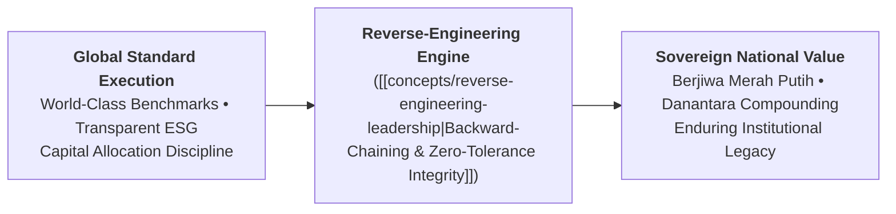
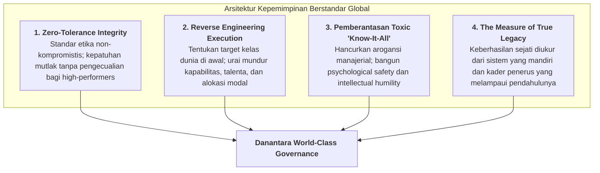

## Executive Plenary Overview

On Wednesday, November 11, 2026, **[[entities/febriany-eddy|Febriany Eddy, S.E., M.B.A., CPA]]**—Managing Director Business 3 at **[[entities/danantara|PT Danantara Asset Management (DAM)]]** and former President Director & CEO of PT Vale Indonesia Tbk—delivered a masterclass in modern executive stewardship to the **P3MD Batch I Soedirman** cohort at Kampus DCU Nawasena. Titled **"Kepemimpinan Kelas Dunia untuk Membangun Negeri: Berstandar Global, Berjiwa Merah Putih"**, the session laid bare the high-stakes cultural, ethical, and operational shifts required to elevate Indonesian state-owned enterprises into globally competitive institutional champions.

Drawing upon more than two decades of senior corporate leadership across international accounting, global mining finance, and state sovereign holding transformations, Febriany challenged the cohort to overcome comfortable domestic benchmarks. In an era where [[entities/danantara|Danantara]] orchestrates hundreds of billions of dollars in national assets, Indonesian leaders cannot shelter behind domestic exceptionalism. Global capital, international joint-venture partners, and foreign sovereign funds demand absolute adherence to world-class governance, uncompromising ESG metrics, and transparent operating discipline.

> [!NOTE] Keynote Speaker Dossier: Febriany Eddy, S.E., M.B.A., CPA
>
> - **Current Designation**: Managing Director Business 3, [[entities/danantara|PT Danantara Asset Management (DAM)]]
> - **Prior Executive Roles**: President Director & CEO, PT Vale Indonesia Tbk (2021–2024); CFO PT Vale Indonesia (2013–2019); Senior Auditor PwC Indonesia & Australia
> - **Pedigree**: Dual EMBA from UCLA Anderson & NUS; B.Econ (Accounting) Universitas UI; Certified Public Accountant (CPA)
> - **Full Dossier**: Consult [[entities/febriany-eddy|Executive Entity Dossier]].

---

## Core Strategic Foundations: The Global-Domestic Synthesis

Febriany opened her address by dismantling the false dichotomy between international excellence and national patriotism:

$$\mathbf{\text{\ldquo Berstandar Global, Berjiwa Merah Putih\rdquo}}$$

- **The Danger of Domestic Complacency**: State-owned enterprises that measure success solely against local rivals frequently develop bloated cost structures, opaque procurement practices, and sluggish execution. When subjected to global commodity cycles or foreign competition, these domestic champions falter.
- **The True Meaning of _Jiwa Merah Putih_**: True patriotism is not reflected in ceremonial slogans or defensive trade protectionism. Patriotism is demonstrated when an Indonesian executive builds an enterprise so efficient, so transparent, and so technologically advanced that it outcompetes global multinationals on equal terms while reinvesting profits back into the Indonesian people.

---

## The Four Pillars of World-Class Sovereign Stewardship

### 1. Zero-Tolerance Integrity: The Non-Negotiable Contract

The single most heavily cited theme of the session was Febriany's uncompromising stance on corporate ethics:

$$\text{Enterprise Value} = \text{Operational Competence} \times \text{Integrity Governor} \quad (I_G \in \{0, 1\})$$

- In state enterprise environments, organizations often tolerate ethical grey zones, procurement irregularities, or minor compliance breaches if the perpetrator is a "star producer" who delivers quarterly commercial targets.
- Febriany emphasized that **zero tolerance means zero tolerance**: the moment an executive compromises on integrity, their competence becomes an active liability to the sovereign. Danantara's institutional credibility rests entirely on absolute ethical clarity.

### 2. Reverse Engineering Audacious Goals (Backward-Chaining)

Conventional management plans forward from existing resource constraints, producing timid, incremental progress ($+5\%$ year-on-year). In contrast, world-class transformation requires **backward-chaining**:

1. Fix the ambitious global standard first (e.g., net-zero emission nickel smelting, zero lost-time injury frequency rate, or sub-second digital payment settlement).
2. Backward-map the precise technical requirements, engineering workflows, and talent density needed to hit that benchmark.
3. Refuse to compromise the target; instead, re-engineer the organization to close the capability delta ($\Delta C = E^* - C_0$).

### 3. Eradicating the Toxic "Know-It-All" Syndrome

Febriany delivered a pointed warning regarding executive psychology:

$$\mathbf{\text{\ldquo Merasa tahu segalanya adalah racun terbesar dalam kepemimpinan.\rdquo}}$$

- When senior directors project omniscient certainty, subordinates conceal operational risks, withhold bad news, and cease innovative experimentation out of fear of public humiliation.
- Great leaders cultivate **intellectual humility**: they ask probing questions, admit when they lack technical answers, actively listen to field personnel, and establish deep [[concepts/psychological-safety|Psychological Safety]].

### 4. Output vs. Outcome & The Durability of Executive Legacy

- **The Output Trap**: Busy managers boast of the number of committees formed, directives issued, or ceremonies attended (_activity/output_). True leaders hold themselves accountable strictly to structural change (_outcome_).
- **The Legacy Test**: If an enterprise stumbles or becomes paralyzed the moment a charismatic CEO departs, that CEO was an institutional failure. True leadership builds robust, institutionalized systems, automates decision rules, and nurtures successors who are equipped to perform better than the founder.

---

## Full-Corpus Empirical Census ($N=58$)

An exhaustive textual census across all 58 participant submissions ($N=58$, 100% extraction) reveals the exact resonance profile of Febriany Eddy's masterclass:

| Core Curricular Theme / Framework               | Mention Count ($n$) | Cohort Percentage (%) | Analytical Resonance & Focus Area                                                                             |
| :---------------------------------------------- | :-----------------: | :-------------------: | :------------------------------------------------------------------------------------------------------------ |
| **Zero-Tolerance Integrity & Moral Red Lines**  |         48          |       **82.8%**       | Universal commitment to non-negotiable compliance and ethical governance across Danantara assets.             |
| **Berstandar Global, Berjiwa Merah Putih**      |         46          |       **79.3%**       | Dismantling domestic complacency and benchmark mediocrity to build internationally competitive SOEs.          |
| **Leader's Legacy & Independent Systems**       |         32          |       **55.2%**       | Defining executive greatness through self-sustaining institutional systems rather than personal tenure.       |
| **Toxic 'Know-It-All' & Intellectual Humility** |         10          |       **17.2%**       | Eliminating executive hubris, encouraging psychological safety, and listening attentively to field realities. |
| **Reverse Engineering Target Ambisius**         |          2          |       **3.4%**        | Adopting backward-chaining methodologies from desired end-state benchmarks down to execution.                 |
| **Distingsi Kritis Output vs. Outcome**         |          1          |       **1.7%**        | Shifting organizational KPIs from activity tracking to lasting structural business outcomes.                  |

---

## Cohort Leadership Commitments: Cultural Transformation

Reflecting on Febriany Eddy's directives, participant reflections synthesized clear operational shifts across state enterprise departments:

| Executive Dimension       | Traditional Bureaucratic Reflex                                                        | The Danantara World-Class Commitment                                                               |
| :------------------------ | :------------------------------------------------------------------------------------- | :------------------------------------------------------------------------------------------------- |
| **Integrity Enforcement** | Excusing compliance infractions for top commercial performers (_kompromi pencapaian_). | Immediate removal for integrity breaches regardless of commercial seniority (_zero tolerance_).    |
| **Target Formulation**    | Incremental budgeting based on historical trends ($+5\%$ baseline).                    | Reverse-engineering from top-quartile global industry benchmarks ($E^*$).                          |
| **Meeting Culture**       | Directors dominating discussion; defensive reactions to junior critique.               | Practicing active listening; welcoming challenge; rewarding transparent bad-news escalation.       |
| **Succession Planning**   | Centralizing power to maintain personal indispensability.                              | Documenting institutional memory; building autonomous operational systems that outlast the leader. |

---

## Archival Traceability & Primary Evidence

| Repository Directory                                                |   Item Count   | Corpus Contents                                                                |
| :------------------------------------------------------------------ | :------------: | :----------------------------------------------------------------------------- |
| `inbox/Rabuan 11 November 2026/`                                    | 58 Submissions | Original intake corpus across Groups 1–4, Elements 1–3 (`.pdf`).               |
| `archive/rabuan/2026-11-11-rabuan-plenary-biref5/`                  | 58 Submissions | Institutional preservation copy with identical directory tree.                 |
| `archive/rabuan/2026-11-11-rabuan-plenary-biref5/.extracted/texts/` | 58 Text Files  | Unabridged plain-text extraction cache for instant computational verification. |

---

## Knowledge Graph & Curricular Bridges

- **Featured Keynote Speaker**:
  - [[entities/febriany-eddy|Febriany Eddy, S.E., M.B.A., CPA]] (Managing Director Business 3, PT Danantara Asset Management)
- **Compounding Core Concepts**:
  - [[concepts/reverse-engineering-leadership|Reverse-Engineering Leadership & Audacious Strategic Benchmarks]]
  - [[concepts/the-integrity-triangle|The Integrity Triangle]]
  - [[concepts/psychological-safety|Psychological Safety & High-Performance Teaming]]
  - [[concepts/pso-commercial-duality|Public Service Obligation (PSO) vs Commercial Duality]]
- **Cross-Session Plenary Integration**:
  - [[rabuan/2026-11-11-muhammad-ali-kejayaan-maritim|Rabuan: Bersama Menuju Kejayaan Maritim Indonesia]] (KSAL Muhammad Ali)
  - [[rabuan/2026-11-11-sudaryono-mbg-ketahanan-pangan|Rabuan: Membangun Fondasi Bangsa — MBG 2.0 & Ketahanan Pangan]] (Dr. Sudaryono)
  - [[rabuan/2026-11-11-pertamina-patra-niaga-biref5|Rabuan BIREF5: Business Immersion PT Pertamina Patra Niaga]] (Downstream Supply Chain Integrity)
  - [[rabuan/2026-09-23-sahala-financial-discipline|Rabuan: Memimpin dengan Financial Discipline]] (Sahala Situmorang, CFO Danantara)
  - [[rabuan/2026-06-09-oskaria-bumn-transformation-danantara|Rabuan: Transformasi Total BUMN & Arsitektur BPI Danantara]] (Dony Oskaria)
- **Direct Curricular Synergies**:
  - [[courses/mk1-organizational-behavior-managing-people/index|MK 1: Organizational Behavior & Managing People]] (Ethical Climate, Power Dynamics & Humility)
  - [[courses/mk5-decision-making-negotiation/index|MK 5: Decision Making & Negotiation]] (Negotiating International JV Agreements & ESG Covenants)
- Return to **[[rabuan/index|Rabuan Executive Masterclass Hub]]**
