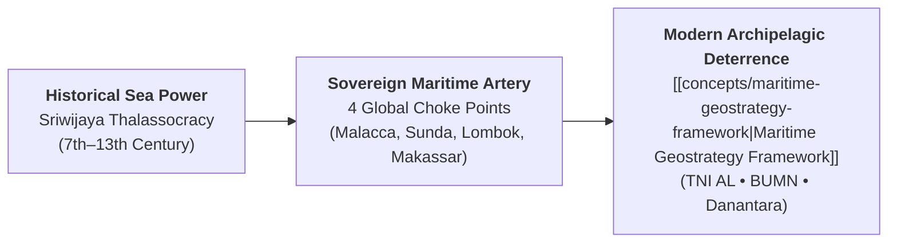
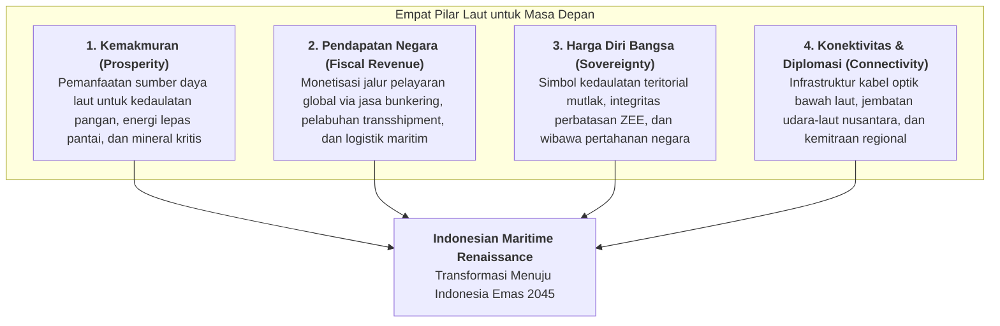
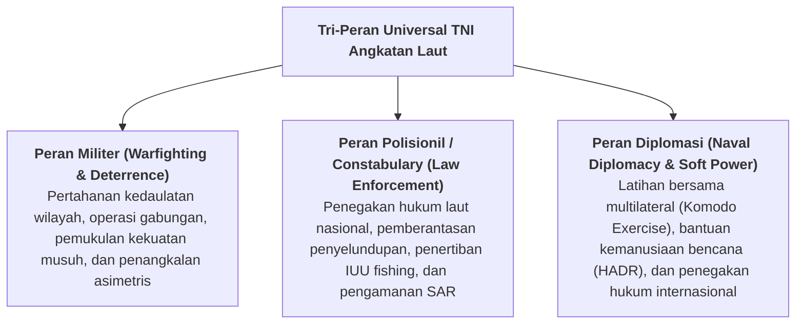
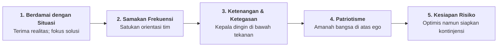

## Executive Plenary Overview

On Wednesday, November 11, 2026, **[[entities/muhammad-ali|Laksamana TNI Dr. Muhammad Ali, S.E., M.M., M.Tr.Opsla]]**—Kepala Staf TNI Angkatan Laut (KSAL)—delivered an intensive executive plenary masterclass to the **P3MD Batch I Soedirman** cohort at Kampus DCU Nawasena. Titled **"Navigasi Masa Depan Indonesia: Strategi Berkelanjutan Menghadapi Geopolitik Kawasan dan Transformasi Global"** (and framing the national imperative **"Bersama Menuju Kejayaan Maritim Indonesia"**), the address connected archipelagic history, regional flashpoints, and sovereign state enterprise logistics into an integrated doctrine of national power.

Admiral Muhammad Ali anchored his opening thesis in the historical legacy of the **Sriwijaya Maritime Empire** (7th–13th century), which dominated maritime trade across Southeast Asia and the Indian Ocean through naval supremacy and strict straits governance. To materialize that heritage into modern defense capability, the Chief of Naval Staff highlighted the strategic induction of **KRI Sriwijaya-100**, the first carrier-grade flagship of the Indonesian Navy, symbolizing a decisive shift from a purely brown-water coastal defense force toward an agile green-water deterrence posture.

> [!NOTE] Keynote Speaker Dossier: Laksamana TNI Dr. Muhammad Ali
>
> - **Current Designation**: Kepala Staf TNI Angkatan Laut (KSAL), Markas Besar TNI Angkatan Laut (Mabesal)
> - **Core Competencies**: Archipelagic Defense Strategy • Submarine Operations • Chokepoint Deterrence • Crisis Leadership
> - **Career Milestones**: Pangkogabwilhan I (2021–2022) $\leftarrow$ Pangkoarmada I (2019–2020) $\leftarrow$ Gubernur Akademi Angkatan Laut (2018–2019). Full profile: [[entities/muhammad-ali|Executive Entity Dossier]].

---

## Strategic Foundations: The Four Pillars of "Laut untuk Masa Depan"

The Chief of Naval Staff challenged the cohort of future state enterprise leaders to dismantle the continental bias that views the ocean as dead space or an obstacle between islands. In Indonesian geopolitical statecraft, water is the primary connective highway of the nation. Admiral Muhammad Ali introduced the **Four Strategic Pillars of Laut Masa Depan**:

1. **Kemakmuran (Prosperity & Resource Security)**:
   The ocean holds the solution to the dual national imperatives of **protein security** and **energy security**. From deep-sea fisheries to offshore hydrocarbon basins and seabed polymetallic nodules, marine resources form the asset base of sovereign wealth.
2. **Pendapatan Negara (Commercial Sea Lines & Bunkering)**:
   Over $40\%$ of global maritime commercial traffic transits Indonesian waters. However, historically, Singapore and regional neighbors captured up to $90\%$ of ancillary maritime revenue (bunkering, transshipment, crew changes, vessel maintenance). Retaining this value requires coordinated investments between [[entities/danantara|Danantara]], Pelindo, and [[entities/pt-pertamina|Pertamina Patra Niaga]].
3. **Harga Diri Bangsa (Sovereign Prestige & Deterrence)**:
   Sovereignty is not sustained by legal treaties alone; it requires visible, credible naval presence. Naval forces enforce boundaries in disputed flashpoints (such as the North Natuna Sea) against illegal incursions, gray-zone coercive fishing fleets, and foreign naval posturing.
4. **Konektivitas & Infrastruktur Bawah Laut (Undersea Connectivity)**:
   Admiral Muhammad Ali revealed that over $95\%$ of national and international digital data packets flow not through satellites, but through thousands of kilometers of fiber-optic cables resting on the Indonesian seabed. Securing this submarine grid is vital to the resilience of national banking, energy dispatch, and sovereign state communications.

---

## Operational Architecture: The Tri-Role Universal Navy

In naval strategic theory (Ken Booth and Geoffrey Till), a modern navy must simultaneously execute three universal functional roles:

| Naval Role                    | Primary Focus                                                                                                                   | Corporate & BUMN Strategic Interface                                                                                        |
| :---------------------------- | :------------------------------------------------------------------------------------------------------------------------------ | :-------------------------------------------------------------------------------------------------------------------------- |
| **Militer (Defense)**         | Sovereign deterrence, anti-access/area-denial (A2/AD) across chokepoints, submarine warfare, and air-sea battle readiness.      | Safeguarding strategic oil/gas offshore platforms, LNG carriers, and vital energy refineries during state-level tension.    |
| **Polisionil (Constabulary)** | Anti-piracy, interdicting fuel smuggling (_kencing BBM di laut_), stopping illegal trawlers, and securing underwater pipelines. | Protecting [[entities/pt-pertamina\|Pertamina]] tanker convoys, securing submarine power cables, and preventing asset loss. |
| **Diplomasi (Diplomatic)**    | Port visits, goodwill missions, disaster relief, and hosting the Multilateral Naval Exercise Komodo (MNEK).                     | Opening international trade corridors, building trusted corridors for state enterprise foreign investments.                 |

---

## Full-Corpus Empirical Census ($N=58$)

An exhaustive textual census across all 58 participant submission files ($N=58$, 100% extraction of Groups 1–4, Elements 1–3) reveals the precise distribution of analytical resonance regarding Admiral Muhammad Ali's lecture:

| Core Curricular Theme / Framework                     | Mention Count ($n$) | Cohort Percentage (%) | Analytical Resonance & Focus Area                                                                                     |
| :---------------------------------------------------- | :-----------------: | :-------------------: | :-------------------------------------------------------------------------------------------------------------------- |
| **Laut untuk Masa Depan (4 Pillars)**                 |         47          |       **81.0%**       | Systematic adoption of prosperity, revenue, sovereignty, and connectivity as BUMN strategic yardsticks.               |
| **Geopolitik Kawasan & Transformasi Pertahanan**      |         41          |       **70.7%**       | Analysis of South China Sea tensions, AUKUS nuclear submarine patrols, and domestic defense-industrial autonomy.      |
| **Tri-Peran Universal TNI AL**                        |         40          |       **69.0%**       | Cross-mapping military, constabulary, and diplomatic missions to enterprise risk management and supply-chain defense. |
| **5 Pesan Kepemimpinan KSAL**                         |         34          |       **58.6%**       | Internalizing executive composure, aligning frequencies, and patriotic self-sacrifice during enterprise turnarounds.  |
| **Sejarah Kemaritiman Sriwijaya & KRI Sriwijaya-100** |         28          |       **48.3%**       | Connecting national historical maritime dominance to contemporary green-water fleet modernization.                    |
| **Pengamanan Selat Strategis & Choke Points**         |         14          |       **24.1%**       | Detailed evaluation of Malacca, Sunda, Lombok, and Makassar straits as irreplaceable sovereign economic choke points. |

---

## Executive Principles: Five Maxims for Leaders Under Pressure

In closing his session, Admiral Muhammad Ali delivered five foundational principles distilled from decades of military command under maritime crises:

1. **Berdamai dengan Keadaan Bukan Berarti Menyerah**:
   A true leader does not paralyze their team by lamenting adverse macroeconomic shocks, government policy shifts, or unexpected market downturns. Accepting reality is the prerequisite for clear-headed problem-solving.
2. **Menyamakan Kepentingan dan Frekuensi**:
   Cross-functional teams fail when individual departments operate on divergent agendas. Leadership is the deliberate act of establishing a shared definition of success before initiating tactical execution.
3. **Ketenangan dan Kejernihan Berpikir**:
   Under extreme pressure, impulsive managers react to suppress anxiety rather than solve problems. Composure (_kepala dingin_) preserves cognitive bandwidth for rational risk calculation.
4. **Patriotisme Melalui Pengorbanan**:
   State enterprise executives must recognize that their fiduciary responsibility extends beyond private shareholder profit; they steward national balance sheets and the welfare of millions.
5. **Keseimbangan Optimisme dan Kontinjensi**:
   Never build enterprise plans that only work when conditions are ideal. Robust strategies explicitly incorporate scenario contingencies for supply-chain seizures and geopolitical embargoes.

---

## Archival Traceability & Primary Evidence

| Repository Directory                                                |   Item Count   | Corpus Contents                                                                |
| :------------------------------------------------------------------ | :------------: | :----------------------------------------------------------------------------- |
| `inbox/Rabuan 11 November 2026/`                                    | 58 Submissions | Original intake corpus across Groups 1–4, Elements 1–3 (`.pdf`).               |
| `archive/rabuan/2026-11-11-rabuan-plenary-biref5/`                  | 58 Submissions | Institutional preservation copy with identical directory tree.                 |
| `archive/rabuan/2026-11-11-rabuan-plenary-biref5/.extracted/texts/` | 58 Text Files  | Unabridged plain-text extraction cache for instant computational verification. |

---

## Knowledge Graph & Curricular Bridges

- **Featured Keynote Speaker**:
  - [[entities/muhammad-ali|Laksamana TNI Dr. Muhammad Ali, S.E., M.M., M.Tr.Opsla]] (Kepala Staf TNI Angkatan Laut)
- **Compounding Core Concepts**:
  - [[concepts/maritime-geostrategy-framework|Maritime Geostrategy Framework & Archipelagic Defense-Economic Statecraft]]
  - [[concepts/crisis-leadership-framework|Crisis Leadership Framework & Tactical Decision Architecture]]
  - [[concepts/the-integrity-triangle|The Integrity Triangle]]
- **Cross-Session Plenary Integration**:
  - [[rabuan/2026-11-11-febriany-eddy-global-leadership|Rabuan: Kepemimpinan Kelas Dunia untuk Membangun Negeri]] (Febriany Eddy)
  - [[rabuan/2026-11-11-sudaryono-mbg-ketahanan-pangan|Rabuan: Membangun Fondasi Bangsa — MBG 2.0 & Ketahanan Pangan]] (Dr. Sudaryono)
  - [[rabuan/2026-11-11-pertamina-patra-niaga-biref5|Rabuan BIREF5: Business Immersion PT Pertamina Patra Niaga]] (Downstream Energy Reliability)
  - [[rabuan/2026-06-22-kusworo-crisis-leadership|Rabuan: Crisis Leadership — Leading Under Pressure]] (Marsdya TNI Kusworo)
- **Direct Curricular Synergies**:
  - [[courses/mk1-organizational-behavior-managing-people/index|MK 1: Organizational Behavior & Managing People]] (Military Composure & Values Alignment)
  - [[courses/mk5-decision-making-negotiation/index|MK 5: Decision Making & Negotiation]] (Geopolitical Chokepoints & Game Theory)
- Return to **[[rabuan/index|Rabuan Executive Masterclass Hub]]**
