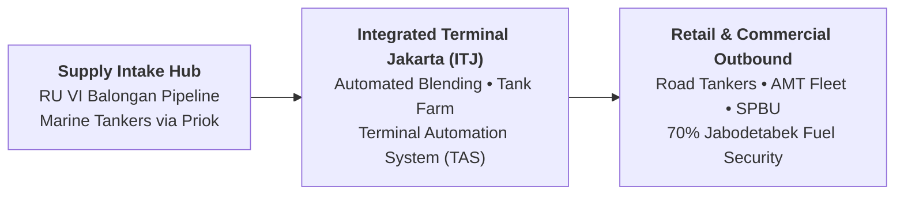
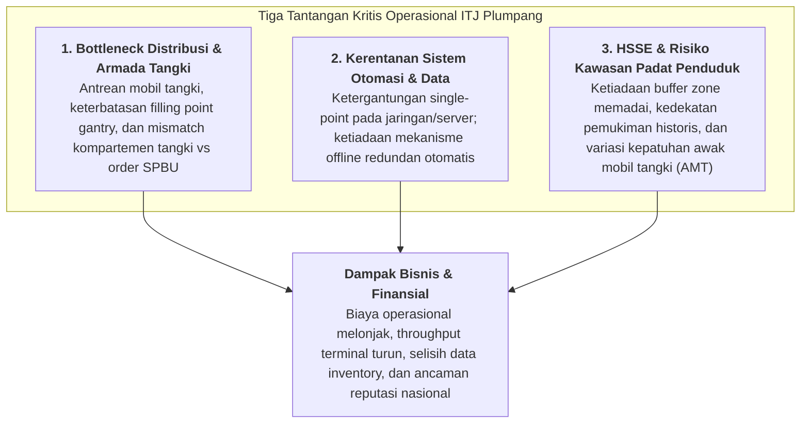
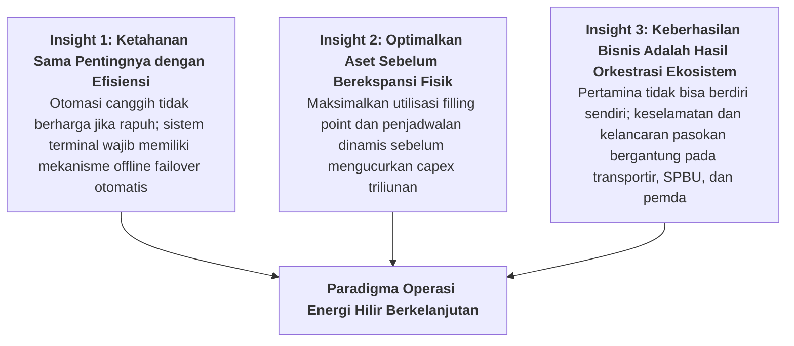

## Executive Immersion Overview

On Wednesday, November 11, 2026, the **P3MD Batch I Soedirman** cohort participated in **Business Immersion Brief 5 (BIREF5)**, an intensive diagnostic investigation into the downstream commercial and trading operations of **[[entities/pt-pertamina|PT Pertamina Patra Niaga]]** centered upon its flagship operational hub: **Integrated Terminal Jakarta (ITJ Plumpang)** in North Jakarta.

As the downstream commercial and retail trading subholding anchor of **PT Pertamina (Persero)** within the **[[entities/danantara|Danantara]]** sovereign ecosystem, PT Pertamina Patra Niaga commands the nation's critical fuel distribution lifeline. The company operates an expansive logistics apparatus comprising 115 fuel terminals (_Terminal BBM_), 179 marine transport vessels under [[entities/pt-pertamina|Pertamina International Shipping (PIS)]], strategic fuel storage under Pertamina Energy Terminal (PET), and over 7,500 retail petrol stations (SPBU) serving retail, commercial, and industrial consumers across the archipelago.

> [!NOTE] Host Enterprise Dossier: PT Pertamina Patra Niaga
>
> - **Corporate Role**: Subholding Commercial & Trading, PT Pertamina (Persero)
> - **Operational Core**: Downstream supply, terminal management, retail fuel distribution, and non-fuel retail (NFR)
> - **Strategic Flagship**: Integrated Terminal Jakarta (ITJ Plumpang) — supplying $>20\%$ of national fuel and $>70\%$ of Greater Jakarta's daily refined fuel consumption. Full enterprise context: [[entities/pt-pertamina|Enterprise Entity Dossier]].

---

## 3 Core Operational Challenges & Root Causes

Through field presentations, technical site briefings, and analytical modeling, the cohort diagnosed three acute, systemic challenges facing Pertamina Patra Niaga's terminal distribution architecture:

### Challenge 1: Keandalan dan Kapasitas Distribusi (Distribution Bottleneck & Gantry Allocation)

- **Observable Symptom**: Severe congestion of road tankers (_mobil tangki_) queuing outside the terminal gates, extended turnaround times per tanker cycle, and periodic stockout threats at retail SPBUs during demand peaks.
- **Root Cause Analysis**:
  - The order planning system from SPBU retailers, road tanker scheduling, and terminal filling point allocations are not dynamically integrated in real-time.
  - Physical terminal footprint is strictly land-constrained by historical urban encroachment, preventing the construction of additional physical loading bays.
  - Mismatch between ordered product volumes and physical tanker compartment configurations (e.g., dispatching a 24 kL multi-compartment tanker for fragmented, single-product orders).

### Challenge 2: Keandalan Sistem Otomasi dan Rekonsiliasi Data (Automation Single Point of Failure)

- **Observable Symptom**: When network connectivity or central database servers stutter, automated loading meters freeze. Terminal operators are forced to revert to manual dip-stick measurement and manual paper tally sheets, ballooning loading times from 15 minutes to over 90 minutes per vehicle and creating massive inventory discrepancy risks (_losses reconciliation_).
- **Root Cause Analysis**:
  - The Terminal Automation System (TAS) was architected with heavy client-server dependence on continuous enterprise connectivity without autonomous, edge-computing offline fallback mechanisms.
  - Automated reconciliation between pipeline intake flowmeters, tank farm volume sensors, and loading arm displacement meters lacks automated real-time variance detection.

### Challenge 3: Keselamatan dan Kepatuhan di Kawasan Padat Penduduk (HSSE & Spatial Safety Buffer)

- **Observable Symptom**: Operating a Category-1 major hazard industrial installation immediately adjacent to densely populated civilian settlements creates permanent catastrophic existential risk for workers, local communities, and enterprise brand equity.
- **Root Cause Analysis**:
  - Historical failure of municipal urban zoning regulations over decades allowed informal civilian settlements to encroach directly against the terminal boundary wall without the mandatory 500-meter safety buffer zone.
  - Disparate safety protocols and variable safety cultures among third-party logistics transport partners (_mitra transportir_) and outsourced tanker drivers (_Awak Mobil Tangki / AMT_).

---

## Strategic Synthesis: Full-Corpus Empirical Census ($N=58$)

An exhaustive textual census across all 58 participant submissions ($N=58$, 100% extraction of Groups 1–4, Elements 1–3) reveals the precise diagnostic focus of the P3MD cohort:

| Operational Dimension / Theme                        | Mention Count ($n$) | Cohort Percentage (%) | Analytical Resonance & Field Diagnostic                                                                                     |
| :--------------------------------------------------- | :-----------------: | :-------------------: | :-------------------------------------------------------------------------------------------------------------------------- |
| **Keandalan Sistem Otomasi & Data (Offline Mode)**   |         57          |       **98.3%**       | Universal demand for offline-first terminal automation, redundant edge gateways, and automatic inventory reconciliation.    |
| **HSSE, Buffer Zone & Keselamatan Pemukiman**        |         57          |       **98.3%**       | Deep analysis of catastrophic industrial safety risks, socio-spatial buffer zones, and community coexistence.               |
| **Antrean Mobil Tangki & Bottleneck Filling Point**  |         55          |       **94.8%**       | Process optimization focusing on Little's Law, dynamic tanker scheduling, and compartment matching algorithms.              |
| **Integrasi Ekosistem Subholding (PIS & PET)**       |         52          |       **89.7%**       | Strategic coordination between marine tanker fleet (Pertamina International Shipping), storage terminals (PET), and retail. |
| **Digitalisasi MyPertamina & Non-Fuel Retail (NFR)** |         46          |       **79.3%**       | Expanding commercial margins through retail consumer loyalty apps, convenience stores, and digitized subsidy verification.  |

---

## 3 Foundational Key Insights from the Cohort

From the exhaustive synthesis across all 58 executive essays, three overarching operational principles emerged:

1. **System Resilience Trumps Superficial Efficiency**:
   A highly digitized terminal that operates at peak efficiency 360 days a year but suffers a total paralyzed shutdown for 5 days due to server outages creates unacceptable national security risk. True operational excellence requires **built-in operational redundancy**: edge-computing offline capability, local transaction buffering, and automatic database reconciliation the instant network connectivity is restored.
2. **Sweat Existing Capital Assets Before Building New Ones**:
   When faced with loading bay bottlenecks, the standard bureaucratic reflex is to request capital expenditure (Capex) to purchase more land or install more loading bays. The cohort correctly observed that **algorithmic optimization of existing gantries**—synchronizing tanker arrivals, eliminating empty deadhead miles, and matching compartment sizes to real-time SPBU replenishment orders—can expand effective terminal throughput by $25\%$ to $35\%$ with near-zero capex.
3. **Enterprise Success is an Ecosystem Phenomenon**:
   Pertamina Patra Niaga does not operate in an insulated vacuum. Delivering clean, reliable energy 24/7 requires managing a web of external stakeholders: third-party transport contractors, independent dealer-owned petrol stations, regional traffic police, municipal urban planning authorities, and vulnerable local communities. Solving terminal safety and logistics bottlenecks requires cross-sectoral institutional alignment.

---

## Cohort Personal Reflections & Behavioral Commitments

### 1. Most Surprising Realization

- The staggering fragility and high stakes of downstream energy distribution: a single network outage or minor valve leak at ITJ Plumpang ripples across Greater Jakarta within six hours, threatening public panic and economic paralysis.
- The realization that industrial safety at a primary energy terminal is an urgent humanitarian and human-rights imperative, directly impacting thousands of civilian families living along the fence line.

### 2. Newly Acquired Analytical Capabilities

- End-to-end downstream supply-chain diagnostics: tracing fuel from offshore crude import and Balongan pipeline manifolds down to individual SPBU nozzle dispensing.
- Comprehensive root-cause problem analysis: separating observable superficial symptoms from underlying structural, technological, and socio-spatial causes.
- Applying multi-criteria decision frameworks combining operational velocity, financial return, technical feasibility, and community safety.

### 3. Committed Behavioral Shifts

- **Refusing to jump to premature solutions**: Transitioning from instinctive "build more" instincts to rigorous, data-driven root-cause problem identification.
- **Demanding backup contingencies**: Insisting on secondary offline fallback procedures for every automated digital workflow before signing off on IT investments.
- **Collaborative ecosystem leadership**: Proactively reaching across organizational boundaries to partner with transport operators and regulatory agencies rather than blaming external stakeholders for delivery delays.

---

## ❓ Open Questions Retained for Executive Boardroom Review

Across the 58 submissions, cohort members framed critical strategic questions requiring long-term policy resolution by Pertamina and Danantara leadership:

1. **The Edge-Failover Dilemma**: How can Pertamina Patra Niaga guarantee $100\%$ operational uptime at high-throughput terminals during wide-area telecommunication blackouts while preventing inventory shrinkage and fraudulent transaction manipulation?
2. **The Buffer Zone Resolution**: Given the political and humanitarian complexity of relocating tens of thousands of residents surrounding ITJ Plumpang, what hybrid engineering solutions (e.g., blast walls, vapor recovery towers, automated thermal cameras, green buffer parks) can provide immediate safety protection while long-term relocation to Kalibaru/Tanjung Priok proceeds?
3. **Contractor Accountability**: How can Patra Niaga enforce zero-tolerance safety and fatigue governance upon thousands of third-party transport drivers without triggering wildcat strikes or distribution slowdowns?

---

## Archival Traceability & Primary Evidence

| Repository Directory                                                |   Item Count   | Corpus Contents                                                                |
| :------------------------------------------------------------------ | :------------: | :----------------------------------------------------------------------------- |
| `inbox/Rabuan 11 November 2026/`                                    | 58 Submissions | Original intake corpus across Groups 1–4, Elements 1–3 (`.pdf`).               |
| `archive/rabuan/2026-11-11-rabuan-plenary-biref5/`                  | 58 Submissions | Institutional preservation copy with identical directory tree.                 |
| `archive/rabuan/2026-11-11-rabuan-plenary-biref5/.extracted/texts/` | 58 Text Files  | Unabridged plain-text extraction cache for instant computational verification. |

---

## Knowledge Graph & Curricular Bridges

- **Host Enterprise Entity**:
  - [[entities/pt-pertamina|PT Pertamina (Persero)]] & PT Pertamina Patra Niaga
- **Parallel Rabuan Keynote Addresses (11 Nov 2026)**:
  - [[rabuan/2026-11-11-muhammad-ali-kejayaan-maritim|Rabuan: Bersama Menuju Kejayaan Maritim Indonesia]] (KSAL Muhammad Ali)
  - [[rabuan/2026-11-11-febriany-eddy-global-leadership|Rabuan: Kepemimpinan Kelas Dunia untuk Membangun Negeri]] (Febriany Eddy)
  - [[rabuan/2026-11-11-sudaryono-mbg-ketahanan-pangan|Rabuan: Membangun Fondasi Bangsa — MBG 2.0 & Ketahanan Pangan]] (Dr. Sudaryono)
- **Compounding Core Concepts**:
  - [[concepts/supply-chain-operations-reference|Supply Chain Operations Reference (SCOR) in Fuel Logistics]]
  - [[concepts/pso-commercial-duality|Public Service Obligation (PSO) vs Commercial Duality]]
  - [[concepts/reverse-engineering-leadership|Reverse-Engineering Leadership & Audacious Strategic Benchmarks]]
  - [[concepts/crisis-leadership-framework|Crisis Leadership Framework & Tactical Decision Architecture]]
- **Program & Immersion Linkages**:
  - [[program/alp/business-immersion-1/pertamina-patra-niaga|Business Immersion 1: Field Diagnostics at ITJ Plumpang]] (October 2026 Field Visit)
- Return to **[[rabuan/index|Rabuan Executive Masterclass Hub]]**
