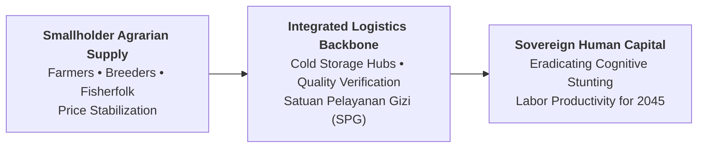
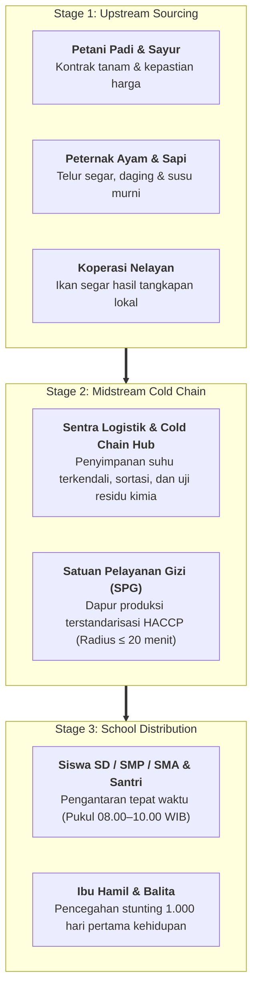
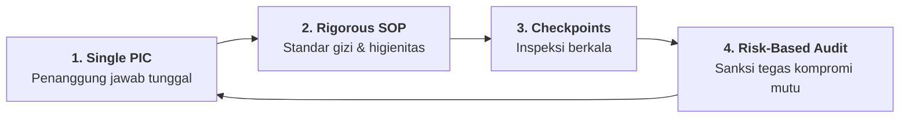

## Executive Plenary Overview

On Wednesday, November 11, 2026, **[[entities/sudaryono|Dr. Sudaryono, B.Eng., M.M., M.B.A.]]**—Wakil Menteri Pertanian Republik Indonesia (Wamentan RI)—delivered a high-energy executive masterclass to the **P3MD Batch I Soedirman** cohort at Kampus DCU Nawasena. Titled **"Membangun Fondasi Bangsa: MBG 2.0 & Ketahanan Pangan Nasional"**, the session connected agricultural production economics, national nutritional security, and large-scale public logistics execution into an integrated framework of national sovereignty.

Sudaryono challenged future corporate leaders to understand that a nation’s sovereign economic and military strength is strictly bounded by the physical and cognitive capacity of its population. A country cannot build an advanced high-tech industrial economy or steward multi-trillion-dollar sovereign assets if its children suffer from chronic malnutrition and developmental stunting. In this strategic paradigm, the **Program Makan Bergizi Gratis (MBG 2.0)** is not a social welfare subsidy; it represents an essential, upfront infrastructure investment into Indonesia's sovereign human capital foundation.

> [!NOTE] Keynote Speaker Dossier: Dr. Sudaryono, B.Eng., M.M., M.B.A.
>
> - **Current Designation**: Wakil Menteri Pertanian Republik Indonesia (Wamentan RI)
> - **Strategic Scope**: Swasembada Pangan Nasional, Modernisasi Cetak Sawah, Digitalisasi Rantai Pasok MBG 2.0
> - **Pedigree**: B.Eng. Aerospace & Defense Engineering from National Defense Academy of Japan (Bouei Daigakko); MBA & Doctor of Public Policy
> - **Civic Leadership**: Ketua Umum Asosiasi Pedagang Pasar Seluruh Indonesia (APPSI). Full profile: [[entities/sudaryono|Executive Entity Dossier]].

---

## Strategic Doctrine: Food Security as Sovereign Defense Infrastructure

Sudaryono grounded his lecture in classical national defense statecraft:

$$\mathbf{\text{\ldquo Ketahanan Pangan adalah Fondasi Utama Kedaulatan Bangsa\rdquo}}$$

Throughout world history, nations have fallen not only to external military invasion, but to domestic starvation and supply-chain collapse. If a country depends on hostile or unstable foreign markets for its staple carbohydrates, proteins, and dairy, its political sovereignty is illusory.

Furthermore, child nutrition directly dictates future economic productivity. Cognitive development between gestation and adolescence establishes the ceiling for adult analytical reasoning, engineering competence, and military readiness. Investing in universal school meals via MBG 2.0 permanently expands Indonesia's future GDP potential while immediately dismantling inter-generational poverty traps.

---

## Operational Architecture: The Integrated Farm-to-Fork Supply Chain

Delivering millions of hot, nutritionally balanced meals every morning across 38 provinces requires an unprecedented supply-chain network combining centralized procurement standards with radically decentralized local execution:

### The Local Multiplier Effect

Unlike conventional centralized government food programs that rely on giant conglomerates, MBG 2.0 is deliberately structured as an open agrarian engine:

- Food supplies are contracted directly from local village farmer cooperatives, livestock breeders, and traditional market merchants.
- Capital injected into the food program circulates multiple times within the rural district, elevating farmer incomes, reducing rural-to-urban migration, and creating hundreds of thousands of local kitchen and logistics jobs.

---

## Governance Model: Delegation with Accountability

To execute this nationwide logistical challenge without drowning in bureaucratic stagnation or falling victim to corruption, Sudaryono outlined the core operating model:

$$\mathbf{\text{\ldquo Delegation with Accountability: Beri Kepercayaan, Kunci Tanggung Jawab, Periksa Berbasis Risiko\rdquo}}$$

- **Single-Point Accountability (PIC)**: When an initiative is assigned to a broad committee, nobody owns the outcome. Every Satuan Pelayanan Gizi (SPG) kitchen and delivery corridor must have an unambiguous, named individual responsible for delivery and hygiene.
- **Monitoring vs. Micromanagement**: The executive does not stand over the cook's shoulder stirring soup. The executive establishes clear quantitative specifications (e.g., minimum $18\text{g}$ protein per meal, temperature $>60^\circ\text{C}$ upon arrival, delivery completed prior to 10:00 AM) and audits adherence at systematic milestone checkpoints.
- **Speed of Execution**: Waiting for perfect paperwork before acting costs nations vital opportunities. Execution velocity must be maintained through parallel task processing, real-time mobile reporting, and automated digital reconciliation.

---

## Full-Corpus Empirical Census ($N=58$)

An exhaustive textual census across all 58 participant submissions ($N=58$, 100% extraction) reveals the extraordinary resonance of Dr. Sudaryono's session:

| Core Curricular Theme / Framework              | Mention Count ($n$) | Cohort Percentage (%) | Analytical Resonance & Focus Area                                                                            |
| :--------------------------------------------- | :-----------------: | :-------------------: | :----------------------------------------------------------------------------------------------------------- |
| **Delegation with Accountability**             |         57          |       **98.3%**       | Near-universal cohort adoption of structured delegation, single-point PICs, and milestone audit checkpoints. |
| **Program Makan Bergizi Gratis (MBG 2.0)**     |         55          |       **94.8%**       | Synthesis of MBG 2.0 operational models, rural multiplier economics, and logistics governance.               |
| **Rantai Pasok Hulu-Hilir & Satuan Pelayanan** |         47          |       **81.0%**       | Granular design of cold-chain hubs, farmer contract-farming, and decentralized kitchen networks.             |
| **Pembangunan Human Capital & Generasi Emas**  |         36          |       **62.1%**       | Linking physical nutritional security to cognitive development and long-term national labor productivity.    |
| **Ketahanan & Swasembada Pangan Nasional**     |         20          |       **34.5%**       | Cross-sector policy analysis aligning the Ministry of Agriculture, Bulog, ID FOOD, and regional farmers.     |

---

## Cohort Leadership Practice: Executive Commitments

In their synthesis, cohort members translated Dr. Sudaryono's principles into personal managerial commitments:

| Management Arena          | Previous Flawed Habit                                                                     | Committed Leadership Standard                                                                                      |
| :------------------------ | :---------------------------------------------------------------------------------------- | :----------------------------------------------------------------------------------------------------------------- |
| **Task Delegation**       | Abdicating responsibility (_"lempar tugas tanpa pantau"_) or suffocating micromanagement. | **Delegation with Accountability**: Explicit single PIC, clear quality criteria, and systematic checkpoint audits. |
| **Inter-Agency Friction** | Defending functional/divisional silos and blaming external ministries for delays.         | Proactive cross-agency alignment; initiating joint working groups to synchronize supply pipelines.                 |
| **Quality Control**       | Reactive inspection only after customer complaints or media scandals occur.               | Preventive risk-based testing; monitoring leading process metrics and raw ingredient cold chains.                  |
| **Focus of Effort**       | Generating complex slide decks and administrative process papers.                         | Direct field verification; obsessing over tangible operational delivery and end-user nutrition outcomes.           |

---

## Archival Traceability & Primary Evidence

| Repository Directory                                                |   Item Count   | Corpus Contents                                                                |
| :------------------------------------------------------------------ | :------------: | :----------------------------------------------------------------------------- |
| `inbox/Rabuan 11 November 2026/`                                    | 58 Submissions | Original intake corpus across Groups 1–4, Elements 1–3 (`.pdf`).               |
| `archive/rabuan/2026-11-11-rabuan-plenary-biref5/`                  | 58 Submissions | Institutional preservation copy with identical directory tree.                 |
| `archive/rabuan/2026-11-11-rabuan-plenary-biref5/.extracted/texts/` | 58 Text Files  | Unabridged plain-text extraction cache for instant computational verification. |

---

## Knowledge Graph & Curricular Bridges

- **Featured Keynote Speaker**:
  - [[entities/sudaryono|Dr. Sudaryono, B.Eng., M.M., M.B.A.]] (Wakil Menteri Pertanian RI)
- **Compounding Core Concepts**:
  - [[concepts/supply-chain-operations-reference|Supply Chain Operations Reference (SCOR) in Public Distribution]]
  - [[concepts/reverse-engineering-leadership|Reverse-Engineering Leadership & Audacious Strategic Benchmarks]]
  - [[concepts/pso-commercial-duality|Public Service Obligation (PSO) vs Commercial Duality]]
  - [[concepts/public-administration-paradigms|Public Administration Paradigms: Delivery & Governance]]
- **Cross-Session Plenary Integration**:
  - [[rabuan/2026-11-11-muhammad-ali-kejayaan-maritim|Rabuan: Bersama Menuju Kejayaan Maritim Indonesia]] (KSAL Muhammad Ali)
  - [[rabuan/2026-11-11-febriany-eddy-global-leadership|Rabuan: Kepemimpinan Kelas Dunia untuk Membangun Negeri]] (Febriany Eddy)
  - [[rabuan/2026-11-11-pertamina-patra-niaga-biref5|Rabuan BIREF5: Business Immersion PT Pertamina Patra Niaga]] (Downstream Energy Supply Chain)
  - [[rabuan/2026-08-19-agus-gumiwang-industrialisasi-nasional|Rabuan: BUMN dan Industrialisasi Nasional]] (Agus Gumiwang Kartasasmita)
- **Direct Curricular Synergies**:
  - [[courses/mk1-organizational-behavior-managing-people/index|MK 1: Organizational Behavior & Managing People]] (Performance Accountability & Leadership Vision)
  - [[courses/mk5-decision-making-negotiation/index|MK 5: Decision Making & Negotiation]] (Public Policy Execution & Supply-Chain Optimization)
- Return to **[[rabuan/index|Rabuan Executive Masterclass Hub]]**
