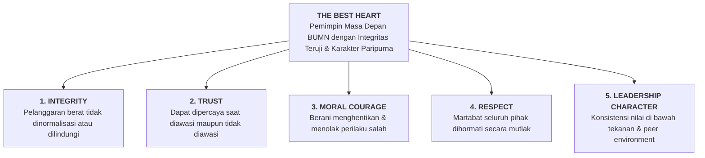
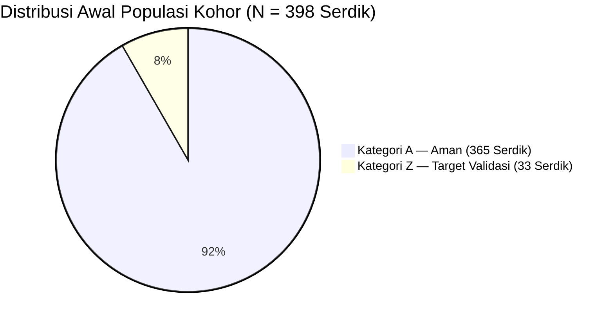
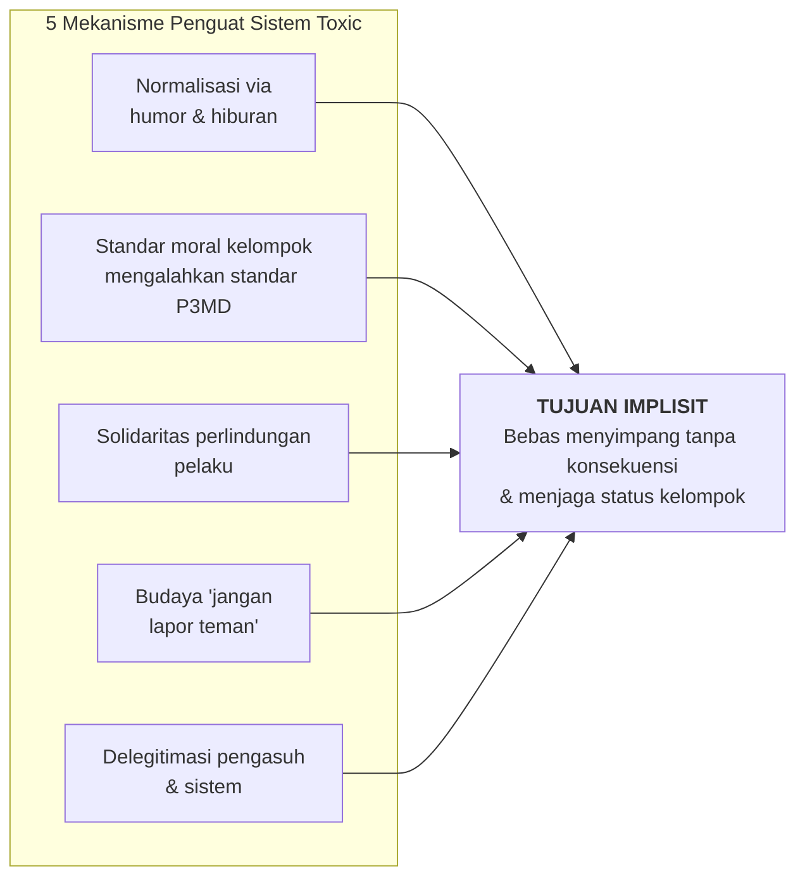
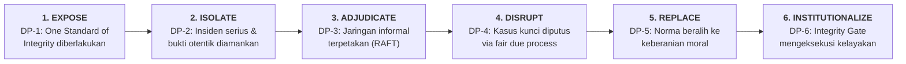
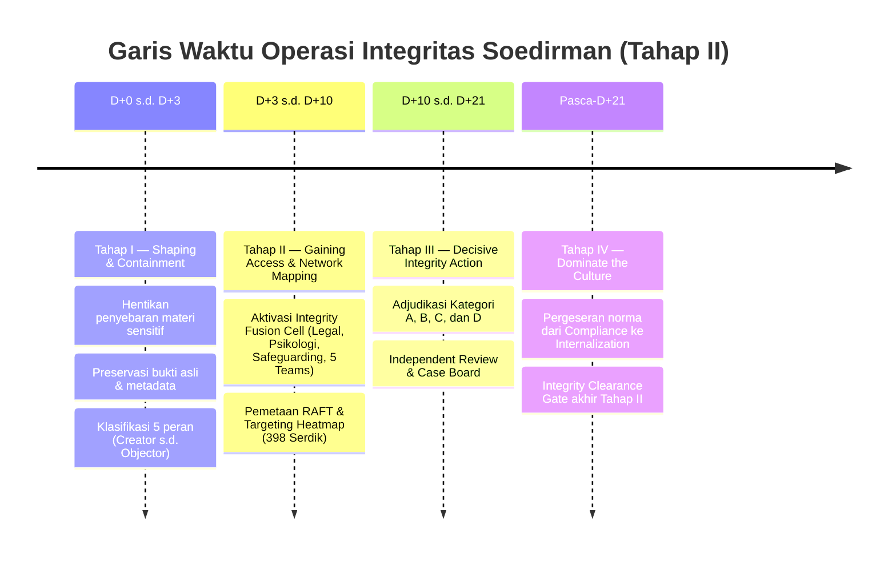
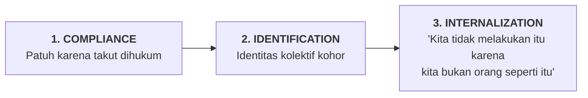

> [!NOTE] Jam Komandan P3MD Tahap II — Kampus DCU Nawasena
> **Pengarahan operasional pagi (_Jam Komandan_, 07.30–08.30 WIB) kepada seluruh kohor P3MD Batch I Soedirman.**
>
> Pada Kamis pagi, 12 November 2026, Komandan Program P3MD **[[entities/anton-palaguna|Marsekal Pertama TNI Dr. Anton 'Sioux' Palaguna, S.E., M.M., M.Han.]]** memaparkan arsitektur **Operasi Integritas Soedirman (OIS P3MD 2026)**—sebuah kampanye strategis untuk memutus budaya _toxic_ informal, melindungi korban serta mayoritas berintegritas, dan menegakkan standar kelayakan pemimpin masa depan BUMN pada **Tahap II (Fase Pembuktian)**.
>
> Operasi ini merupakan mandat kepemimpinan langsung yang dilaporkan secara berkala kepada Presiden Republik Indonesia (**[[entities/prabowo-subianto|Prabowo Subianto]]**) serta pimpinan lembaga pengampu ([[entities/danantara|Danantara]], BP BUMN, Sekretaris Kabinet Mayor Teddy Indra Wijaya, Wamen BUMN [[entities/dony-oskaria|Dony Oskaria]], dan Ketua FHCI [[entities/agus-dwi-handaya|Agus Dwi Handaya]]), yang seluruhnya memberikan kepercayaan penuh atas objektivitas sistem pengasuhan P3MD.

---

## 🧭 1. Commander's Intent & Strategic End State: _The Best Heart_

**Tahap II P3MD adalah fase pembuktian.** Pada Tahap I (Kesatrian Kodiklat TNI), kepadatan jadwal fisik menekan perilaku menyimpang karena keterbatasan waktu dan kelelahan. Di Tahap II (Kampus DCU Nawasena), ruang kebebasan dan fleksibilitas akademik justru menjadi medan uji sejati: **integritas tidak lagi cukup dipahami secara kognitif; integritas harus dibuktikan melalui perilaku nyata ketika tidak diawasi dan berada di zona nyaman**.

> **Commander's Intent**: Memastikan hanya calon pemimpin yang layak dipercaya ketika tidak diawasi (_unwatched_) dan berada di zona nyaman yang berhak melanjutkan perjalanan menuju puncak kepemimpinan nasional dan BUMN.

Dalam pengarahan lisannya, Marsma Anton menegaskan bahwa pemimpin masa depan BUMN bukan sekadar manajer korporasi biasa—pendidikan P3MD merupakan sarana strategis negara mencetak calon pemimpin nasional yang kelak dapat ditempatkan di berbagai sektor strategis. Karena itu:

- **Ukuran keberhasilan OIS bukanlah jumlah peserta yang dikeluarkan**, melainkan **reliabilitas karakter tertinggi** dari kohor yang diluluskan.
- **Pemimpin tidak cukup baik bagi dirinya sendiri**: berdiam diri menyaksikan keburukan berjalan di sekitar kita sama artinya dengan memberi legitimasi diam-diam terhadap pelanggaran tersebut.

---

## 📊 2. Sistem Klasifikasi Perilaku: _Alpha–Zulu Grading Model_

Untuk memetakan kondisi karakter secara objektif dan adil tanpa menggeneralisasi kohor, Komandan Program merumuskan sistem _grading_ dinamis yang diperbarui berdasarkan observasi pengasuh dan verifikasi lintas-fakta (_cross-check_):

| Kode Tingkat               | Klasifikasi                     | Profil Perilaku &amp; Dampak Ekosistem                                                                                                                       | Orientasi Pembinaan / Tindakan                                                  |
| :------------------------- | :------------------------------ | :----------------------------------------------------------------------------------------------------------------------------------------------------------- | :------------------------------------------------------------------------------ |
| **$\alpha_1$ (Alpha 1)**   | _Batch-Wide Positive Leader_    | Berintegritas tinggi dan aktif memengaruhi ekosistem satu _batch_. Tidak diam saat melihat penyimpangan; menjadi penyeimbang utama norma positif.            | Akselerasi &amp; penguatan peran _norm setter_ kohor.                           |
| **$\alpha_2$ (Alpha 2)**   | _Element/Group Positive Anchor_ | Berintegritas kuat dan mampu memengaruhi serta menjaga kelompok/elemennya tetap resilien terhadap tekanan negatif.                                           | Pemberdayaan sebagai _positive agent_ di level elemen.                          |
| **$\alpha_3$ (Alpha 3)**   | _Self-Contained Integrity_      | Pribadi baik dan jujur, namun pasif hanya menjaga diri sendiri tanpa keberanian memengaruhi lingkungan. **Rawan tergelincir ke Zulu** bila ditekan kelompok. | Aktivasi keberanian moral (_moral courage_) agar naik ke $\alpha_2 / \alpha_1$. |
| **$\zeta_1$ (Zulu 1)**     | _Passive Disengagement_         | Kurang kepedulian etis dan gemar mengeluh (_complaining_), tetapi hanya berkutat pada dirinya sendiri tanpa memprovokasi orang lain.                         | Pendampingan personal &amp; pembinaan korektif.                                 |
| **$\zeta_2$ (Zulu 2)**     | _Contagious Negativity_         | Mulai menularkan sinisme dan kebiasaan negatif kepada 2–3 rekan terdekat atau satu elemen.                                                                   | Intervensi terukur &amp; pemutusan rantai pengaruh.                             |
| **$\zeta_3$ (Zulu 3)**     | _Systemic Toxic Influencer_     | Menolak sistem secara terbuka (_denial_), mendiskreditkan program/pengasuh, meremehkan atau melecehkan rekan, dan memaksa narasi negatif.                    | Adjudikasi formal, pengawasan ketat, dan evaluasi kelayakan.                    |
| **$\zeta_X$ (Zulu X-Ray)** | _Disqualifier / Separation_     | Pelanggaran integritas berat yang terbukti secara sah melalui verifikasi lintas-fakta dan sidang komando.                                                    | Sidang Dewan Kasus untuk pengembalian ke BUMN asal (_separation_).              |

Target strategis komando dalam sisa masa pendidikan 4 bulan adalah **menggeser seluruh kohor ke kuadran Alpha ($\alpha_3 \rightarrow \alpha_2 \rightarrow \alpha_1$)** melalui pembiasaan perilaku (_behavioral conditioning_) yang konsisten.

---

## 🎯 3. Definisi Lawan Sejati: Sistem Sosial Informal vs. Individu

Kesalahan terbesar dalam operasi penegakan disiplin adalah menganggap seluruh peserta sebagai musuh. Data awal mematahkan mitos tersebut secara telak:

| Komponen Analisis              | Realitas Lapangan &amp; Batasan Operasional                                                                                                                                                                                                                         |
| :----------------------------- | :------------------------------------------------------------------------------------------------------------------------------------------------------------------------------------------------------------------------------------------------------------------ |
| **The Myth vs. The Reality**   | **Lawan operasi BUKAN 398 Serdik** (91,7% / 365 serdik berada dalam Kategori A / Aman). Lawan sejati adalah **Sistem Sosial Informal** yang menormalisasi pelanggaran, memberi _reward_ kelompok pada penyimpangan, melindungi pelaku, dan menciptakan budaya diam. |
| **Serious Integrity Incident** | Insiden perekaman dan penyebaran materi sensitif, eksploitasi martabat, serta pelecehan **bukan "kenakalan"** (_bercanda_). Ini merupakan pelanggaran integritas serius yang wajib ditangani dengan _safeguarding_ ketat dan penindakan tegas.                      |
| **Bukan Kriminalisasi Kritik** | Kritik wajar dari serdik terhadap fasilitas, jadwal, atau metode pengasuh **harus dibedakan secara hati-hati** dan tidak boleh dikriminalisasi sebagai penghinaan atau pembangkangan terorganisasi.                                                                 |

> [!WARNING] Efek Psikologis Ruang Bercanda &amp; _Peer Approval_
> Dalam paparannya, Marsma Anton menggarisbawahi bagaimana penyimpangan kerap dibungkus sebagai **humor atau candaan kelompok**. Bagi pelaku dan penontonnya, hal itu dianggap hiburan; namun bagi korban, dampaknya sangat traumatis dan menghancurkan keseimbangan psikologis kohor. Sikap diam mayoritas (_silent majority_) dibaca oleh pelaku sebagai **persetujuan sosial (_peer approval_)** yang memperbesar eskalasi penyimpangan.

---

## 🔍 4. Analisis _Center of Gravity_ (CoG) &amp; Sistem _Toxic_

Menggunakan metodologi perencanaan militer yang beliau ajarkan di **Sesko TNI**, Marsma Anton membedah sistem _toxic_ sebagai sebuah organisme yang memiliki tujuan implisit: **mempertahankan kebebasan menyimpang tanpa konsekuensi dan menjaga status kelompok**.

### Kemampuan Kritis Lawan (_Critical Capability_)

Kemampuan membentuk, menyebarkan, dan mempertahankan norma kelompok yang membuat perilaku tidak berintegritas menjadi **diterima secara sosial (_socially acceptable_) tanpa segera menimbulkan konsekuensi**. Ketika ketidakpantasan dianggap lumrah dan tidak ada sanksi cepat, daya rusak budaya _toxic_ akan melumpuhkan seluruh norma pendidikan.

### Identifikasi &amp; Pengujian Logika _Center of Gravity_ (CoG)

| Kandidat Elemen                  | Status dalam Analisis CoG                | Penjelasan Operasional                                                                                                                          |
| :------------------------------- | :--------------------------------------- | :---------------------------------------------------------------------------------------------------------------------------------------------- |
| **Smartphone / Grup WA**         | _Means / Enabler_ (Bukan CoG)            | Sekadar sarana fisik dan kanal komunikasi digital.                                                                                              |
| **Pelanggar Pertama**            | _Actor_ (Belum Tentu CoG)                | Individu pemula belum tentu memiliki pengaruh pengendali norma.                                                                                 |
| **Budaya Diam**                  | _Critical Requirement_ / CR (Bukan Doer) | Syarat hidup ekosistem yang membuat penyimpangan leluasa bergerak.                                                                              |
| **Jaringan Influencer Informal** | **CENTER OF GRAVITY (TARGET LOCK)**      | **The Doers**: Aktor tidak resmi yang memberi legitimasi sosial, perlindungan, dan _social reward_ (apresiasi/tawa/dukungan) atas penyimpangan. |

**Uji Validasi Tiga Langkah (_Does – Uses – Vulnerable_):**

1. **DOES**: Apakah jaringan informal menciptakan budaya _toxic_? **YA**—merekalah aktor utama pembentuk norma.
2. **USES**: Apa yang mereka perlukan untuk bertahan? _Peer approval_, bungkamnya mayoritas (_silent majority_), pemimpin informal yang mengorkestrasi narasi, dan ruang komunikasi tertutup.
3. **VULNERABLE**: Di mana titik retak sistem ini? **Transparansi**, **aktivasi _positive influencers_**, dan **kepastian konsekuensi (_certainty of consequence_)**.

---

## ⚡ 5. _Critical Requirements_ vs. _Critical Vulnerabilities_

Budaya _toxic_ membutuhkan tiga pilar penyangga agar tetap hidup: **Penonton (_Bystander_)**, **Pelindung (_Solidaritas_)**, dan **Ketidakpastian Hukum**. Hilangkan ketiganya, maka sistem akan runtuh dengan sendirinya.

| _Critical Requirements_ (Armor Sistem _Toxic_)         | _Critical Vulnerabilities_ (Tuas Penghancuran Taktis) | Efek Taktis yang Dicapai                                              |
| :----------------------------------------------------- | :---------------------------------------------------- | :-------------------------------------------------------------------- |
| Ketergantungan pada _peer approval_                    | Menghilangkan _prestige_ perilaku _toxic_             | Menghentikan insentif sosial/pujian bagi pelanggar                    |
| _Bystander silence_ (_silent majority_ pasif)          | Mengaktifkan _positive agents_                        | Mengubah mayoritas diam menjadi _moral majority_                      |
| Solidaritas kelompok / perlindungan pelaku             | Memecah _mutual protection_ antar-pelaku              | Pelaku tanpa loyalitas sejati akan saling membuka fakta saat tertekan |
| Ketidakpastian konsekuensi &amp; lambatnya investigasi | Kepastian sanksi di fase seleksi Tahap II             | Meniadakan persepsi bahwa pelanggaran bisa dinegosiasikan             |
| Ruang komunikasi digital tertutup                      | _Digital traceability_ secara sah &amp; terverifikasi | Membongkar jaringan fakta tanpa razia massal ilegal                   |

---

## 🛡️ 6. _Friendly Center of Gravity_ &amp; Dilema Peran Ganda

Jika sisi lawan bertumpu pada jaringan influencer informal, maka pusat gravitasi pihak pengasuh (_Friendly CoG_) adalah **Legitimasi Komando dan Kesatuan Sistem Pengasuhan P3MD**—perpaduan antara Komandan, 20 Pengasuh, dukungan kelembagaan BUMN/Danantara, dan kepercayaan serdik.

- **Critical Capability Pengasuh**: Menetapkan standar moral seragam, menemukan fakta secara adil, dan menjatuhkan konsekuensi dengan konsistensi absolut.
- **5 Ancaman Internal yang Dapat Meruntuhkan Sistem Sendiri**: Inkonsistensi antar-pengasuh, kebocoran informasi investigasi, favoritisme, _collective punishment_ (menghukum semua orang atas kesalahan segelintir pihak), dan keputusan impulsif/prematur sebelum verifikasi.

### Dilema Peran Ganda: Asesor Negara vs. Orang Tua

Dalam refleksi jujurnya, Marsma Anton memaparkan beratnya memikul dua peran secara paralel:

1. **Sebagai Asesor &amp; Komandan**: Wajib menjaga objektivitas mutlak tanpa kompromi demi memastikan mandat Presiden dan pimpinan BUMN terpenuhi.
2. **Sebagai Orang Tua, Kakak, dan Pembina**: Memahami bahwa setiap serdik membawa latar belakang pribadi, luka lama (_trauma_), tekanan keluarga, dan kerumitan psikologis. Untuk perilaku pribadi di luar kampus yang terdeteksi namun tidak merusak ekosistem P3MD, pendekatan yang dipilih bukanlah kriminalisasi, melainkan **pemanggilan personal sebagai orang tua untuk pembinaan dan pemulihan masa depan kader**.

---

## 🗺️ 7. Pendekatan Operasional &amp; Arsitektur Kampanye (LOO &amp; LOE)

Operasi Integritas Soedirman dijalankan melalui enam fase strategis berurutan yang terikat pada enam _Decisive Points_ (DP-1 hingga DP-6):

### Lini Operasi Utama &amp; Lini Pendukung

| Jalur Operasi           | Fokus Fungsional                | Mekanisme &amp; Batasan Eksekusi                                                                                                                          |
| :---------------------- | :------------------------------ | :-------------------------------------------------------------------------------------------------------------------------------------------------------- |
| **LOO 1 (Main Effort)** | _Integrity Accountability_      | Alur berurutan: Insiden $\rightarrow$ Verifikasi fakta $\rightarrow$ Keputusan adil $\rightarrow$ Konsekuensi nyata.                                      |
| **LOE 2**               | _Safeguarding &amp; Protection_ | Perlindungan identitas korban, protokol _anti-retaliation_ mutlak, dan pendampingan psikologis.                                                           |
| **LOE 3**               | _Integrity Intelligence_        | Integrasi data sah (laporan, evaluasi _peer_) dengan kerangka **RAFT**. **Dilarang keras** melakukan penggeledahan telepon massal atau penyadapan ilegal. |
| **LOE 4**               | _Culture Warfare_               | Mematahkan _prestige_ perilaku _toxic_ sehingga _positive agents_ lebih dominan daripada _toxic influencers_.                                             |
| **LOE 5**               | _Selection &amp; Human Capital_ | Pengujian akhir kelayakan memegang amanah BUMN dan kepentingan publik.                                                                                    |

---

## ⏱️ 8. Eksekusi Empat Fase &amp; Peta Sasaran (_Targeting Heatmap_)

### Tahap I ($D+0$ s.d. $D+3$): _Shaping & Containment_

Pengendalian kerusakan secara instan dengan menerapkan **diferensiasi peran secara proporsional** (tidak menyamaratakan pelaku pasif dan aktif):

$$
\text{CREATOR} \neq \text{DISTRIBUTOR} \neq \text{RECIPIENT} \neq \text{BYSTANDER} \neq \text{OBJECTOR}
$$

Disertai pemberlakuan **Commander Integrity Order**: _zero tolerance_ terhadap eksploitasi martabat, kewajiban total menjaga bukti, dan larangan mutlak _trial by rumor_.

### Tahap II ($D+3$ s.d. $D+10$): _Integrity Fusion Cell_ &amp; _Targeting Heatmap_

Investigasi tidak diserahkan secara serampangan kepada seluruh pengasuh, melainkan ditangani oleh **Integrity Fusion Cell** di bawah Komandan (Dir. Ops) dan Senior Pengasuh (_Chief Investigator_), didukung unsur **Legal**, **Psikologi**, **Safeguarding**, serta **Evidence Custodian + 5 Integrity Teams**.

Analisis jaringan **RAFT** (_Relationships, Actors, Functions, Tensions_) mengklasifikasikan enam tipe simpul jaringan: _Instigators_ – _Amplifiers_ – _Followers_ – _Silent Majority_ – _Positive Agents_ – _Vulnerable Individuals_.

**Temuan Kunci _Targeting Heatmap_ ($N = 398$ Serdik):**

- **Populasi Keseluruhan**: **365 Serdik (91,7%)** berada di Kategori A (Aman); **33 Serdik (8,3%)** masuk Kategori Z (Target Validasi).
- **Hotspot Utama (Grup 1 – Elemen 1 / G1-E1)**: **8 dari 29 serdik (27,6%)** berada pada kategori Z (mencakup 4 $\zeta_2$ dan 2 $\zeta_3$).
- **Klaster Prioritas (_Amber Warning_)**: Konsentrasi $\zeta_3$ ditemukan secara tidak homogen di **G1-E1, G1-E3, G4-E2, dan G4-E3**, sehingga menjadi fokus validasi jaringan.
- **Benchmark Positif (Grup 1 – Elemen 2 / G1-E2)**: Dari 30 serdik, **0% berada pada kategori Z**. Elemen bersih ini dijadikan _positive-control group_ untuk memelajari dinamika norma stabilitas integritas.

### Tahap III ($D+10$ s.d. $D+21$): _Decisive Integrity Action_

Matriks adjudikasi empat tingkat mengikat proses penjatuhan keputusan dengan dua aturan besi: **(1) Tidak boleh ada sanksi murni berdasarkan satu _screenshot_ tanpa verifikasi konteks/keaslian**, dan **(2) Pelanggaran serius tidak boleh diturunkan derajatnya demi mempertahankan kuota kelulusan**.

| Kategori                       | Karakteristik Pelanggaran                                                        | Orientasi Keputusan                                               |
| :----------------------------- | :------------------------------------------------------------------------------- | :---------------------------------------------------------------- |
| **A — Developmental Lapse**    | Kesalahan ringan, individual, mengakui dengan jujur, tidak merugikan pihak lain. | _Coaching_ &amp; pembinaan.                                       |
| **B — Integrity Concern**      | Pelanggaran berulang, sikap _disrespect_, _misleading_, atau _concealment_ awal. | _Formal warning_ / remediasi terstruktur.                         |
| **C — Serious Misconduct**     | Pelecehan, eksploitasi, _humiliation_, intimidasi, atau _deliberate abuse_.      | _Formal adjudication_ (sidang etik).                              |
| **D — Integrity Disqualifier** | Pelanggaran serius + niat jahat + _concealment_ / _retaliation_ / _recurrence_.  | Pertimbangan _Separation / Drop Out_ (dikembalikan ke BUMN asal). |

### Tahap IV: _Dominate the Culture_ &amp; _Voluntary Disclosure Window_

Untuk mencegah regenerasi sistem _toxic_, kohor didorong melewati tiga tingkatan perubahan budaya:

Transformasi ini dioperasionalisasikan lewat **4 Pilar Identitas Angkatan Soedirman**:

1. _SAYA Angkatan Soedirman._
2. _SAYA calon pemimpin bangsa._
3. _SAYA menjaga orang lain ketika tidak ada yang melihat._
4. _SAYA menghentikan yang salah meskipun pelakunya teman saya._

Selain itu, komando membuka **Voluntary Integrity Disclosure Window** berbatas waktu di awal operasi bagi serdik untuk melaporkan sendiri pelanggaran minor di masa lalu demi pembinaan—sebuah langkah strategis untuk memecah solidaritas _toxic_ secara instan karena setiap aktor harus memilih menyelamatkan integritas pribadinya atau melindungi jaringan penyimpangan. **Fasilitas mitigasi ini otomatis gugur** untuk lima pelanggaran berat: (1) eksploitasi seksual &amp; kekerasan fisik, (2) tindakan merugikan korban &amp; intimidasi, (3) _evidence tampering_, (4) _retaliation_, dan (5) _major dishonesty_ / manipulasi mayor.

---

## 🤝 9. _The 20-Year Peer Leadership Playbook_ &amp; Pelajaran Eksekutif

Dalam sesi tanya jawab interaktif, salah seorang serdik mengemukakan akar psikologis dari _silent majority_: ketakutan menjadi **orang pertama** yang menegur rekan sebaya di grup tertutup karena takut dirisak (_dibully_) atau dikucilkan.

Menjawab tantangan tersebut, Marsma Anton membagikan teknik praktis yang beliau gunakan selama **20 tahun memimpin paguyuban rekan seangkatan (alumni AAU 2000)**—karena memimpin sesama rekan sebaya jauh lebih rumit dibandingkan memimpin junior atau senior:

1. **Pre-Alignment di Luar Kanal Utama**: Sebelum mengambil sikap di grup obrolan formal/informal, hubungi 2–3 rekan berintegritas secara langsung (_offline_ / telepon) untuk menyamakan persepsi.
2. **Principled First Post**: Luncurkan pesan korektif yang santun, tegas, dan berprinsip oleh salah satu rekan yang memiliki kredibilitas sosial tinggi (_norm setter_, bukan _informan_ atau penjilat pengasuh).
3. **Immediate Reinforcing Wave**: Rekan-rekan yang sudah berkoordinasi segera merespons dan mendukung pesan pertama tersebut secara serentak.
4. **Norm Crystallization**: Dalam sekejap, pihak _toxic_ kehilangan _peer approval_, berubah menjadi minoritas terpinggirkan tanpa perlu dibully balik, dan pola keberanian moral pun terkonsolidasi.

### Menolak Arogansi Akademik &amp; Teladan Datuk Nora Manaf

Marsma Anton juga memperingatkan kohor agar tidak terjebak menjadi pribadi yang hanya pandai memecahkan studi kasus kelas atau bersikap _"kakehan cangkem golek ranking"_ (banyak bicara mengejar peringkat akademik), namun lumpuh menghadapi konflik sosial nyata (_social conflict problem solving_).

Mengutip perbincangannya bersama **[[entities/nora-manaf|Datuk Nora Manaf]]** (Group CHRO Maybank), beliau mencontohkan bagaimana organisasi global berani mengangkat seorang _fresh graduate_ berusia **24 tahun** tanpa pengalaman teknis langsung menjadi **Vice President** hanya berdasarkan evaluasi **integritas, ketangguhan (_resilience_), dan karakter**. Setelah menduduki jabatan tersebut, organisasi menugaskan para mentor ahli untuk mengajarinya keahlian teknis dalam dua minggu.

> _"Kompetensi teknis bisa dipelajari dan dibantu para ahli. Tetapi integritas dan karakter ketika tidak diawasi—itu yang mahal dan tidak bisa ditambal."_

---

## 🔺 10. Diagnostik Karakter: _The Integrity Triangle_

Secara mendalam dibahas pada halaman konsep **[[concepts/the-integrity-triangle|The Integrity Triangle]]**, kerangka ini menegaskan bahwa **respons pasca-kesalahan jauh lebih diagnostik daripada kesalahan itu sendiri**:

- **Karakter Unggul**: Mengakui $\rightarrow$ Menyesal $\rightarrow$ Membantu investigasi $\rightarrow$ Memperbaiki.
- **Karakter Toxic**: Menyangkal $\rightarrow$ Menghapus bukti $\rightarrow$ Mempengaruhi saksi $\rightarrow$ Menyalahkan korban $\rightarrow$ Mengulangi.

---

## 🏛️ 11. Tata Kelola Kelembagaan, _Clearance Gate_, &amp; 9 Garis Merah

### _The Integrity Clearance Gate_ (Akhir Tahap II)

Enam pilar rekam jejak (**Catatan Tahap I**, **Perilaku Tahap II**, **Integrity Incidents**, **Peer Behavior**, **Leadership Behavior**, dan **Response to Correction**) disaring melalui empat pertanyaan uji kelayakan pemimpin:

1. _Can I trust him/her?_
2. _Would I place people under his/her leadership?_
3. _Would I trust him/her with public resources?_
4. _Would I trust this person when nobody is watching?_

### Restrukturisasi Peran 20 Pengasuh

Agar **[[concepts/psychological-safety|psychological safety]]** tetap terjaga, 20 pengasuh tidak diubah menjadi penyidik murni. Alokasi peran mereka diatur secara presisi:

- **70% _Character Coaching_** (membimbing &amp; membina)
- **20% _Observation_** (menilai perilaku sehari-hari)
- **10% _Discipline Enforcement_** (penegakan hukum bersama _Integrity Fusion Cell_)

### _Strategic Reserve_ &amp; _Command Chain_

Pimpinan lembaga (BUMN / Danantara / URI) memberikan **Policy Legitimacy** yang mutlak bahwa integritas adalah syarat kelulusan tanpa perlindungan politik bagi pelanggar serius, namun menjaga prinsip **Non-Interference**—tidak mendikte vonis atas individu tertentu. Setiap keputusan pemisahan (_termination/separation_) wajib melewati **Independent Review** tiga lapis (**Evidence Review $\rightarrow$ Case Board $\rightarrow$ Command Decision**) sehingga keputusan Komandan terlindung dari bias tunggal.

### 9 Garis Merah Operasional (_Hal yang Dapat Menghancurkan Program_)

| Larangan Operasional (_JANGAN_)         | Dampak Sistemik (_KARENA_)                                  |
| :-------------------------------------- | :---------------------------------------------------------- |
| _Collective punishment_                 | Membuat mayoritas bersatu melindungi minoritas pelanggar.   |
| _Public humiliation_                    | Menghancurkan legitimasi komando dan martabat manusia.      |
| Razia digital tanpa dasar               | Membuka persoalan hukum dan menghancurkan _trust_.          |
| Memaksa serdik menjadi informan         | Menghasilkan _false intelligence_ dan merusak persaudaraan. |
| Menghukum kritik yang sah               | Menciptakan _culture of fear_ (budaya takut bersuara).      |
| Membocorkan identitas korban            | Memicu _secondary victimization_ (viktimisasi berulang).    |
| Menentukan tersangka sebelum _evidence_ | Menjebak penyidik dalam _confirmation bias_.                |
| Mengandalkan satu _screenshot_          | Kehilangan konteks utuh dan berisiko salah hukum.           |
| Membiarkan sponsor menentukan vonis     | Menghancurkan _procedural legitimacy_ P3MD.                 |

---

## 🧘 12. Sintesis Akhir &amp; Kontemplasi Kesadaran (08.30 WIB)

Operasi Integritas Soedirman merangkai delapan langkah taktis (_Identify Act $\rightarrow$ Understand Network $\rightarrow$ Protect Victim $\rightarrow$ Break Reward $\rightarrow$ Hold Accountable $\rightarrow$ Strengthen Majority $\rightarrow$ Select for Character $\rightarrow$ The Best Heart_) ke dalam tiga fase besar pembinaan P3MD:

1. **Tahap I**: _We Develop the Person._
2. **Tahap II**: _We Verify the Character._
3. **Tahap III**: _We Trust the Leader._

> **END STATE**: Pemimpin BUMN yang melakukan hal benar ketika diawasi, ketika tidak diawasi, ketika berada dalam tekanan, dan—yang paling menentukan—ketika kelompoknya sendiri mengajak melakukan hal yang salah.

Menutup sesi pukul 08.30 WIB sebelum para kader kembali ke ruang kelas MBA, Marsma Anton memandu doa hening sebagai pengantar menuju sesi lanjutan mengenai **manajemen ego**. Beliau meminta seluruh peserta menjadi _pengamat yang jernih_ atas getaran perasaan dan lintasan pikiran tanpa melawannya, lalu mensyukuri nikmat terkecil sekalipun—termasuk tarikan napas:

> _"Perasaan dan pikiran itu bukan diri kita. Selama ini kita sering terjebak oleh ego, pikiran, dan perasaan. **Sang kesadaran yang mengamati itulah kalian yang sebenarnya.**"_

---

## 🔗 Koneksi Lintas Kurikulum &amp; Repositori

- **[[concepts/best-mind-best-heart\|Best Mind and Best Heart]]**: Landasan doktrin P3MD dari Taklimat Hambalang Presiden Prabowo Subianto.
- **[[concepts/the-integrity-triangle\|The Integrity Triangle]]**: Model diagnostik berlapis (_Act – Intent – Response_) yang menjadi standar adjudikasi OIS.
- **[[rabuan/2026-10-20-anton-upi-dies-natalis-orasi\|Orasi Ilmiah Marsma Anton Palaguna (Dies Natalis UPI ke-72)]]**: Penjabaran filosofis _Behavior Change Engine_ dan pengasuhan 24 jam.
- **[[concepts/psychological-safety\|Psychological Safety]]**: Mengapa 20 pengasuh menjaga porsi 70% _coaching_ agar pembinaan tidak berubah menjadi budaya ketakutan.
- **[[entities/nora-manaf\|Datuk Nora Manaf]]**: Perspektif akselerasi pemimpin muda berbasis integritas (_The People Equation_).
