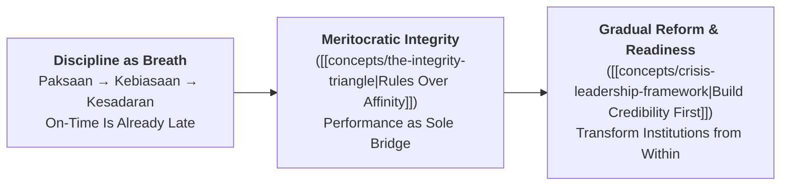
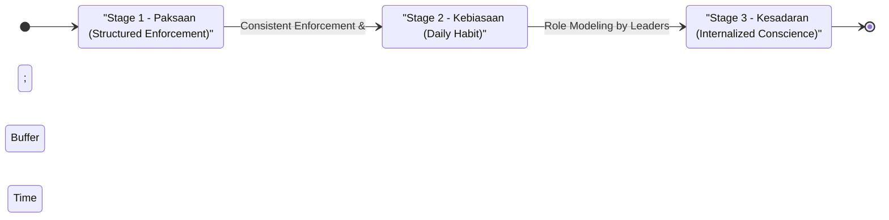
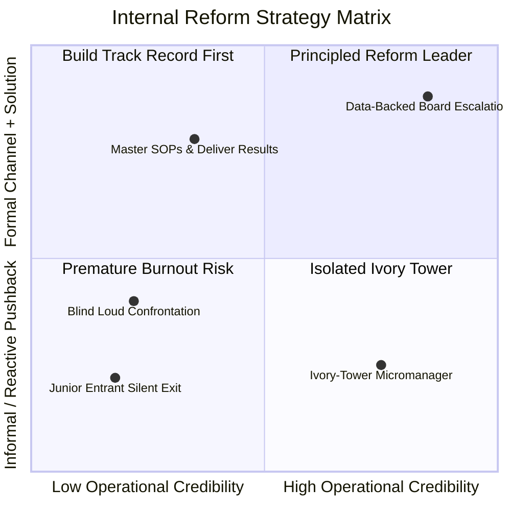

## Executive Plenary Overview

On Wednesday afternoon, November 25, 2026, **[[entities/djamari-chaniago|Jenderal TNI (Kehormatan) (Purn.) Djamari Chaniago]]**—Menteri Koordinator Bidang Politik dan Keamanan Republik Indonesia (2025–2026)—delivered a commanding closing plenary to the **P3MD Batch I Soedirman** cohort at Kampus DCU Nawasena. Titled **"Pengabdian Tanpa Batas: Kepemimpinan, Disiplin, dan Kesiapan Menjawab Panggilan Negara"**, his address taught first through personal example before a single doctrine was spoken.

At **77 years of age** (approaching 78) and having received the invitation only the previous evening, Jenderal Djamari refused an offer to reschedule to the following week because _"saya selalu siap"_ (I am always ready). Standing unassisted for roughly one hour **without slides or visual aids** so the cohort's attention would remain undivided, he challenged young state-enterprise cadres: _"Masa kalian yang muda kalah dengan saya."_ A soldier's oath of national service, he demonstrated, carries no expiration date.

> [!NOTE] Keynote Speaker Dossier: Jenderal TNI (Kehormatan) (Purn.) Djamari Chaniago
>
> - **State Mandate**: Menteri Koordinator Bidang Politik dan Keamanan RI (2025–2026) & Former BUMN Commissioner / President Commissioner
> - **Living Demonstration**: Age 77; accepted assignment on <24h notice; spoke ~1 hour without slides
> - **Core Leadership Pillars**: Discipline as Breath • Buffer-Time Rule • Rule-Bound Meritocracy • _Seribu Cara_ Problem Solving • Gradual Internal Reform
> - **Full Profile**: Consult [[entities/djamari-chaniago|Executive Entity Dossier]].

---

## Strategic Mandate & Five National Indicators for Indonesia Emas

Anchoring P3MD within the constitutional mandate of the **Pembukaan UUD 1945** and the national transformation framework (_Paradoks Indonesia dan Strategi Transformasi Bangsa_), Jenderal Djamari outlined five concrete yardsticks toward **Indonesia Emas 2045**:

1. **Per-Capita Income Parity**: Elevating national income per capita to developed-nation thresholds.
2. **Poverty Toward Zero**: Ensuring headline macroeconomic figures translate into palpable welfare for ordinary citizens.
3. **International Leadership & Presence**: Strengthening Indonesia's respected influence on the global stage.
4. **Human Capital Competitiveness**: Developing technically reliable, disciplined cadres across strategic institutions.
5. **Environmental Stewardship**: Balancing resource industrialization with ecological responsibility.

Grand national strategy succeeds or fails at the level of **reliable technical execution**. P3MD graduates are not placed inside BUMN merely to occupy seats, but to execute the operational core of national transformation with unbreakable discipline.

---

## The Discipline Doctrine: From External Enforcement to Internalized Breath

Recalling counsel carried since his days as an Army captain—**"Disiplin itu napasmu; kesetiaan kepada bangsa adalah kebanggaan; kehormatan adalah segala-galanya"**—Jenderal Djamari defined discipline as aligning attitude, action, and speech with governing rules. Crucially, discipline rarely begins as spontaneous enlightenment; it matures across three deliberate stages (much like teaching a child daily prayer from age seven until skipping feels like something missing):

- **The Leader as Living Standard**: Rules collapse when leaders exempt themselves. If staff start at 07:30, the executive should arrive by 07:00—subordinates calibrate automatically to visible behavior rather than memos.
- **The Buffer-Time Rule (_Waktu Cadangan_)**: Jenderal Djamari compressed operational reliability into one strict standard: **"Kalau tepat waktu, itu masih terlambat."** Every schedule requires built-in margin so unexpected friction never compromises execution.

---

## Uncompromising Integrity, Meritocracy & Conscience in BUMN

Addressing future corporate directors directly, Jenderal Djamari warned that financial temptations and pressure to bend procedures inside BUMN are severe—and a single compromise opens the door to total ethical collapse:

- **Rules Override Personal Affinity (_Ketentuan di Atas Rasa Suka_)**: A leader must be ready to sacrifice—even be sacrificed—to protect institutional standards. Never promote a favored subordinate who fails formal criteria, and never block a qualified performer out of personal dislike: _"Yang melarang saya adalah ketentuan."_
- **Performance as the Sole Bridge (_Prestasi_)**: Subordinates must never build upward favor by visiting a superior's residence, bringing personal gifts (_oleh-oleh_), or lobbying for titles (_pantang meminta jabatan_—asking immediately places you in a subordinate moral debt). Work output and verified achievement are the only legitimate media of communication.
- **The Conscience Test (Resigning from BUMN Boards)**: Sharing his own experience resigning prematurely after roughly one to two years as Commissioner and President Commissioner at state enterprises when his conscience could not accept prevailing irregularities and he lacked leverage to correct them, he left the cohort with a timeless rule:

$$\mathbf{\text{\ldquo Kebohongan berjalan lebih cepat, tetapi kejujuran pasti akan sampai.\rdquo}}$$

---

## The Resource Governance Paradox: _Kaya Tetapi Salah Kelola_

Echoing the morning historical critique from [[rabuan/2026-11-25-fadli-zon-sejarah-kearifan-bangsa|Dr. Fadli Zon]], Jenderal Djamari illustrated why national abundance fails to reach citizens when governance breaks down:

- Indonesia's theoretical **capture fisheries** value reaches roughly **USD 35 billion per year**, yet in 2024 roughly **16,000 illegal foreign vessels** operated across national waters while maritime fiscal contributions to APBN remained minimal.
- Decades of commodity exports such as **coal** left disproportionate proceeds parked offshore, while illicit corruption gains sat idle _"di bawah bantal"_ instead of compounding domestic productivity.

While hardware gaps (radar and patrol vessels) are real, the decisive constraint remains human willpower: **"Kalau mau ada seribu cara, kalau tidak mau ada sepuluh ribu alasan."**

---

## Institutional Reform Playbook: _Jangan Ragu, Tetapi Jangan Sekarang_

During Q&A, participants asked how young P3MD entrants should respond when encountering entrenched toxic practices inside BUMN—whether to resign immediately or fight from within. Jenderal Djamari offered a pragmatic, three-part playbook:

1. **Staff-Matured Decisions (No _Menara Gading_)**: Leaders never decide in ivory-tower isolation; they consult staff to mature intelligence estimates, treat subordinates humanely without playing favorites (_anak emas_), and remain open to structured input.
2. **Earn Footing Before Escalating (_Jangan Ragu, Tetapi Jangan Sekarang_)**: As junior entrants, build operational credibility, procedural mastery, and an indisputable performance record first—just as an officer builds competence from lieutenant through colonel before challenging a commander directly.
3. **Escalate Through Proper Channels with Solutions**: When confronting misconduct, document facts, anchor objections in formal regulations, and present concrete corrective solutions through authorized governance channels—while protecting physical health and cohort _esprit de corps_ so peers mutually keep one another honest.

---

## Full-Corpus Empirical Census ($N=46$)

An exhaustive textual census across all 46 participant submissions ($N=46$, 100% extraction) quantifies the behavioral themes most deeply internalized from Jenderal Djamari Chaniago's address:

| Core Curricular Theme / Framework                                              | Mention Count ($n$) | Cohort Percentage (%) | Analytical Resonance & Focus Area                                                                                |
| :----------------------------------------------------------------------------- | :-----------------: | :-------------------: | :--------------------------------------------------------------------------------------------------------------- |
| **Disiplin sebagai Napas & Keteladanan Pemimpin**                              |         45          |       **97.8%**       | Modeling punctuality, procedural compliance, and 3-stage discipline (_paksaan $\to$ kebiasaan $\to$ kesadaran_). |
| **Pengabdian Tanpa Batas & Kesiapan Menjawab Panggilan Negara**                |         37          |       **80.4%**       | Committing to lifelong national service regardless of rank, comfort, or formal retirement.                       |
| **Integritas, Kepatuhan Ketentuan & Menolak Kompromi**                         |         37          |       **80.4%**       | Placing rules above personal preference and refusing minor ethical compromises in BUMN governance.               |
| **_Paradoks Indonesia_ & 5 Indikator Indonesia Emas 2045**                     |         21          |       **45.7%**       | Linking technical BUMN execution to per-capita income, zero poverty, and tangible citizen welfare.               |
| **_"Kebohongan Berjalan Lebih Cepat, Kejujuran Pasti Sampai"_**                |         18          |       **39.1%**       | Rejecting manipulative shortcuts in favor of verifiable, durable institutional trust.                            |
| **Meritokrasi Berbasis Prestasi (Anti _Oleh-Oleh_ & Lobi Jabatan)**            |         17          |       **37.0%**       | Making verified work output the sole currency of career advancement and upward communication.                    |
| **Tata Kelola Kekayaan Alam (Perikanan USD 35M, 16rb Kapal, _"Seribu Cara"_)** |         12          |       **26.1%**       | Shifting from excuse-making (_sepuluh ribu alasan_) to solution-oriented sovereign asset protection.             |
| **Kesaksian Mundur dari Komisaris BUMN demi Hati Nurani**                      |         10          |       **21.7%**       | Confronting the real moral limits of boardroom oversight when systemic change is blocked.                        |
| **Keteladanan Fisik (Usia 77 Tahun, Tanpa Slide, Hadir Mendadak)**             |         10          |       **21.7%**       | Internalizing personal readiness and executive presence without reliance on presentation crutches.               |
| **Prinsip Waktu Cadangan (_"Tepat Waktu Itu Sudah Terlambat"_)**               |          6          |       **13.0%**       | Operationalizing buffer time in meetings, ALP deliverables, and plant operations.                                |

---

## Cohort Leadership Commitments: Daily Behavioral Shifts

| Arena of Conduct       | Legacy Organizational Habit                                         | Committed Soedirman Standard                                                                        |
| :--------------------- | :------------------------------------------------------------------ | :-------------------------------------------------------------------------------------------------- |
| **Time & Readiness**   | Arriving right at start time; requesting extensions when rushed.    | Enforcing _"tepat waktu itu sudah terlambat"_ with internal early deadlines and buffer margins.     |
| **Upward Mobility**    | Cultivating informal personal favors or seeking easy placements.    | Relying exclusively on **verified _prestasi_** and never lobbying for titles.                       |
| **Problem Escalation** | Listing resource or bureaucracy excuses (_sepuluh ribu alasan_).    | Presenting **at least one viable corrective pathway** (_seribu cara_) alongside every constraint.   |
| **Cultural Reform**    | Either staying silent forever or clashing prematurely without data. | Building **operational credibility first**, then escalating principled, data-backed fixes formally. |

---

## Archival Traceability & Primary Evidence

| Repository Directory                                                |   Item Count   | Corpus Contents                                                              |
| :------------------------------------------------------------------ | :------------: | :--------------------------------------------------------------------------- |
| `Rabuan_25_November_2026-20261125T155706Z-1-001.zip`                | 46 Submissions | Original uploaded cohort reflection package across Groups 1–4, Elements 1–3. |
| `archive/rabuan/2026-11-25-rabuan-plenary-biref7/`                  | 46 Submissions | Institutional preservation copy with identical `Grup X/Elemen Y/` tree.      |
| `archive/rabuan/2026-11-25-rabuan-plenary-biref7/.extracted/texts/` | 46 Text Files  | Unabridged plain-text extraction cache verified via `cohort-summary.json`.   |

---

## Knowledge Graph & Curricular Bridges

- **Featured Keynote Speaker**:
  - [[entities/djamari-chaniago|Jenderal TNI (Kehormatan) (Purn.) Djamari Chaniago]] (Menko Polkam RI 2025–2026)
- **Compounding Core Concepts**:
  - [[concepts/the-integrity-triangle|The Integrity Triangle: Character Diagnostic Framework]]
  - [[concepts/crisis-leadership-framework|Crisis Leadership Framework & Tactical Decision Architecture]]
  - [[concepts/best-mind-best-heart|Best Mind and Best Heart: The P3MD Leadership Doctrine]]
  - [[concepts/public-administration-paradigms|Public Administration Paradigms & State Enterprise Governance]]
- **Parallel Rabuan & BIREF7 Sessions (25 Nov 2026)**:
  - [[rabuan/2026-11-25-fadli-zon-sejarah-kearifan-bangsa|Rabuan: Menjadi Pemimpin Teladan — Sejarah, Kebudayaan & Kearifan Bangsa]] (Dr. Fadli Zon)
  - [[rabuan/2026-11-25-tatacipta-dirgantara-iptek-industri-strategis|Rabuan: Menuju Indonesia yang Mandiri — IPTEK & Industri Strategis 2045]] (Prof. Tatacipta Dirgantara)
  - [[rabuan/2026-11-25-jasa-marga-biref7|Business Immersion BIREF7: PT Jasa Marga (Persero) Tbk]] (Infra-Culture & Asset Recycling)
  - [[rabuan/2026-11-12-operasi-integritas-soedirman|Special Session: Operasi Integritas Soedirman]] (Marsma TNI Dr. Anton Palaguna)
- **Direct Curricular Synergies**:
  - [[courses/mk1-organizational-behavior-managing-people/index|MK 1: Organizational Behavior & Managing People]] (Meritocratic Culture, Power & Ethical Escalation)
  - [[courses/mk5-decision-making-negotiation/index|MK 5: Decision Making & Negotiation]] (Staff-Matured Intelligence & Principled Reform Strategy)
- Return to **[[rabuan/index|Rabuan Executive Masterclass Hub]]**
