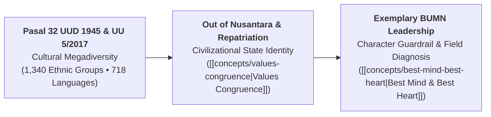
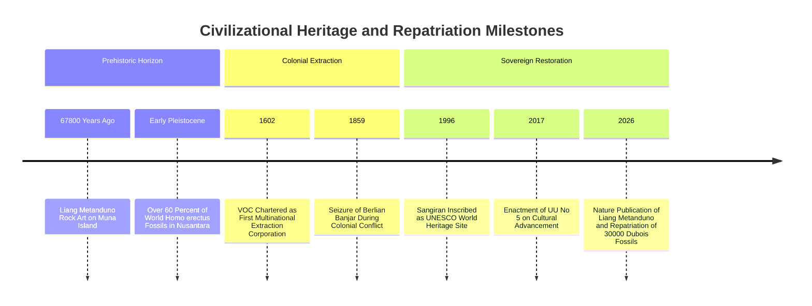
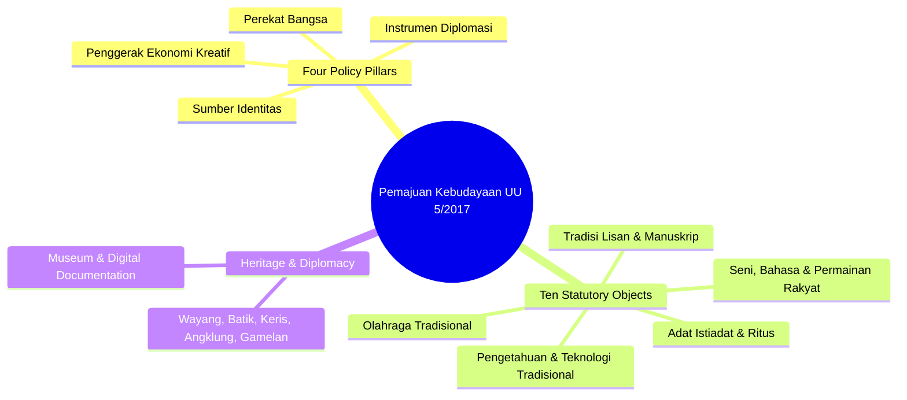

## Executive Plenary Overview

On Wednesday, November 25, 2026, **[[entities/fadli-zon|Prof. (Hon.) Dr. Fadli Zon, S.S., M.Sc.]]**—Menteri Kebudayaan Republik Indonesia—delivered the opening morning plenary masterclass to the **P3MD Batch I Soedirman** cohort at Kampus DCU Nawasena. Titled **"Menjadi Pemimpin Teladan di Tengah Masyarakat: Belajar dari Sejarah dan Kearifan Bangsa"**, the session reframed national culture from a ceremonial afterthought into the deepest strategic bedrock of state sovereignty and state-owned enterprise (BUMN) stewardship.

Dr. Fadli Zon highlighted the historic institutional elevation of the **Ministry of Culture** (_Kementerian Kebudayaan_) as an independent ministry for the first time since Indonesian independence—separating it from education and tourism portfolios. Grounding this mandate in the constitutional architecture of **UUD 1945**, he noted that **Pasal 32** (mandating the advancement of national culture amid global civilization) deliberately precedes **Pasal 33** (governing the national economy and state control of strategic resources). Natural resources such as coal, nickel, oil, and gas will eventually deplete, whereas culture endures as long as the nation's people endure.

> [!NOTE] Keynote Speaker Dossier: Prof. (Hon.) Dr. Fadli Zon, S.S., M.Sc.
>
> - **Current Designation**: Menteri Kebudayaan Republik Indonesia (First standalone Ministry of Culture post-independence)
> - **Constitutional & Statutory Anchor**: Pasal 32 Ayat (1) UUD 1945 & Undang-Undang Nomor 5 Tahun 2017 tentang Pemajuan Kebudayaan
> - **Core Strategic Themes**: Cultural Megadiversity • _Out of Nusantara_ Narrative • Cultural & Historical Repatriation • Value-Based Role Modeling
> - **Full Profile**: Consult [[entities/fadli-zon|Executive Entity Dossier]].

---

## Two Foundational National Narratives: Megadiversity & Civilizational Depth

### 1. Cultural Megadiversity as Sovereign Capital

Indonesia represents one of the planet's richest cultural ecosystems, spanning **1,340 ethnic groups** (_suku bangsa_) and **718 regional languages**—roughly **10%** of all living languages worldwide. Within corporate and state-enterprise leadership, culture functions much like organizational DNA: machines, software, and consultants can be bought, yet disciplined, honest, high-trust institutional culture must be cultivated continuously from the top down.

### 2. _Out of Nusantara_: Reinventing Indonesian Identity on Scientific Evidence

Challenging colonial historiography that labeled the archipelago the "Far East" and compressed national memory into the colonial resistance era, Dr. Fadli Zon presented paleoanthropological evidence establishing Indonesia as a **Civilizational State**—one of humanity's oldest continuous cultural hearths:

- **Sangiran & Early Hominid Heritage**: Over **60%** of global _Homo erectus_ fossil finds originate in Indonesia, anchored by the UNESCO World Heritage Site of **Sangiran** (inscribed 1996 across five clusters: Krikilan, Dayu, Ngebung, Bukuran, and Manyarejo).
- **World's Oldest Rock Art**: Prehistoric cave paintings at **Liang Metanduno (Muna Island)**—dated to **67,800 years ago** and published in _Nature_ (January 2026)—alongside **Leang Karampuang** predate European Paleolithic sites such as Lascaux (~17,000 years) by tens of millennia.
- **Cultural & Historical Justice via Repatriation**: Active state diplomacy has secured the repatriation of more than **30,000 Nusantara fossils** from the Eugène Dubois collection in the Netherlands, while pursuing the return of the **1859 Banjar Diamond** (_Berlian Banjar_) and Sangiran specimens held in Germany.

---

## Policy Architecture: 4 Pillars & 10 Objects of Cultural Advancement

Under **UU No. 5 Tahun 2017**, national cultural stewardship moves beyond passive preservation into active protection, development, utilization, and institutional nurturing (_pelindungan, pengembangan, pemanfaatan, pembinaan_) across ten statutory domains and four strategic pillars:

For BUMN executives, the **Penggerak Ekonomi Kreatif** and **Instrumen Diplomasi** pillars convert heritage (culinary, crafts, performing arts, and cultural tourism) into sustainable regional value chains while anchoring corporate social legitimacy (_cultural capital_) in host communities.

---

## Historical Warning: Extractive Elites & The Primacy of Character

Dr. Fadli Zon connected historical awareness directly to modern economic governance. During the colonial era, the **VOC (1602)** pioneered monopolistic extraction, and even _Politik Etis_ functioned primarily to train skilled low-wage clerks while keeping _bumiputra_ subordinated. High headline GDP per capita in the Dutch East Indies enriched European shareholders while indigenous citizens labored as coolies in their own homeland—a reminder that aggregate GDP growth is meaningless if domestic value added does not reach citizens.

Tracing that warning forward to the **1997–1998 Asian Financial Crisis**, he noted how externally imposed structural recipes (rapid privatization, market liberalization, and subsidy removal) crippled strategic national industries and state enterprises. Because powerful global actors operate under the realist rule _"the strong do what they can"_, Indonesia remains vulnerable to division primarily through **"the betrayal of the elites"**. He anchored the cohort with an enduring leadership maxim:

$$\mathbf{\text{\ldquo Lose wealth, nothing is lost; lose health, something is lost; lose character, everything is lost.\rdquo}}$$

---

## Practical Leadership Architecture: Values, Triad & Field Diagnosis

To translate historical consciousness into daily BUMN execution, Dr. Fadli Zon outlined three practical behavioral pillars:

1. **Indonesian Cultural Leadership Virtues**: Grounding executive authority in **Amanah** (fiduciary trustworthiness), **Gotong Royong** (collaborative burden-sharing), **Musyawarah** (deliberative consensus), and **Keteladanan** (leading by personal example).
2. **The Execution Triad**: Ideas fail without operational alignment across three dimensions—**Getting Motivation Right** (shared purpose), **Getting Arrangement Right** (clear roles, institutions, and resources), and **Getting Coordination Right** (cross-unit synchronization).
3. **Listening First & Honest Field Diagnosis (Q&A Doctrine)**: When asked when a leader must teach versus learn from society, he emphasized listening directly to those experiencing problems on the ground—citing Soekarno's grassroots immersion and Soeharto's unescorted regional visits to bypass sanitized upward reports. Accurate diagnosis prevents policy malpractice: _"jangan sampai sakit kepala diberi obat sakit perut."_

---

## Full-Corpus Empirical Census ($N=46$)

An exhaustive textual census across all 46 participant submissions ($N=46$, 100% extraction across Groups 1–4, Elements 1–3) quantifies how the cohort internalized Dr. Fadli Zon's plenary themes:

| Core Curricular Theme / Framework                                                      | Mention Count ($n$) | Cohort Percentage (%) | Analytical Resonance & Focus Area                                                                            |
| :------------------------------------------------------------------------------------- | :-----------------: | :-------------------: | :----------------------------------------------------------------------------------------------------------- |
| **Budaya, Sejarah, Identitas & Kearifan Bangsa**                                       |         45          |       **97.8%**       | Anchoring modern BUMN strategy in national cultural roots and historical self-awareness.                     |
| **Nilai Kepemimpinan (Amanah, Gotong Royong, Musyawarah, Keteladanan)**                |         32          |       **69.6%**       | Operationalizing indigenous Indonesian values as daily governance and role-modeling standards.               |
| **Cultural Megadiversity (1.340 Etnis & 718 Bahasa)**                                  |         28          |       **60.9%**       | Treating Indonesia's pluralism as a strategic asset rather than a coordination burden.                       |
| **Pasal 32 UUD 1945 & UU No. 5/2017 (10 Objek Pemajuan Kebudayaan)**                   |         25          |       **54.3%**       | Recognizing culture's constitutional precedence before economic resource governance (Pasal 33).              |
| **Repatriasi Warisan Budaya (Koleksi Dubois, Berlian Banjar, Cultural Justice)**       |         24          |       **52.2%**       | Viewing artifact repatriation as sovereign memory restoration, museum strengthening, and historical justice. |
| **Jejak Peradaban Nusantara (_Homo erectus_ 60%, Liang Metanduno 67.800, Sangiran)**   |         23          |       **50.0%**       | Replacing colonial inferiority complexes with evidence-based civilizational confidence.                      |
| **4 Pilar Kebudayaan, Ekonomi Kreatif & Diplomasi Budaya**                             |         16          |       **34.8%**       | Translating cultural capital into creative-economy value chains and soft-power diplomacy.                    |
| **Narasi _Out of Nusantara_ & _Reinventing Indonesian Identity_**                      |         14          |       **30.4%**       | Reframing Indonesia from a passive colonial "Far East" periphery into a central civilizational origin.       |
| **Sejarah Ekstraktif (VOC, Politik Etis, Krisis IMF 1998 & _Betrayal of the Elites_)** |         11          |       **23.9%**       | Guarding strategic BUMN assets against elite capture, short-term compromises, and value extraction.          |
| **Triad Eksekusi (_Getting Motivation, Arrangement & Coordination Right_)**            |          8          |       **17.4%**       | Connecting moral inspiration to institutional design and cross-agency synchronization.                       |

---

## Cohort Leadership Commitments: From Technocracy to Grounded Stewardship

| Leadership Dimension      | Conventional Technocratic Reflex                                       | Grounded Cultural Stewardship Commitment                                                       |
| :------------------------ | :--------------------------------------------------------------------- | :--------------------------------------------------------------------------------------------- |
| **Project Feasibility**   | Relying solely on financial spreadsheets and imported templates.       | Mapping local socio-cultural context and community wisdom before designing BUMN interventions. |
| **Field Diagnosis**       | Accepting curated upward slide reports from regional subordinates.     | Conducting unvarnished field listening (_turun ke lapangan_) before prescribing solutions.     |
| **Internal Capability**   | Defaulting to foreign consultants and standards without local inquiry. | Benchmarking domestic capability and historical institutional lessons first.                   |
| **Character & Integrity** | Rationalizing minor reporting shortcuts to meet short-term KPIs.       | Upholding **Amanah** and [[concepts/the-integrity-triangle\|zero-compromise character]].       |

---

## Archival Traceability & Primary Evidence

| Repository Directory                                                |   Item Count   | Corpus Contents                                                              |
| :------------------------------------------------------------------ | :------------: | :--------------------------------------------------------------------------- |
| `Rabuan_25_November_2026-20261125T155706Z-1-001.zip`                | 46 Submissions | Original uploaded cohort reflection package across Groups 1–4, Elements 1–3. |
| `archive/rabuan/2026-11-25-rabuan-plenary-biref7/`                  | 46 Submissions | Institutional preservation copy with identical `Grup X/Elemen Y/` tree.      |
| `archive/rabuan/2026-11-25-rabuan-plenary-biref7/.extracted/texts/` | 46 Text Files  | Unabridged plain-text extraction cache verified via `cohort-summary.json`.   |

---

## Knowledge Graph & Curricular Bridges

- **Featured Keynote Speaker**:
  - [[entities/fadli-zon|Prof. (Hon.) Dr. Fadli Zon, S.S., M.Sc.]] (Menteri Kebudayaan Republik Indonesia)
- **Compounding Core Concepts**:
  - [[concepts/best-mind-best-heart|Best Mind and Best Heart: The P3MD Leadership Doctrine]]
  - [[concepts/the-integrity-triangle|The Integrity Triangle: Character Diagnostic Framework]]
  - [[concepts/values-congruence|Values Congruence & Executive Friction]]
  - [[concepts/public-administration-paradigms|Public Administration Paradigms & State Enterprise Governance]]
- **Parallel Rabuan & BIREF7 Sessions (25 Nov 2026)**:
  - [[rabuan/2026-11-25-tatacipta-dirgantara-iptek-industri-strategis|Rabuan: Menuju Indonesia yang Mandiri — IPTEK & Industri Strategis 2045]] (Prof. Tatacipta Dirgantara)
  - [[rabuan/2026-11-25-djamari-chaniago-pengabdian-disiplin-negara|Rabuan: Pengabdian Tanpa Batas — Disiplin & Kesiapan Panggilan Negara]] (Jenderal Djamari Chaniago)
  - [[rabuan/2026-11-25-jasa-marga-biref7|Business Immersion BIREF7: PT Jasa Marga (Persero) Tbk]] (Infra-Culture & Asset Recycling)
- **Direct Curricular Synergies**:
  - [[courses/mk1-organizational-behavior-managing-people/index|MK 1: Organizational Behavior & Managing People]] (Values Congruence, Ethical Culture & Role Modeling)
  - [[courses/mk5-decision-making-negotiation/index|MK 5: Decision Making & Negotiation]] (Diagnostic Framing & Multi-Stakeholder Legitimacy)
- Return to **[[rabuan/index|Rabuan Executive Masterclass Hub]]**
