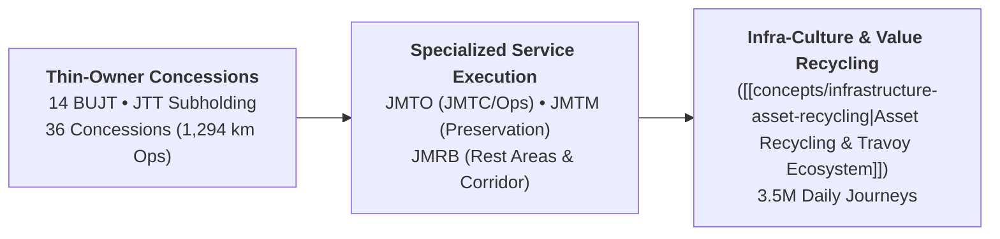
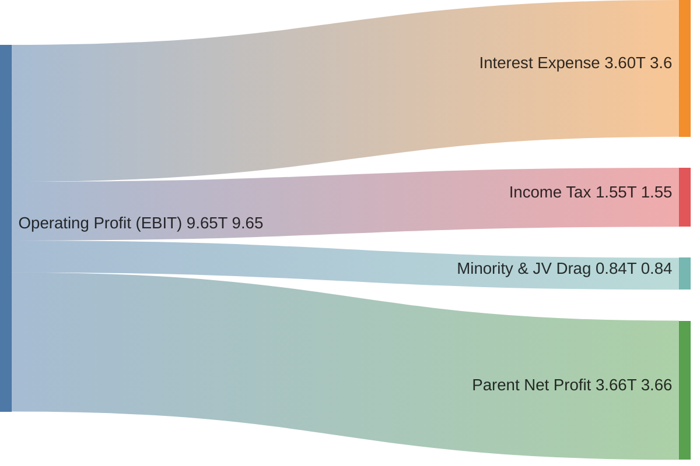

## Executive Immersion Overview

On Wednesday, November 25, 2026, the **P3MD Batch I Soedirman** cohort conducted **Business Immersion Brief 7 (BIREF7)**, examining the strategic, financial, and operational architecture of **[[entities/pt-jasa-marga|PT Jasa Marga (Persero) Tbk]]** through classroom briefings and a field immersion at the **Jasamarga Tollroad Command Center (JMTC)** in Bekasi.

Founded in 1978 initially as both toll-road builder and regulator, Jasa Marga transitioned to a pure-play operator in 2004, listed on the Indonesia Stock Exchange (IDX: `JSMR`) in 2007, and today operates under the **[[entities/danantara|BPI Danantara]]** sovereign portfolio (70% state-owned via Danantara, 30% public). Operating under the foundational concession principle **"The State Owns the Road, Jasa Marga Owns the Concession"** (30–50 year BOT terms regulated by the Ministry of Public Works / PU and BPJT), Jasa Marga manages **36 toll concessions** spanning **~1,736 km**—with **29 corridors fully operational (1,294 km, ~42% national operational share)**, 3 partially operational, 4 in land acquisition/construction, and **+62 km** slated for Q1 2027 commissioning (Probolinggo–Banyuwangi, Jogja–Bawen, and Jogja–Solo)—handling roughly **3.5 million vehicle transactions per day** (85% concentrated in Java; 15% across Sumatra, Kalimantan, Sulawesi, and Bali).

To scale governance across this footprint, Jasa Marga separates asset ownership from specialized execution via a **"Thin Owner"** model (**14 BUJT** concession subsidiaries plus subholding **PT Jasamarga Transjawa Tol / JTT**) backed by three specialized service arms: **JMTO** (toll collection, patrol, and JMTC operations), **JMTM** (pavement preservation and engineering maintenance), and **JMRB** (rest-area and corridor non-toll monetization). Guided by the **JSMR MOVE** corporate culture (_Modern, Optimistic, Valuable, Excellent_ — SK Direksi No. 161/KPTS/2025), leadership is executing a historic strategic pivot from **Infra-Structure** (measuring kilometers of asphalt built) to **Infra-Culture** (managing integrated, customer-centric travel journeys).



> [!NOTE] Host Enterprise Dossier: PT Jasa Marga (Persero) Tbk
>
> - **Ownership & Governance**: 70% State ([[entities/danantara|Danantara]]) / 30% Public (`JSMR`); Concession Regulator: Ministry of PU & BPJT
> - **Network Footprint**: 36 Concessions (~1,736 km total; 1,294 km operational = 42% national share); 85% Java / 15% Outside Java
> - **Operational Nerve Center**: Jasamarga Tollroad Command Center (JMTC), Bekasi — 3,500+ CCTV cameras, 341 DMS boards, radar, and Call Center 133
> - **Full Enterprise Context**: Consult [[entities/pt-jasa-marga|Enterprise Entity Dossier]] and [[program/alp/business-immersion-1/jasa-marga|Business Immersion 1 Dossier]].

---

## Financial Performance & Earnings Conversion Analysis

BIREF7 revealed a striking financial paradox beneath Jasa Marga's headline operational strength. While toll-tariff adjustments and new corridors lifted revenue and sustained an extraordinary **67.0% EBITDA margin**, parent-level net profit declined—demonstrating why infrastructure analysis must trace cash conversion all the way from EBIT down to parent equity:

| Financial & Operational Indicator       | FY 2025 Actual            | 9M 2026 Actual            | Diagnostic Driver & Capital Structure Dynamics                                                                                |
| :-------------------------------------- | :------------------------ | :------------------------ | :---------------------------------------------------------------------------------------------------------------------------- |
| **Operating Revenue (Ex-Construction)** | **Rp19.81 T** (+5.8% YoY) | **Rp15.60 T** (+7.9% YoY) | **~92%–95%** derived from toll tariffs; organic traffic grew only **+0.35%** in 2025, making growth tariff-led.               |
| **EBITDA & EBITDA Margin**              | **Rp13.27 T** (**67.0%**) | **Rp10.50 T** (**67.0%**) | High core operational efficiency sustained via gate digitization and centralized maintenance scheduling.                      |
| **Operating Profit (EBIT)**             | **Rp9.65 T**              | In line with EBITDA       | Strong cash generation from mature Greater Jakarta and Trans-Java corridors.                                                  |
| **Net Profit Attributable to Parent**   | **Rp3.66 T** (**-19.3%**) | **Rp2.70 T** (**-2.6%**)  | Only **~38% of EBIT** reaches parent shareholders due to financing drag, taxes (**Rp1.55 T** post-PMK 72), & JVs.             |
| **Debt, AUC & Dividend Profile**        | **Assets Rp160.0 T**      | —                         | **Rp76.9 T** debt (**Rp3.60 T** interest = **37% EBIT**); **Rp31.7 T** AUC non-yielding; FY25 dividend **Rp1.1 T** (31% DPR). |

Applying the **[[concepts/infrastructure-asset-recycling|Earnings Conversion Ratio]]** ($\eta_{\text{earn}} = \text{Parent Net Profit} / \text{EBIT}$) exposes how financing costs and construction gestation siphon core operational profits:



---

## Four Core Structural & Operational Challenges

Through field observation at JMTC and technical Q&A with subsidiary executives—including **Agustinus Dwi Winarsa** (President Director of PT Jasamarga Jogja Bawen)—the cohort diagnosed four interlocking dilemmas:

| Core Structural Challenge                                | Quantified Business Impact                                                                                                  | Underlying Root Causes                                                                                                                               | Strategic Remediation Pathway                                                                                       |
| :------------------------------------------------------- | :-------------------------------------------------------------------------------------------------------------------------- | :--------------------------------------------------------------------------------------------------------------------------------------------------- | :------------------------------------------------------------------------------------------------------------------ |
| **1. Two-Speed Network & Interest Drag**                 | Parent net profit fell **19.3%**; two outer-island corridors lose **~Rp0.8 T/yr**; debt service limits fresh CapEx.         | **13 mature** Jakarta corridors sit near gridlock ($V/C \ 0.80\text{–}0.94$) while frontier corridors sit at $V/C \ 0.04\text{–}0.05$; Rp31.7 T AUC. | **[[concepts/infrastructure-asset-recycling\|Asset Recycling]]** (35% JTT stake = **Rp15.75 T**), brownfield shift. |
| **2. ODOL Trucks & Jurisdictional Enforcement Gap**      | Pavement overlay/preservation burns **~Rp1.5 T/yr**; severe fatal crash risks on steep grades from truck-car velocity gaps. | **ODOL** trucks inflict **$4\times\text{–}13\times$** structural damage; Jasa Marga can only detect, lacking direct police ticketing power.          | Integrating **7 WIM sensors** with **Korlantas ETLE** & **Kemenhub BLUe** ahead of **Zero ODOL (1 Jan 2027)**.      |
| **3. Low Digital Adoption Funnel (Travoy & Travoy Go)**  | Non-toll revenue stuck at **~5%–8%**; Travoy reaches only **~0.4%** of 3.5M daily transactions (**~2 per 500 cars**).       | **1,356,742 downloads** drop to **126,602 MAU (9.3%)** and **12,463 DAU (0.9%)**; RFID **Travoy Go** (<1% share, 42,974 stickers, 100 gates).        | Daily commuter utility, frictionless **2-sec** RFID clearance (vs. 5–9 sec card tap), & rest-area destinations.     |
| **4. Aging Assets (1978), Peak Surges & Cultural Shift** | Maintenance lane closures trigger commuter friction; rest areas overflow during peak surges (**+37%** during Lebaran 2026). | Legacy **1978** infrastructure; narrow **22:00–05:00 WIB** repair window; **12 extreme rain events (2025)**; 50-yr asphalt-first culture.            | Precision diagnostics (**Hawkeye / JIMMS**, **Travoy Patch**), JMTC predictive ops, & **JSMR MOVE** embedding.      |

### Challenge Deep-Dive: Two-Speed Network & Asset Recycling

Jasa Marga operates a starkly bifurcated portfolio under Indonesia's **[[concepts/pso-commercial-duality|PSO vs Commercial Duality]]**: saturated Greater Jakarta arteries (**Jakarta–Tangerang $V/C = 0.94$**, **Dalam Kota $0.80\text{–}0.90$**) cannot easily add physical lanes, while regional connectivity mandates outside Java (**Balikpapan–Samarinda** and **Manado–Bitung** at **$V/C = 0.04\text{–}0.05$**) generate combined losses of **~Rp0.8 trillion/year**. Recycling mature equity—exemplified by the 2024 divestment of **35% of PT Jasamarga Transjawa Tol (JTT) for Rp15.75 trillion**—delevers the holding balance sheet and shifts new investment discipline from risky greenfield builds toward selective **brownfield** assets.

```mermaid
quadrantChart
    title Jasa Marga Two-Speed Portfolio
    x-axis Low Traffic (V/C) --> High Traffic (V/C)
    y-axis Low Debt Drag --> High Debt Drag
    quadrant-1 Recycle & Monetize
    quadrant-2 Cash Cow & Infra-Culture
    quadrant-3 Selective Brownfield
    quadrant-4 Frontier PSO Drag
    "Jakarta-Tangerang (0.94)": [0.94, 0.28]
    "Dalam Kota Jakarta": [0.86, 0.24]
    "Trans-Java JTT (35% Sold)": [0.78, 0.72]
    "Balikpapan-Samarinda": [0.08, 0.84]
    "Manado-Bitung": [0.06, 0.86]
```

### Challenge Deep-Dive: Steep-Grade Safety, ODOL & Jurisdictional Split (Bawen Case)

In mentoring Q&A regarding high accident incidence on steep terrain such as **Semarang / Jogja–Bawen**, **Agustinus Dwi Winarsa** clarified that all geometric alignments, curve radii, and grades pass strict **Class-1 Ministry of PU** engineering standards prior to operating permits. On-road fatalities stem overwhelmingly from **non-construction factors**: heavy-truck brake failures, driver fatigue, and severe _velocity gaps_ caused by overloaded **ODOL** freight crawling uphill. Yet a critical governance split limits mitigation: Jasa Marga detects overloads via **7 Weigh-in-Motion (WIM)** sensors, while legal enforcement belongs exclusively to **Kemenhub (BLUe)** and **Korlantas Polri (ETLE)**—making automated cross-agency enforcement vital before **Zero ODOL** takes full effect on **January 1, 2027**.

### Challenge Deep-Dive: The Travoy Digital Adoption Funnel Gap

Although JMTC delivers measurable roadside excellence—monitoring **3,500+ CCTV feeds**, **341 DMS signs**, radar, and **Call Center 133** to achieve **23-minute average incident response** (beating the **30-minute SPM** mandate) and **98.85% user satisfaction**—customer-facing digital habits lag far behind:


Usage spikes seasonally during **Lebaran Mudik (20,335 DAU in 2026)** and collapses on ordinary workdays—proving that **Travoy** is still perceived as an emergency _mudik_ tool rather than a daily commuting companion, even though **Travoy Go** slashes toll-gate clearance from **5–9 seconds** (card tap) to **2 seconds** (free-flow RFID).

---

## Full-Corpus Empirical Census ($N=46$)

An exhaustive textual census across all 46 BIREF7 participant submissions ($N=46$, 100% extraction across Groups 1–4, Elements 1–3) establishes the exact distribution of cohort analytical focus:

| Operational / Strategic Dimension                                         | Mention Count ($n$) | Cohort Percentage (%) | Analytical Resonance & Diagnostic Focus                                                                                            |
| :------------------------------------------------------------------------ | :-----------------: | :-------------------: | :--------------------------------------------------------------------------------------------------------------------------------- |
| **Adopsi Digital Travoy & RFID Travoy Go (<1% / 12.463 DAU)**             |         44          |       **95.7%**       | Diagnosing the downloads-to-DAU drop-off and non-toll monetization via **[[concepts/digital-marketing-funnel\|digital funnels]]**. |
| **Pergeseran _Infra-Structure_ ke _Infra-Culture_ & JSMR MOVE**           |         42          |       **91.3%**       | Transitioning from road construction metrics to customer-centric travel journeys and rest-area ecosystems.                         |
| **Tekanan Laba Bersih (-19,3%) & Beban Bunga Utang (Rp76,9T)**            |         39          |       **84.8%**       | Auditing EBIT-to-parent-net-profit conversion (**~38%**) and interest drag from **Rp31.7T** AUC assets.                            |
| **Operasi Real-Time JMTC (3.500+ CCTV, 341 DMS, Respons 23 Menit)**       |         38          |       **82.6%**       | Evaluating ITS traffic control against statutory **30-minute SPM** and **98.85%** user satisfaction.                               |
| **Struktur Grup _Thin Owner_ (14 BUJT, JMTO, JMTM, JMRB)**                |         36          |       **78.3%**       | Separating concession holding entities from specialized operations, preservation, and commercial services.                         |
| **Truk ODOL (Daya Rusak 4–13×, Overlay Rp1,5T, WIM & Zero ODOL 2027)**    |         32          |       **69.6%**       | Addressing pavement destruction and cross-agency WIM–ETLE–BLUe enforcement gaps.                                                   |
| **_Asset Recycling_ (Divestasi 35% JTT Rp15,75T) & Seleksi _Brownfield_** |         31          |       **67.4%**       | Using partial divestments to deleverage debt and fund disciplined brownfield growth.                                               |
| **Aset Menua (1978), Jendela 22.00–05.00 & Hawkeye/JIMMS**                |         30          |       **65.2%**       | Managing lifecycle preservation under tight nocturnal maintenance windows and extreme weather.                                     |
| **Jaringan Dua Kecepatan ($V/C$ 0,94 Jakarta vs. 0,04–0,05 Luar Jawa)**   |         27          |       **58.7%**       | Balancing saturated metropolitan corridors with loss-making frontier regional toll roads (~Rp0.8T/yr).                             |
| **Studi Kasus Geometrik Bawen (Diskusi Dirut Jogja–Bawen)**               |          5          |       **10.9%**       | Distinguishing compliant Class-1 PU geometry from heavy-vehicle brake/velocity-gap safety failures.                                |

---

## Four Foundational Key Insights from the Cohort

1. **Revenue & EBITDA Growth Do Not Guarantee Shareholder Value**: A **67% EBITDA margin** can mask severe equity value erosion when high leverage (**Rp76.9T** debt) and long-gestation AUC (**Rp31.7T**) trap **62%** of EBIT before it reaches parent shareholders.
2. **When Physical Lanes Saturate, Value Migrates to _Infra-Culture_**: With 13 mature corridors above $V/C = 0.90$ and core traffic growing only **+0.35%**, sustainable upside requires converting the **5%–8% non-toll slice**—turning rest areas into high-dwell destinations and turning 3.5 million daily trips into connected platform relationships.
3. **Downloads Are a Vanity Metric; Daily Habits Define Digital ROI**: Measuring digital transformation by **1.36M downloads** hides a **0.9% DAU conversion**; apps succeed only when embedded into everyday commuter friction (instant RFID clearance, live congestion rerouting, and parking visibility).
4. **Physical Standards Alone Cannot Deliver Safety Without Ecosystem Enforcement**: Even world-class Class-1 PU road geometry and 23-minute JMTC rescue response fail if **ODOL** trucks and uncoordinated enforcement agencies generate systemic highway hazards.

---

## Cohort Personal Reflections & Behavioral Commitments

### 1. Most Surprising Realizations

- That a near-monopoly toll operator earning a **67% EBITDA margin** could still post a **-19.3% net profit drop**, and that two outer-island concessions lose ~Rp0.8T/year despite critical regional connectivity mandates.
- That **only ~2 out of every 500 daily toll transactions** correspond to a daily active **Travoy** user, exposing the chasm between technical app launch and habitual customer adoption.

### 2. Newly Acquired Analytical Capabilities

- Tracing infrastructure financial statements end-to-end from **EBITDA $\rightarrow$ EBIT $\rightarrow$ Interest/Tax/Minority $\rightarrow$ Parent Net Profit** alongside **$V/C$ saturation diagnostics**.
- Structuring **Thin-Owner concession governance** across regulator (PU/BPJT), concessionaire (BUJT), operator (JMTO), maintainer (JMTM), and optimizer (JMRB).

### 3. Committed Behavioral Shifts

- **Auditing Full-Chain Value Conversion**: Refusing to sign off on BUMN CapEx or ALP proposals based on top-line revenue or EBITDA alone without testing debt service, ramp-up time, and parent cash conversion.
- **Measuring Digital Initiatives by Retention (DAU/MAU)**: Designing digital public services around everyday user habits rather than peak seasonal usage or cumulative download counts.
- **Lifecycle Asset Thinking**: Factoring multi-decade preservation, NDT/predictive inspection, and user-behavior risks at the earliest project planning stage.

---

## ❓ Open Questions Retained for Executive Boardroom Review

1. **Zero ODOL 2027 Governance & Revenue-Sharing**: What automated enforcement protocol and commercial incentive structure between Jasa Marga, **Korlantas Polri**, and **Kemenhub** can turn **WIM sensor** detections into instant gate denials or automatic ETLE fines ahead of 2027 without disrupting national logistics?
2. **Breaking the _Mudik-Only_ Ceiling on Travoy**: Which daily commuter value propositions (e.g., nationwide interoperable **Travoy Go** RFID toll discounts, dynamic commuter routing, or EV/rest-area loyalty integration) can lift daily retention beyond 1%?
3. **Balancing Asset Recycling & Long-Term Concession Cash Flows**: How should Jasa Marga calibrate future divestments (following the 35% JTT transaction) so debt reduction does not strip away long-term cash-cow annuities needed to cross-subsidize outer-island PSO corridors?

---

## Archival Traceability & Primary Evidence

| Repository Directory                                                |   Item Count   | Corpus Contents                                                              |
| :------------------------------------------------------------------ | :------------: | :--------------------------------------------------------------------------- |
| `Rabuan_25_November_2026-20261125T155706Z-1-001.zip`                | 46 Submissions | Original uploaded cohort reflection package across Groups 1–4, Elements 1–3. |
| `archive/rabuan/2026-11-25-rabuan-plenary-biref7/`                  | 46 Submissions | Institutional preservation copy with identical `Grup X/Elemen Y/` tree.      |
| `archive/rabuan/2026-11-25-rabuan-plenary-biref7/.extracted/texts/` | 46 Text Files  | Unabridged plain-text extraction cache verified via `cohort-summary.json`.   |

---

## Knowledge Graph & Curricular Bridges

- **Host Enterprise Entity**:
  - [[entities/pt-jasa-marga|PT Jasa Marga (Persero) Tbk]] & [[entities/danantara|BPI Danantara]]
- **Prior Jasa Marga & Infrastructure Sessions**:
  - [[program/alp/business-immersion-1/jasa-marga|Business Immersion 1: PT Jasa Marga — JMTC Field Diagnostics (October 2026)]]
  - [[rabuan/2026-09-23-syamsul-infrastruktur|Rabuan 2026-09-23: Nation in Motion — Infrastruktur sebagai Penggerak Pertumbuhan]] (Dipl.-Ing. Syamsul Bachri Yusuf)
  - [[rabuan/2026-09-23-sahala-financial-discipline|Rabuan 2026-09-23: Memimpin dengan Financial Discipline]] (Sahala Situmorang)
- **Parallel Rabuan Keynotes (25 Nov 2026)**:
  - [[rabuan/2026-11-25-fadli-zon-sejarah-kearifan-bangsa|Rabuan: Menjadi Pemimpin Teladan — Sejarah, Kebudayaan & Kearifan Bangsa]] (Dr. Fadli Zon)
  - [[rabuan/2026-11-25-tatacipta-dirgantara-iptek-industri-strategis|Rabuan: Menuju Indonesia yang Mandiri — IPTEK & Industri Strategis 2045]] (Prof. Tatacipta Dirgantara)
  - [[rabuan/2026-11-25-djamari-chaniago-pengabdian-disiplin-negara|Rabuan: Pengabdian Tanpa Batas — Disiplin & Kesiapan Panggilan Negara]] (Jenderal Djamari Chaniago)
- **Compounding Core Concepts**:
  - [[concepts/infrastructure-asset-recycling|Infrastructure Asset Recycling & Two-Speed Concession Portfolio Management]]
  - [[concepts/pso-commercial-duality|Public Service Obligation (PSO) vs Commercial Viability Duality]]
  - [[concepts/incremental-capital-output-ratio|Incremental Capital Output Ratio (ICOR) & Infrastructure Capital Productivity]]
  - [[concepts/digital-marketing-funnel|Digital Marketing Funnel & Platform Ecosystem]]
  - [[concepts/capacity-cushion|Capacity Cushion and Strategic Capacity Planning]]
- **Direct Curricular Synergies**:
  - [[courses/mk2-financial-management-strategy/index|MK 2: Financial Management & Strategy]] (Leverage, Interest Coverage & Asset Recycling)
  - [[courses/mk3-marketing-management/index|MK 3: Marketing Management]] (Digital Adoption Funnels & Non-Toll Monetization)
  - [[courses/mk4-operations-supply-chain-management/index|MK 4: Operations & Supply Chain Management]] (JMTC Real-Time Control & Lifecycle Preservation)
- Return to **[[rabuan/index|Rabuan Executive Masterclass Hub]]**
