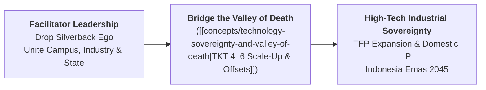
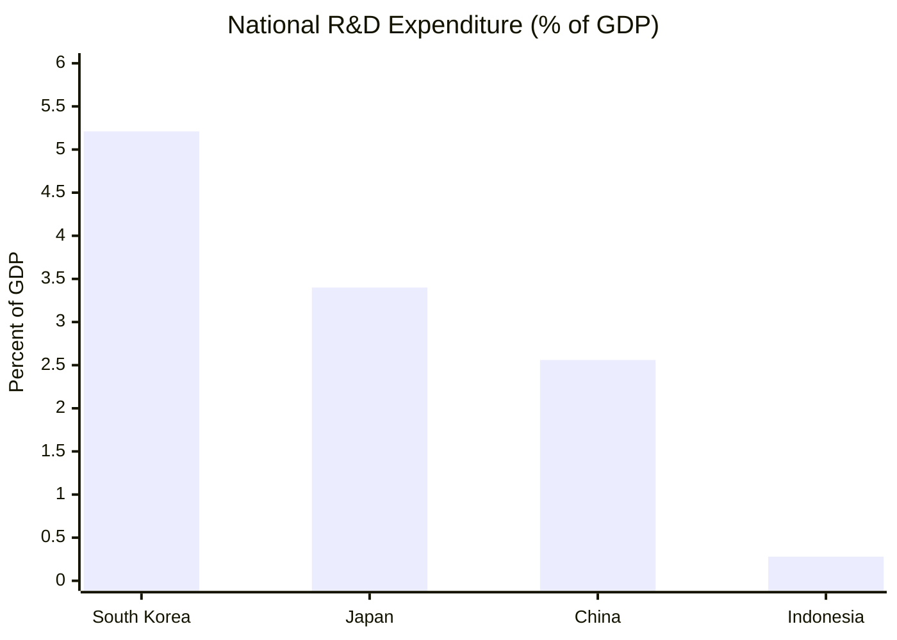

## Executive Plenary Overview

On Wednesday, November 25, 2026, **[[entities/tatacipta-dirgantara|Prof. Dr. Ir. Tatacipta Dirgantara, M.T., IPU, ASEAN Eng.]]**—Rector of Institut Teknologi Bandung (ITB) for 2025–2030—delivered the midday plenary masterclass to the **P3MD Batch I Soedirman** cohort at Kampus DCU Nawasena. Framed around **"Menuju Indonesia yang Mandiri: Peningkatan Kapasitas SDM dan Penguasaan IPTEK bagi Industri Strategis Indonesia"** (and leadership grounded in science and innovation for **Indonesia Emas 2045**), the session diagnosed why resource-rich nations stagnate in the middle-income trap and how BUMN leaders can unlock true **[[concepts/technology-sovereignty-and-valley-of-death|Technology Sovereignty]]**.

Prof. Tatacipta opened with a biological leadership parable: the **Silverback Gorilla**. In a gorilla troop, two dominant alphas cannot coexist; young challengers inevitably fracture the group into competing splinter bands. Building national industrial independence cannot be accomplished by "alpha-hero" executives or isolated institutions trying to hold every answer. True strategic leaders act as **ecosystem facilitators**—lowering ego to weave universities, research labs, state enterprises, and government policy into a unified **Triple Helix** engine.

> [!NOTE] Keynote Speaker Dossier: Prof. Dr. Ir. Tatacipta Dirgantara, M.T., IPU, ASEAN Eng.
>
> - **Current Designation**: Rektor Institut Teknologi Bandung (ITB), Periode 2025–2030
> - **Domain Focus**: Aerospace & Mechanical Engineering • Innovation Ecosystems • University-Industry Commercialization
> - **Core Analytical Lenses**: Total Factor Productivity (TFP) • B.J. Habibie Reverse-Transformation • Co-Design & Offset Policy • Innovation Valley of Death (TKT 4–6)
> - **Full Profile**: Consult [[entities/tatacipta-dirgantara|Executive Entity Dossier]].

---

## Macroeconomic Evidence: Technology as the Engine of Prosperity

Global GDP per capita remained virtually flat for nearly 2,000 years until sequential industrial revolutions drove exponential separation. East Asian peers—**Japan (1970s)**, **South Korea (1980s)**, **China (2000s)**, and increasingly **Vietnam** (which only two decades ago sent students to study at ITB)—achieved sustained high-income take-off by shifting growth from commodity consumption to high-value-added technology exports. Indonesia, by contrast, experienced two structural stalls: first during the **1997–1998 financial crisis**, and again around **2013**, remaining constrained in middle-income dependency.

The empirical root cause appears starkly in R&D intensity and **Total Factor Productivity (TFP)**:

| National Innovation Metric                        | Indonesia |  China   | Japan  | South Korea | Strategic Implication                                                        |
| :------------------------------------------------ | :-------: | :------: | :----: | :---------: | :--------------------------------------------------------------------------- |
| **Gross R&D Expenditure (% of GDP)**              | **0.28%** |  2.56%   | 3.40%  |  **5.21%**  | Underinvestment traps industry in imported turnkey assembly.                 |
| **TFP Contribution to Economic Growth**           | **~0.1%** | **2.9%** |  High  |    High     | Indonesian growth relies on capital and consumption, not technology mastery. |
| **Policy Continuity Horizon for Industrial Base** |  25 yrs   |  25 yrs  | 25 yrs |   25 yrs    | Capability maturation requires ~25 years across political cycles.            |

Prof. Tatacipta emphasized that breaking this ceiling requires three simultaneous commitments: **(1) superior STEM and engineering human capital**, **(2) sovereign mastery of industrial processes and IP**, and **(3) roughly 25 years of consistent industrial policy** across government transitions—resisting the bureaucratic temptation to _"beli saja biar cepat"_ (import turnkey systems for quick ribbon-cuttings), which adds fixed assets without creating the **$7\times\text{–}10\times$ domestic multiplier** of local component manufacturing.

---

## Historical Blueprint: B.J. Habibie's Reverse-Transformation & Innovation Model

Drawing on national history—from ITB alumnus **Djuanda** securing archipelagic territorial unity (_Deklarasi Djuanda_) with _"kepala dan kemauan"_, to President Soekarno's 1962 aerospace-maritime vision, to President Soeharto summoning **B.J. Habibie** home on **28 January 1974** (_"Rudy, kamu bisa membuat apa saja di Indonesia, kecuali revolusi"_)—Prof. Tatacipta unpacked Habibie's **21-year reverse-transformation architecture** ("starting at the end and ending at the beginning"):

The profound lesson of the **N-250** (first flight in 1995) before its interruption by **1998 IMF conditionality** is that **the aircraft was merely the vehicle (_wahana_)**—the true permanent product was trained Indonesian engineers, test laboratories, certification institutions, and university-industry linkages. When adversity hits, as Prof. Tatacipta warned: _"Kalau mau maju, kita pasti akan dihambat, jadi kita harus siap."_

He further framed sustainable innovation around five interlocking criteria—**Initiative, Novelty, Value, Sustainability, and Impact**—illustrated by ITB and Masjid Salman's rapid **COVID-19 emergency ventilator**, which proved that winning product specifications must always be co-defined directly with end-users.

---

## Dismantling the "Transfer of Technology" Illusion & Bridging the Valley of Death

Prof. Tatacipta directly challenged a dangerous assumption inside BUMN procurement: **"Transfer of technology" as an automatic clause does not exist.** Core proprietary technology is never surrendered voluntarily by foreign vendors. Real capability transfer occurs only when the buyer enforces structural leverage:

1. **Staged Co-Design, Co-Manufacturing & Offsets**: China built hydropower megaprojects with European consultants while mandating rising domestic engineering ratios (**25% $\rightarrow$ 50% $\rightarrow$ 75%**) until the fourth project was built wholly domestically. Similarly, Malaysia leveraged **Airbus A400M** procurement offsets to establish **CTRM** (recruiting laid-off Indonesian aerospace engineers after 1998) as a certified global composites supplier.
2. **Bridging Institutions for the Valley of Death (TKT 4–6)**: Universities operate naturally at **Technology Readiness Levels (TKT/TRL) 1–4** (lab discovery), whereas commercial industry demands **TKT 9** (warranted reliability). Advanced economies close this gap through dedicated intermediary institutions—**Fraunhofer** (Germany), **RIKEN** (Japan), and **A\*STAR** (Singapore)—rather than leaving startups and professors stranded across the chasm.

### Two Contrasting ITB Case Studies: Sovereign Innovation vs. Foreign IP Capture

| Case Dimension        | **Katalis Merah Putih (ITB & Pertamina)**                                                                                                           | **Morowali Battery Lab (Foreign Partner / GEM & CSU)**                                                                                                             |
| :-------------------- | :-------------------------------------------------------------------------------------------------------------------------------------------------- | :----------------------------------------------------------------------------------------------------------------------------------------------------------------- |
| **Origin & Timeline** | 2003 ITB catalysis research scaled from **50 mL** lab synthesis to **200 L** domestic autoclave; **PT Katalis Sinergi Indonesia** formed late 2020. | **Rp0.5 trillion** laboratory constructed at ITB within **8 months** for nickel-battery processing.                                                                |
| **Output & IP Owner** | Indigenous catalyst converting palm oil into **green diesel, green gasoline, and green avtur** under Indonesian IP.                                 | Produced **144 patents in one year**, yet intellectual property is captured by foreign firms.                                                                      |
| **Strategic Lesson**  | Stalled at commercial refinery trials because BUMN plant leaders feared short-term downtime KPIs; BUMN must serve as courageous **first buyer**.    | _"Hebat bagi ITB, tetapi penjajahan bagi Indonesia"_—and foreign partners abruptly halted **rare-earth** metallurgy collaboration once strategic minerals emerged. |

Prof. Tatacipta also criticized persistent _"inlander mentality"_ in domestic organizations that prestige-value foreign diplomas over domestic mastery—even in joint supervision programs where ITB faculty perform the actual research mentorship.

---

## Full-Corpus Empirical Census ($N=46$)

An exhaustive textual census across all 46 participant submissions ($N=46$, 100% extraction) reveals the dominant diagnostic takeaways across the P3MD cohort:

| Core Curricular Theme / Framework                                                   | Mention Count ($n$) | Cohort Percentage (%) | Analytical Resonance & Focus Area                                                                            |
| :---------------------------------------------------------------------------------- | :-----------------: | :-------------------: | :----------------------------------------------------------------------------------------------------------- |
| **Ekosistem Triple Helix & Kolaborasi Kampus–Industri–Pemerintah**                  |         44          |       **95.7%**       | Recognition that BUMN must act as first adopters and co-developers with domestic universities.               |
| **Penguasaan IPTEK, Hilirisasi & Nilai Tambah Industri**                            |         44          |       **95.7%**       | Moving downstream processing from raw equipment imports to domestic engineering and IP mastery.              |
| **Model Transformasi Terbalik B.J. Habibie (NC-212, CN-235, N-250, N-2130)**        |         28          |       **60.9%**       | Treating physical hardware as a _wahana_ whose lasting output is human capital and institutional depth.      |
| **Kesenjangan TFP (0,1% vs. 2,9%) & Belanja Riset R&D (0,28% PDB)**                 |         25          |       **54.3%**       | Benchmarking Indonesia's innovation deficit against South Korea (5.21%), Japan (3.40%), and China (2.56%).   |
| **_Valley of Death_ (TKT 1–4 vs. 9) & Lembaga Jembatan (Fraunhofer/RIKEN/A\*STAR)** |         25          |       **54.3%**       | Diagnosing why lab prototypes fail to cross into commercial plant trials without shared-risk intermediaries. |
| **Studi Kasus Katalis Merah Putih (ITB & Pertamina)**                               |         21          |       **45.7%**       | Examining how short-term refinery KPIs block indigenous catalyst adoption despite commercial readiness.      |
| **Ilusi Transfer Teknologi, _Co-Design/Co-Manufacturing_ & _Offset_**               |         18          |       **39.1%**       | Restructuring BUMN procurement rules to enforce domestic engineering participation and IP co-ownership.      |
| **Konsistensi Kebijakan Lintas Pemerintahan (±25 Tahun)**                           |         15          |       **32.6%**       | Committing to multi-decade technological roadmaps beyond quarterly earnings or electoral cycles.             |
| **CTRM Malaysia, Ventilator Salman ITB & Deklarasi Djuanda**                        |         13          |       **28.3%**       | Operational proof points for offset industrialization, user-driven prototyping, and sovereign resolve.       |
| **Metafora _Silverback Gorilla_ & Kepemimpinan Fasilitator**                        |          7          |       **15.2%**       | Shifting executive posture from lone technical hero to collaborative ecosystem orchestrator.                 |
| **Lab Baterai Morowali (144 Paten) & Geopolitik _Rare Earth_**                      |          6          |       **13.0%**       | Confronting foreign IP capture and strategic mineral restrictions in domestic university partnerships.       |

---

## Cohort Leadership Commitments: From Turnkey Buyer to Sovereign Sponsor

| Procurement & Innovation Arena | Legacy Bureaucratic Reflex                                              | Sovereign Innovation Commitment                                                                         |
| :----------------------------- | :---------------------------------------------------------------------- | :------------------------------------------------------------------------------------------------------ |
| **Vendor & Tech Sourcing**     | Defaulting to _"beli saja biar cepat"_ via foreign turnkey packages.    | Auditing domestic campus/industry readiness first; mandating **co-design, co-manufacturing & offsets**. |
| **Intellectual Property (IP)** | Judging partnerships solely on CapEx speed or academic paper counts.    | Requiring explicit **IP ownership**, patent sharing, and progressive local-engineer quotas (25%–75%).   |
| **Commercial Pilot Risk**      | Blocking TKT 4–7 plant trials to protect short-term annual EBITDA KPIs. | Ring-fencing controlled trial budgets so BUMN plants serve as **first buyers** of domestic R&D.         |
| **Leadership Ego**             | Competing as isolated _"silverback"_ units hoarding technical credit.   | Facilitating cross-functional **Triple Helix** alliances with clear user-defined specifications.        |

---

## Archival Traceability & Primary Evidence

| Repository Directory                                                |   Item Count   | Corpus Contents                                                              |
| :------------------------------------------------------------------ | :------------: | :--------------------------------------------------------------------------- |
| `Rabuan_25_November_2026-20261125T155706Z-1-001.zip`                | 46 Submissions | Original uploaded cohort reflection package across Groups 1–4, Elements 1–3. |
| `archive/rabuan/2026-11-25-rabuan-plenary-biref7/`                  | 46 Submissions | Institutional preservation copy with identical `Grup X/Elemen Y/` tree.      |
| `archive/rabuan/2026-11-25-rabuan-plenary-biref7/.extracted/texts/` | 46 Text Files  | Unabridged plain-text extraction cache verified via `cohort-summary.json`.   |

---

## Knowledge Graph & Curricular Bridges

- **Featured Keynote Speaker**:
  - [[entities/tatacipta-dirgantara|Prof. Dr. Ir. Tatacipta Dirgantara, M.T., IPU, ASEAN Eng.]] (Rektor ITB 2025–2030)
- **Compounding Core Concepts**:
  - [[concepts/technology-sovereignty-and-valley-of-death|Technology Sovereignty, Innovation Valley of Death & Industrial Offset Strategy]]
  - [[concepts/manufacturing-value-added|Manufacturing Value Added (MVA) & Structural Industrial Transformation]]
  - [[concepts/leadership-ambidexterity|Leadership Ambidexterity]]
- **Parallel Rabuan & BIREF7 Sessions (25 Nov 2026)**:
  - [[rabuan/2026-11-25-fadli-zon-sejarah-kearifan-bangsa|Rabuan: Menjadi Pemimpin Teladan — Sejarah, Kebudayaan & Kearifan Bangsa]] (Dr. Fadli Zon)
  - [[rabuan/2026-11-25-djamari-chaniago-pengabdian-disiplin-negara|Rabuan: Pengabdian Tanpa Batas — Disiplin & Kesiapan Panggilan Negara]] (Jenderal Djamari Chaniago)
  - [[rabuan/2026-11-25-jasa-marga-biref7|Business Immersion BIREF7: PT Jasa Marga (Persero) Tbk]] (Infra-Culture & Asset Recycling)
  - [[rabuan/2026-08-19-agus-gumiwang-industrialisasi-nasional|Rabuan: BUMN dan Industrialisasi Nasional]] (Dr. Agus Gumiwang Kartasasmita)
- **Direct Curricular Synergies**:
  - [[courses/mk2-financial-management-strategy/index|MK 2: Financial Management & Strategy]] (Overcoming Short-Term KPI Myopia in R&D CapEx)
  - [[courses/mk4-operations-supply-chain-management/index|MK 4: Operations & Supply Chain Management]] (Local Component Ecosystems & Pilot Qualification)
- Return to **[[rabuan/index|Rabuan Executive Masterclass Hub]]**
