

  

    

      Kuliah Rabuan
      Executive Plenary &amp; Masterclass Series
    

    <h1 class="rabuan-title">Where Indonesia's State Enterprise Leadership Meets Boardroom Reality</h1>
    

      Named after the cohort's Wednesday plenary tradition (<em>Kuliah Rabuan</em>), this executive repository convenes all plenary debriefs and VIP masterclasses delivered to the <strong>P3MD Batch I Soedirman</strong> cohort at Kampus DCU Nawasena. While anchored in Wednesday plenary synchronization slots, the series encompasses intensive executive masterclasses convened across other weekdays as well. Cabinet special staff, BUMN chief executives, Danantara asset architects, and international business school faculty deliver unvarnished strategic debriefs from the frontlines of state enterprise transformation.
    

    

      National Strategy
      Capital Allocation
      Enterprise Transformation
      Systemic Risk Governance
    

  

  

    

      
      

        <strong>The Keynote</strong>
        Bridge theory to executive reality
      

    

  

  

    
13

    
Masterclasses Delivered

    
Synchronized plenary series

  

  

    
12

    
Plenary Keynote Speakers

    
C-Suite, Cabinet &amp; Flag Officers

  

  

    
13

    
Elite Institutions

    
BP BUMN, Danantara, TNI AL, Kementan, Pertamina, IMD

  

  

    
100%

    
Boardroom Reality

    
Real-world heuristics &amp; capital data

  

  
Masterclass Archive

  <h2 class="rabuan-section-title">Plenary Sessions &amp; Executive Briefings</h2>
  
Comprehensive briefings, analytical frameworks, and executive heuristics from delivered sessions.

  <!-- Session 8: Laksamana TNI Dr. Muhammad Ali -->
  

    

      TNI Angkatan Laut
      WED &middot; 11 NOV 2026
    

    

      

        

          

            <svg class="rabuan-portrait-svg" viewBox="0 0 90 120" fill="none" xmlns="http://www.w3.org/2000/svg" aria-hidden="true">
              <circle cx="45" cy="38" r="18" fill="currentColor" fill-opacity="0.16"/>
              <path d="M15 108C15 80 27 66 45 66C63 66 75 80 75 108" stroke="currentColor" stroke-width="4" stroke-linecap="round" fill="currentColor" fill-opacity="0.10"/>
            </svg>
            MA
          

        

      

      

        <h3 class="rabuan-topic">
          <a href="2026-11-11-muhammad-ali-kejayaan-maritim" class="internal">Bersama Menuju Kejayaan Maritim Indonesia: Geopolitik Kawasan &amp; Pertahanan Laut</a>
        </h3>
        

          <a href="../entities/muhammad-ali" class="internal">Laksamana TNI Dr. Muhammad Ali, S.E., M.M., M.Tr.Opsla</a>
        

        
Kepala Staf TNI Angkatan Laut (KSAL)

        

          <a href="../concepts/maritime-geostrategy-framework" class="rabuan-theme-tag internal">Maritime Geostrategy</a>
          4 Pilar Laut Masa Depan
          Tri-Peran TNI AL
        

      

    

    

      <a href="2026-11-11-muhammad-ali-kejayaan-maritim" class="internal">
        Buka Sesi Kejayaan Maritim
        <svg xmlns="http://www.w3.org/2000/svg" width="14" height="14" viewBox="0 0 24 24" fill="none" stroke="currentColor" stroke-width="2.5" stroke-linecap="round" stroke-linejoin="round" aria-hidden="true"><line x1="5" y1="12" x2="19" y2="12"></line><polyline points="12 5 19 12 12 19"></polyline></svg>
      </a>
    

  

  <!-- Session 9: Febriany Eddy -->
  

    

      Danantara Asset Management
      WED &middot; 11 NOV 2026
    

    

      

        

          

            <svg class="rabuan-portrait-svg" viewBox="0 0 90 120" fill="none" xmlns="http://www.w3.org/2000/svg" aria-hidden="true">
              <circle cx="45" cy="38" r="18" fill="currentColor" fill-opacity="0.16"/>
              <path d="M15 108C15 80 27 66 45 66C63 66 75 80 75 108" stroke="currentColor" stroke-width="4" stroke-linecap="round" fill="currentColor" fill-opacity="0.10"/>
            </svg>
            FE
          

        

      

      

        <h3 class="rabuan-topic">
          <a href="2026-11-11-febriany-eddy-global-leadership" class="internal">Kepemimpinan Kelas Dunia untuk Membangun Negeri: Berstandar Global, Berjiwa Merah Putih</a>
        </h3>
        

          <a href="../entities/febriany-eddy" class="internal">Febriany Eddy, S.E., M.B.A., CPA</a>
        

        
Managing Director Business 3, PT Danantara Asset Management

        

          <a href="../concepts/reverse-engineering-leadership" class="rabuan-theme-tag internal">Reverse Engineering</a>
          Zero-Tolerance Integrity
          Enduring Legacy
        

      

    

    

      <a href="2026-11-11-febriany-eddy-global-leadership" class="internal">
        Buka Sesi Kepemimpinan Kelas Dunia
        <svg xmlns="http://www.w3.org/2000/svg" width="14" height="14" viewBox="0 0 24 24" fill="none" stroke="currentColor" stroke-width="2.5" stroke-linecap="round" stroke-linejoin="round" aria-hidden="true"><line x1="5" y1="12" x2="19" y2="12"></line><polyline points="12 5 19 12 12 19"></polyline></svg>
      </a>
    

  

  <!-- Session 10: Dr. Sudaryono -->
  

    

      Kementerian Pertanian RI
      WED &middot; 11 NOV 2026
    

    

      

        

          

            <svg class="rabuan-portrait-svg" viewBox="0 0 90 120" fill="none" xmlns="http://www.w3.org/2000/svg" aria-hidden="true">
              <circle cx="45" cy="38" r="18" fill="currentColor" fill-opacity="0.16"/>
              <path d="M15 108C15 80 27 66 45 66C63 66 75 80 75 108" stroke="currentColor" stroke-width="4" stroke-linecap="round" fill="currentColor" fill-opacity="0.10"/>
            </svg>
            SD
          

        

      

      

        <h3 class="rabuan-topic">
          <a href="2026-11-11-sudaryono-mbg-ketahanan-pangan" class="internal">Membangun Fondasi Bangsa: MBG 2.0, Ketahanan Pangan Nasional &amp; Ekosistem Gizi</a>
        </h3>
        

          <a href="../entities/sudaryono" class="internal">Dr. Sudaryono, B.Eng., M.M., M.B.A.</a>
        

        
Wakil Menteri Pertanian Republik Indonesia

        

          Delegation with Accountability
          MBG 2.0 Ecosystem
          Human Capital 2045
        

      

    

    

      <a href="2026-11-11-sudaryono-mbg-ketahanan-pangan" class="internal">
        Buka Sesi MBG 2.0 &amp; Pangan
        <svg xmlns="http://www.w3.org/2000/svg" width="14" height="14" viewBox="0 0 24 24" fill="none" stroke="currentColor" stroke-width="2.5" stroke-linecap="round" stroke-linejoin="round" aria-hidden="true"><line x1="5" y1="12" x2="19" y2="12"></line><polyline points="12 5 19 12 12 19"></polyline></svg>
      </a>
    

  

  <!-- BIREF 5: PT Pertamina Patra Niaga -->
  

    

      Pertamina Patra Niaga
      WED &middot; 11 NOV 2026
    

    

      

        

          

            <svg class="rabuan-portrait-svg" viewBox="0 0 90 120" fill="none" xmlns="http://www.w3.org/2000/svg" aria-hidden="true">
              <circle cx="45" cy="38" r="18" fill="currentColor" fill-opacity="0.16"/>
              <path d="M15 108C15 80 27 66 45 66C63 66 75 80 75 108" stroke="currentColor" stroke-width="4" stroke-linecap="round" fill="currentColor" fill-opacity="0.10"/>
            </svg>
            PPN
          

        

      

      

        <h3 class="rabuan-topic">
          <a href="2026-11-11-pertamina-patra-niaga-biref5" class="internal">Business Immersion BIREF5: Keandalan Distribusi Hilir, Otomasi Terminal &amp; Tata Kelola Keselamatan</a>
        </h3>
        

          <a href="../entities/pt-pertamina" class="internal">PT Pertamina Patra Niaga (ITJ Plumpang)</a>
        

        
Subholding Commercial &amp; Trading, PT Pertamina (Persero)

        

          Terminal Automation
          Buffer Zone HSSE
          Tanker Logistics
        

      

    

    

      <a href="2026-11-11-pertamina-patra-niaga-biref5" class="internal">
        Buka Dossier BIREF5 Pertamina
        <svg xmlns="http://www.w3.org/2000/svg" width="14" height="14" viewBox="0 0 24 24" fill="none" stroke="currentColor" stroke-width="2.5" stroke-linecap="round" stroke-linejoin="round" aria-hidden="true"><line x1="5" y1="12" x2="19" y2="12"></line><polyline points="12 5 19 12 12 19"></polyline></svg>
      </a>
    

  

  <!-- Session 7: Dr. Ric Roi -->
  

    

      IMD Business School
      WED &middot; 14 OCT 2026
    

    

      

        

          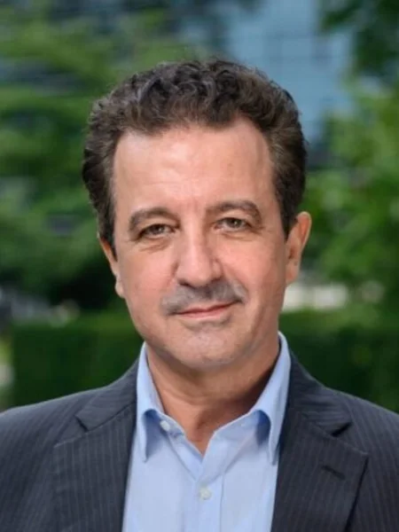
          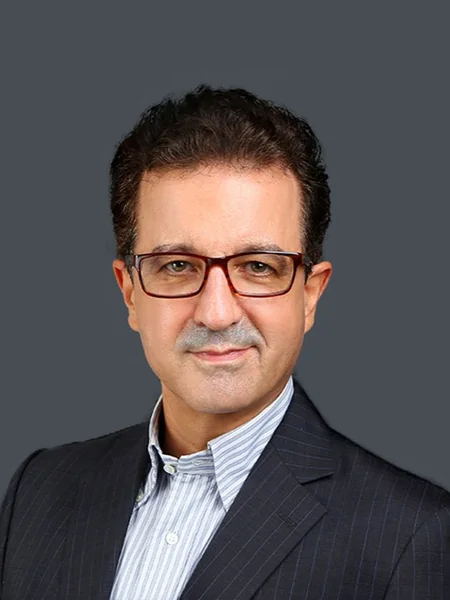
        

      

      

        <h3 class="rabuan-topic">
          <a href="2026-10-14-ric-roi-impact-career" class="internal">Making an Impact, Making a Career: Corporate Trajectories &amp; Ambidexterity</a>
        </h3>
        

          <a href="../entities/ric-roi" class="internal">Dr. Ric Roi</a>
        

        
Academic Director, IMD Strategic Talent Lab &amp; Professor of Leadership

        

          5 Levels of Impact
          <a href="../concepts/leadership-ambidexterity" class="rabuan-theme-tag internal">Ambidexterity</a>
          Executive Stewardship
        

      

    

    

      <a href="2026-10-14-ric-roi-impact-career" class="internal">
        Buka Sesi Making an Impact
        <svg xmlns="http://www.w3.org/2000/svg" width="14" height="14" viewBox="0 0 24 24" fill="none" stroke="currentColor" stroke-width="2.5" stroke-linecap="round" stroke-linejoin="round" aria-hidden="true"><line x1="5" y1="12" x2="19" y2="12"></line><polyline points="12 5 19 12 12 19"></polyline></svg>
      </a>
    

  

  <!-- Session 6: Prof. Irwan Meilano -->
  

    

      Institut Teknologi Bandung
      WED &middot; 30 SEP 2026
    

    

      

        

          
          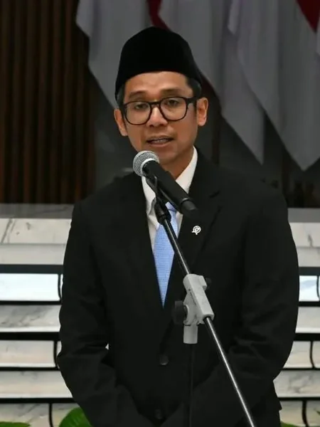
        

      

      

        <h3 class="rabuan-topic">
          <a href="2026-09-30-meilano-systemic-risk" class="internal">The Shifting Ground: Systemic Risk Governance &amp; Institutional Resilience</a>
        </h3>
        

          <a href="../entities/irwan-meilano" class="internal">Prof. Irwan Meilano, S.T., M.Sc., Ph.D.</a>
        

        
Guru Besar Geodesi Gempa Bumi &amp; Dekan FITB, Institut Teknologi Bandung

        

          Systemic Risk
          Disaster Governance
          Turkey Illusion
          Institutional Fragility
        

      

    

    

      <a href="2026-09-30-meilano-systemic-risk" class="internal">
        Buka Sesi Systemic Risk Governance
        <svg xmlns="http://www.w3.org/2000/svg" width="14" height="14" viewBox="0 0 24 24" fill="none" stroke="currentColor" stroke-width="2.5" stroke-linecap="round" stroke-linejoin="round" aria-hidden="true"><line x1="5" y1="12" x2="19" y2="12"></line><polyline points="12 5 19 12 12 19"></polyline></svg>
      </a>
    

  

  <!-- Session 5: Prof. Edward Buckingham -->
  

    

      Monash University
      WED &middot; 30 SEP 2026
    

    

      

        

          
          
        

      

      

        <h3 class="rabuan-topic">
          <a href="2026-09-30-buckingham-minto-method" class="internal">Strategic Execution, Structured Communication &amp; The Minto Method</a>
        </h3>
        

          <a href="../entities/edward-buckingham" class="internal">Prof. Edward Buckingham</a>
        

        
Professor of Management, Monash Business School &amp; Director, Monash Indonesia

        

          <a href="../concepts/minto-pyramid-principle" class="rabuan-theme-tag internal">Minto Pyramid</a>
          SCQA Framework
          Iron Triangle
          BLUF Principle
        

      

    

    

      <a href="2026-09-30-buckingham-minto-method" class="internal">
        Buka Sesi Strategic Execution
        <svg xmlns="http://www.w3.org/2000/svg" width="14" height="14" viewBox="0 0 24 24" fill="none" stroke="currentColor" stroke-width="2.5" stroke-linecap="round" stroke-linejoin="round" aria-hidden="true"><line x1="5" y1="12" x2="19" y2="12"></line><polyline points="12 5 19 12 12 19"></polyline></svg>
      </a>
    

  

  <!-- Session 4: Sahala Tua Paulus Situmorang -->
  

    

      Danantara Asset Mgmt
      WED &middot; 23 SEP 2026
    

    

      

        

          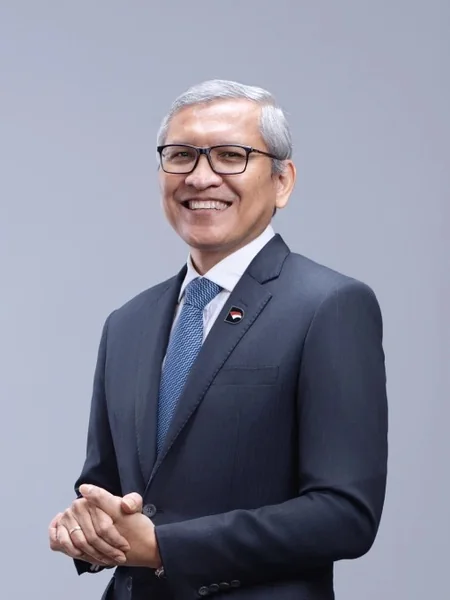
          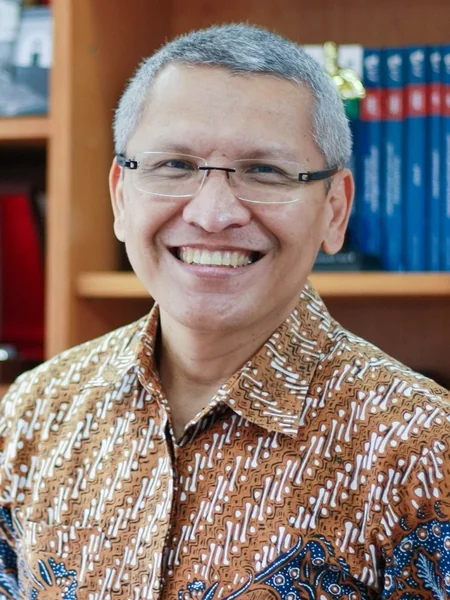
        

      

      

        <h3 class="rabuan-topic">
          <a href="2026-09-23-sahala-financial-discipline" class="internal">Memimpin dengan Financial Discipline: Capital Allocation, Risk &amp; Productivity</a>
        </h3>
        

          <a href="../entities/sahala-situmorang" class="internal">Sahala Tua Paulus Situmorang, S.E.Ak., M.B.A.</a>
        

        
Managing Director Finance / CFO, <a href="../entities/danantara" class="internal">PT Danantara Asset Management</a>

        

          <a href="../concepts/capital-capability-synergy" class="rabuan-theme-tag internal">Capital Allocation</a>
          Risk Quantification
          Total Quality Management
          <a href="../concepts/weighted-average-cost-of-capital" class="rabuan-theme-tag internal">Enterprise ROIC</a>
        

      

    

    

      <a href="2026-09-23-sahala-financial-discipline" class="internal">
        Buka Sesi Financial Discipline
        <svg xmlns="http://www.w3.org/2000/svg" width="14" height="14" viewBox="0 0 24 24" fill="none" stroke="currentColor" stroke-width="2.5" stroke-linecap="round" stroke-linejoin="round" aria-hidden="true"><line x1="5" y1="12" x2="19" y2="12"></line><polyline points="12 5 19 12 12 19"></polyline></svg>
      </a>
    

  

  <!-- Session 3: Dipl.-Ing. Syamsul Bachri Yusuf -->
  

    

      KemenPU &amp; Jasa Marga
      WED &middot; 23 SEP 2026
    

    

      

        

          
          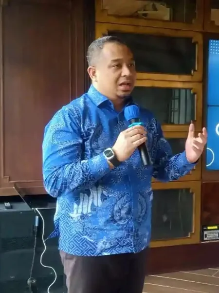
        

      

      

        <h3 class="rabuan-topic">
          <a href="2026-09-23-syamsul-infrastruktur" class="internal">Nation in Motion: Infrastruktur sebagai Penggerak Pertumbuhan &amp; Pemerataan</a>
        </h3>
        

          <a href="../entities/syamsul-bachri-yusuf" class="internal">Dipl.-Ing. Syamsul Bachri Yusuf, M.Si. (Han)</a>
        

        
Staf Khusus Menteri PU &amp; Dewan Komisaris <a href="../entities/pt-jasa-marga" class="internal">PT Jasa Marga (Persero) Tbk</a>

        

          <a href="../concepts/incremental-capital-output-ratio" class="rabuan-theme-tag internal">ICOR Dynamics</a>
          FEW Nexus
          KPBU Financing
          Toll Network Integration
        

      

    

    

      <a href="2026-09-23-syamsul-infrastruktur" class="internal">
        Buka Sesi Nation in Motion
        <svg xmlns="http://www.w3.org/2000/svg" width="14" height="14" viewBox="0 0 24 24" fill="none" stroke="currentColor" stroke-width="2.5" stroke-linecap="round" stroke-linejoin="round" aria-hidden="true"><line x1="5" y1="12" x2="19" y2="12"></line><polyline points="12 5 19 12 12 19"></polyline></svg>
      </a>
    

  

  <!-- Session 2B: Datuk (Dr.) Nora Manaf -->
  

    

      Maybank &amp; Manaf Gardner
      WED &middot; 16 SEP 2026
    

    

      

        

          

            <svg class="rabuan-portrait-svg" viewBox="0 0 90 120" fill="none" xmlns="http://www.w3.org/2000/svg" aria-hidden="true">
              <circle cx="45" cy="38" r="18" fill="currentColor" fill-opacity="0.16"/>
              <path d="M15 108C15 80 27 66 45 66C63 66 75 80 75 108" stroke="currentColor" stroke-width="4" stroke-linecap="round" fill="currentColor" fill-opacity="0.10"/>
            </svg>
            NM
          

        

      

      

        <h3 class="rabuan-topic">
          <a href="2026-09-16-nora-manaf-people-equation" class="internal">The Future of Work: The People Equation, Responsible Capitalism &amp; Leadership with Humanity</a>
        </h3>
        

          <a href="../entities/nora-manaf" class="internal">Datuk (Dr.) Nora Manaf</a>
        

        
Former Group CHCO, Maybank (2008–2024) &amp; Chairman, Manaf Gardner Associates

        

          <a href="../concepts/the-people-equation" class="rabuan-theme-tag internal">The People Equation</a>
          Responsible Capitalism
          Maybank Transformation
          Skills-Based Org
        

      

    

    

      <a href="2026-09-16-nora-manaf-people-equation" class="internal">
        Buka Sesi The People Equation
        <svg xmlns="http://www.w3.org/2000/svg" width="14" height="14" viewBox="0 0 24 24" fill="none" stroke="currentColor" stroke-width="2.5" stroke-linecap="round" stroke-linejoin="round" aria-hidden="true"><line x1="5" y1="12" x2="19" y2="12"></line><polyline points="12 5 19 12 12 19"></polyline></svg>
      </a>
    

  

  <!-- Session 2: Indayati Oetomo -->
  

    

      John Robert Powers
      FRI &middot; 04 SEP 2026 &middot; SPECIAL SESSION
    

    

      

        

          
          
        

      

      

        <h3 class="rabuan-topic">
          <a href="2026-09-04-indayati-professional-image" class="internal">Building Professional Image &amp; Executive Communication Skills</a>
        </h3>
        

          <a href="../entities/indayati-oetomo" class="internal">Indayati Oetomo</a>
        

        
Executive Director, John Robert Powers Indonesia

        

          <a href="../concepts/professional-image-framework" class="rabuan-theme-tag internal">Executive Presence</a>
          Leadership Voice
          Personal Branding
          Stakeholder Gravitas
        

      

    

    

      <a href="2026-09-04-indayati-professional-image" class="internal">
        Buka Sesi Professional Image
        <svg xmlns="http://www.w3.org/2000/svg" width="14" height="14" viewBox="0 0 24 24" fill="none" stroke="currentColor" stroke-width="2.5" stroke-linecap="round" stroke-linejoin="round" aria-hidden="true"><line x1="5" y1="12" x2="19" y2="12"></line><polyline points="12 5 19 12 12 19"></polyline></svg>
      </a>
    

  

  <!-- Session 1: Agus Dwi Handaya -->
  

    

      Danantara Asset Mgmt
      MON &middot; 31 AUG 2026
    

    

      

        

          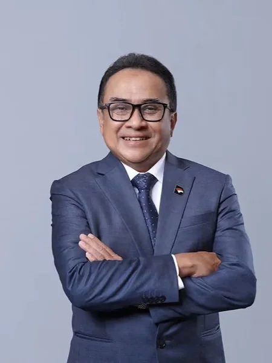
          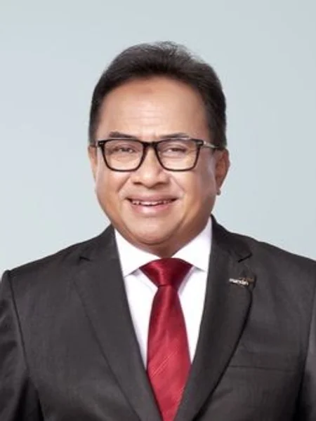
        

      

      

        <h3 class="rabuan-topic">
          <a href="2026-09-02-adh-peoplemath" class="internal">PeopleMath: Produktivitas Berkualitas, Kebahagiaan Tanpa Batas &amp; Strategi Tough &amp; Agile Learner</a>
        </h3>
        

          <a href="../entities/agus-dwi-handaya" class="internal">Agus Dwi Handaya</a>
        

        
Managing Director Human Capital, <a href="../entities/danantara" class="internal">PT Danantara Asset Management</a>

        

          <a href="../concepts/peoplemath-framework" class="rabuan-theme-tag internal">PPH &amp; 20 Rumus</a>
          <a href="../concepts/tough-and-agile-learner" class="rabuan-theme-tag internal">Tough &amp; Agile Learner</a>
          3N Leader &amp; Individu
          Vb/Vp Velocity
        

      

    

    

      <a href="2026-09-02-adh-peoplemath" class="internal">
        Buka Sesi PeopleMath
        <svg xmlns="http://www.w3.org/2000/svg" width="14" height="14" viewBox="0 0 24 24" fill="none" stroke="currentColor" stroke-width="2.5" stroke-linecap="round" stroke-linejoin="round" aria-hidden="true"><line x1="5" y1="12" x2="19" y2="12"></line><polyline points="12 5 19 12 12 19"></polyline></svg>
      </a>
    

  

  <!-- Session 1B: Hadjar Seti Adji -->
  

    

      PT Wijaya Karya (WIKA)
      MON &middot; 31 AUG 2026
    

    

      

        

          

            <svg class="rabuan-portrait-svg" viewBox="0 0 90 120" fill="none" xmlns="http://www.w3.org/2000/svg" aria-hidden="true">
              <circle cx="45" cy="38" r="18" fill="currentColor" fill-opacity="0.16"/>
              <path d="M15 108C15 80 27 66 45 66C63 66 75 80 75 108" stroke="currentColor" stroke-width="4" stroke-linecap="round" fill="currentColor" fill-opacity="0.10"/>
            </svg>
            HS
          

        

      

      

        <h3 class="rabuan-topic">
          <a href="2026-08-31-hadjar-from-learner-to-transformer" class="internal">From a Learner to a Transformer for Legacy: Blue Ocean Transformation &amp; Pragmatic PeopleMath</a>
        </h3>
        

          <a href="../entities/hadjar-seti-adji" class="internal">Hadjar Seti Adji</a>
        

        
Direktur Manajemen SDM &amp; Transformasi, <a href="../entities/pt-wijaya-karya" class="internal">PT Wijaya Karya (Persero) Tbk</a>

        

          Learner &rarr; Legacy
          Blue Ocean Strategy
          BIM &amp; Green Building
          Ethical Execution Triad
        

      

    

    

      <a href="2026-08-31-hadjar-from-learner-to-transformer" class="internal">
        Buka Sesi Learner to Transformer
        <svg xmlns="http://www.w3.org/2000/svg" width="14" height="14" viewBox="0 0 24 24" fill="none" stroke="currentColor" stroke-width="2.5" stroke-linecap="round" stroke-linejoin="round" aria-hidden="true"><line x1="5" y1="12" x2="19" y2="12"></line><polyline points="12 5 19 12 12 19"></polyline></svg>
      </a>
    

  

  <!-- Session 0 / Kick-Off: Dony Oskaria -->
  

    

      Danantara &amp; BP BUMN
      WED &middot; 02 SEP 2026
    

    

      

        

          

            <svg class="rabuan-portrait-svg" viewBox="0 0 90 120" fill="none" xmlns="http://www.w3.org/2000/svg" aria-hidden="true">
              <circle cx="45" cy="38" r="18" fill="currentColor" fill-opacity="0.16"/>
              <path d="M15 108C15 80 27 66 45 66C63 66 75 80 75 108" stroke="currentColor" stroke-width="4" stroke-linecap="round" fill="currentColor" fill-opacity="0.10"/>
            </svg>
            DO
          

        

      

      

        <h3 class="rabuan-topic">
          <a href="2026-09-02-oskaria-directorship-doctrine" class="internal">Directorship as a Standard, Sovereign Stewardship &amp; Turnaround Doctrine</a>
        </h3>
        

          <a href="../entities/dony-oskaria" class="internal">Dony Oskaria</a>
        

        
COO <a href="../entities/danantara" class="internal">BPI Danantara</a> &amp; Kepala BP BUMN

        

          Reconstructed Dossier
          5 Directorship Capabilities
          8 BP BUMN Rules
          4-Phase Turnaround
        

      

    

    

      <a href="2026-09-02-oskaria-directorship-doctrine" class="internal">
        Buka Sesi Directorship Doctrine
        <svg xmlns="http://www.w3.org/2000/svg" width="14" height="14" viewBox="0 0 24 24" fill="none" stroke="currentColor" stroke-width="2.5" stroke-linecap="round" stroke-linejoin="round" aria-hidden="true"><line x1="5" y1="12" x2="19" y2="12"></line><polyline points="12 5 19 12 12 19"></polyline></svg>
      </a>
    

  

  
Cohort Initiative

  <h2 class="rabuan-section-title">Special Sessions, Presidential Directives &amp; Livestream Briefings</h2>
  
Independent executive briefings, presidential directives at Padepokan Garuda Yaksa, and major keynote orations observed and analyzed by the cohort.

  <!-- Special Session: Presiden Prabowo Subianto - Taklimat Hambalang -->
  

    

      Padepokan Garuda Yaksa &middot; Istana
      SUN &middot; 24 MAY 2026
    

    

      

        

          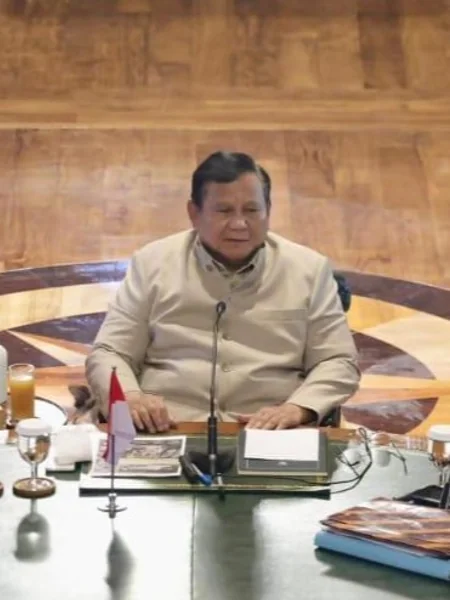
          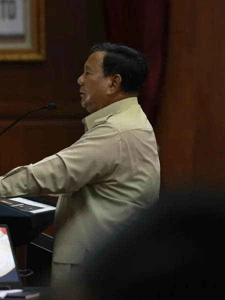
        

      

      

        <h3 class="rabuan-topic">
          <a href="2026-05-24-prabowo-taklimat-hambalang" class="internal">Taklimat Perdana Presiden: Doktrin BUMN, Best Mind &amp; Best Heart, dan Pertahanan Ekonomi</a>
        </h3>
        

          <a href="../entities/prabowo-subianto" class="internal">Jenderal TNI (Purn.) H. Prabowo Subianto</a>
        

        
Presiden Republik Indonesia &amp; Inisiator Program P3MD

        

          In-Person &middot; Hambalang
          <a href="../concepts/best-mind-best-heart" class="rabuan-theme-tag internal">Best Mind Best Heart</a>
          Lengser Keprabon
          Danantara
        

      

    

    

      <a href="2026-05-24-prabowo-taklimat-hambalang" class="internal">
        Buka Taklimat Hambalang
        <svg xmlns="http://www.w3.org/2000/svg" width="14" height="14" viewBox="0 0 24 24" fill="none" stroke="currentColor" stroke-width="2.5" stroke-linecap="round" stroke-linejoin="round" aria-hidden="true"><line x1="5" y1="12" x2="19" y2="12"></line><polyline points="12 5 19 12 12 19"></polyline></svg>
      </a>
    

  

  <!-- Special Session: Presiden Prabowo Subianto - KEM-PPKF RAPBN 2027 -->
  

    

      DPR RI &middot; Gedung Nusantara
      WED &middot; 20 MAY 2026
    

    

      

        

          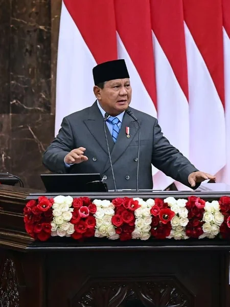
          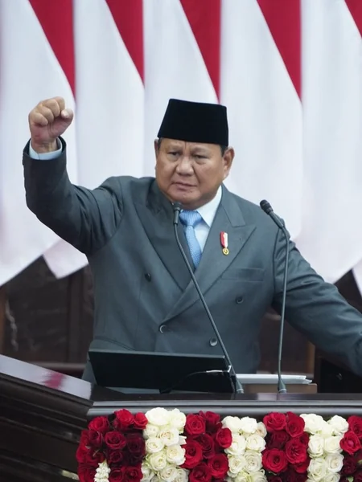
        

      

      

        <h3 class="rabuan-topic">
          <a href="2026-05-20-prabowo-kem-ppkf-rapbn-2027" class="internal">Kerangka Ekonomi Makro &amp; Pokok-Pokok Kebijakan Fiskal (KEM-PPKF) RAPBN 2027</a>
        </h3>
        

          <a href="../entities/prabowo-subianto" class="internal">Jenderal TNI (Purn.) H. Prabowo Subianto</a>
        

        
Presiden Republik Indonesia

        

          Livestream &middot; DPR Paripurna
          Pasal 33 UUD 1945
          Makan Bergizi Gratis
          KDMP
        

      

    

    

      <a href="2026-05-20-prabowo-kem-ppkf-rapbn-2027" class="internal">
        Buka Pidato KEM-PPKF
        <svg xmlns="http://www.w3.org/2000/svg" width="14" height="14" viewBox="0 0 24 24" fill="none" stroke="currentColor" stroke-width="2.5" stroke-linecap="round" stroke-linejoin="round" aria-hidden="true"><line x1="5" y1="12" x2="19" y2="12"></line><polyline points="12 5 19 12 12 19"></polyline></svg>
      </a>
    

  

  <!-- Special Session: Operasi Integritas Soedirman (Jam Komandan) -->
  

    

      BPPK Kemhan &middot; DCU Nawasena
      THU &middot; 12 NOV 2026
    

    

      

        

          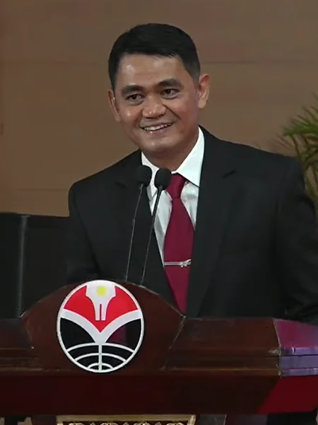
          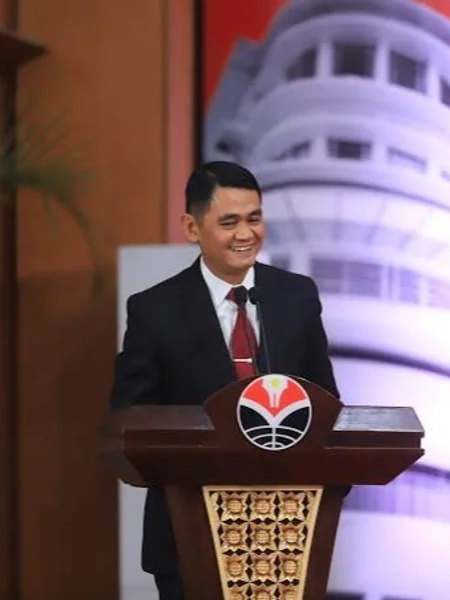
        

      

      

        <h3 class="rabuan-topic">
          <a href="2026-11-12-operasi-integritas-soedirman" class="internal">Operasi Integritas Soedirman: Disrupt Toxicity, Protect Integrity, Select the Worthy</a>
        </h3>
        

          <a href="../entities/anton-palaguna" class="internal">Marsma TNI Dr. Anton "Sioux" Palaguna</a>
        

        
Komandan BPPK Kemhan RI &amp; Komandan Program P3MD Batch I Soedirman

        

          Jam Komandan &middot; Tahap II
          <a href="../concepts/the-integrity-triangle" class="rabuan-theme-tag internal">The Integrity Triangle</a>
          Alpha-Zulu Grading
          Center of Gravity
        

      

    

    

      <a href="2026-11-12-operasi-integritas-soedirman" class="internal">
        Buka Sesi Operasi Integritas
        <svg xmlns="http://www.w3.org/2000/svg" width="14" height="14" viewBox="0 0 24 24" fill="none" stroke="currentColor" stroke-width="2.5" stroke-linecap="round" stroke-linejoin="round" aria-hidden="true"><line x1="5" y1="12" x2="19" y2="12"></line><polyline points="12 5 19 12 12 19"></polyline></svg>
      </a>
    

  

  <!-- Special Session: Marsma Anton Pallaguna -->
  

    

      BPPK Kemhan &middot; Mabes TNI
      TUE &middot; 20 OCT 2026
    

    

      

        

          
          
        

      

      

        <h3 class="rabuan-topic">
          <a href="2026-10-20-anton-upi-dies-natalis-orasi" class="internal">Mendidik Guru, Menantang Pemimpin: Sinergi Ekosistem &amp; Doktrin Kepemimpinan P3MD</a>
        </h3>
        

          <a href="../entities/anton-palaguna" class="internal">Marsma TNI Dr. Anton "Sioux" Palaguna</a>
        

        
Komandan BPPK Kemhan RI &amp; Komandan Program P3MD Batch I Soedirman

        

          Livestream &middot; Cohort Initiative
          <a href="../concepts/behavior-change-engine" class="rabuan-theme-tag internal">Behavior Change Engine</a>
          QFI Framework
          P3MD Blueprint
        

      

    

    

      <a href="2026-10-20-anton-upi-dies-natalis-orasi" class="internal">
        Buka Sesi Doktrin Komandan
        <svg xmlns="http://www.w3.org/2000/svg" width="14" height="14" viewBox="0 0 24 24" fill="none" stroke="currentColor" stroke-width="2.5" stroke-linecap="round" stroke-linejoin="round" aria-hidden="true"><line x1="5" y1="12" x2="19" y2="12"></line><polyline points="12 5 19 12 12 19"></polyline></svg>
      </a>
    

  

  <!-- Special Foundation Plenary: Dr. Agus Gumiwang Kartasasmita -->
  

    

      Kemenperin &middot; Kodiklat TNI
      WED &middot; 19 AUG 2026
    

    

      

        

          

            <svg class="rabuan-portrait-svg" viewBox="0 0 90 120" fill="none" xmlns="http://www.w3.org/2000/svg" aria-hidden="true">
              <circle cx="45" cy="38" r="18" fill="currentColor" fill-opacity="0.16"/>
              <path d="M15 108C15 80 27 66 45 66C63 66 75 80 75 108" stroke="currentColor" stroke-width="4" stroke-linecap="round" fill="currentColor" fill-opacity="0.10"/>
            </svg>
            AGK
          

        

      

      

        <h3 class="rabuan-topic">
          <a href="2026-08-19-agus-gumiwang-industrialisasi-nasional" class="internal">BUMN dan Industrialisasi Nasional: Membangun Pemimpin Berkarakter, Tata Kelola Kuat, dan Daya Saing</a>
        </h3>
        

          <a href="../entities/agus-gumiwang-kartasasmita" class="internal">Dr. Agus Gumiwang Kartasasmita, M.Si.</a>
        

        
Menteri Perindustrian Republik Indonesia

        

          Fase I &middot; Kodiklat TNI
          <a href="2026-08-18-agus-gumiwang-kepemimpinan-bumn-reading" class="rabuan-theme-tag internal">Pre-Session Reading</a>
          <a href="../concepts/manufacturing-value-added" class="rabuan-theme-tag internal">MVA #1 ASEAN</a>
          <a href="../concepts/soft-budget-constraint" class="rabuan-theme-tag internal">Soft Budget Constraint</a>
          P3DN &amp; TKDN
        

      

    

    

      <a href="2026-08-19-agus-gumiwang-industrialisasi-nasional" class="internal">
        Buka Sesi Industrialisasi Nasional
        <svg xmlns="http://www.w3.org/2000/svg" width="14" height="14" viewBox="0 0 24 24" fill="none" stroke="currentColor" stroke-width="2.5" stroke-linecap="round" stroke-linejoin="round" aria-hidden="true"><line x1="5" y1="12" x2="19" y2="12"></line><polyline points="12 5 19 12 12 19"></polyline></svg>
      </a>
    

  

  <!-- Special Foundation Plenary: Marsda TNI Dr. Budhi Achmadi -->
  

    

      Staf Strategi &middot; Mabes TNI
      FRI &middot; 03 JUL 2026
    

    

      

        

          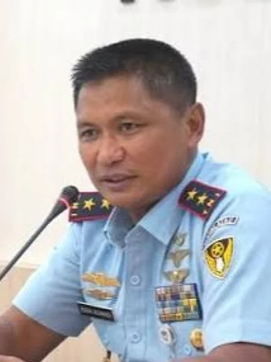
          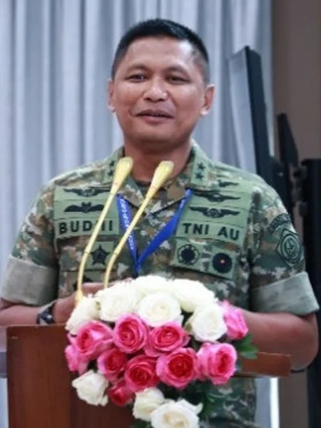
        

      

      

        <h3 class="rabuan-topic">
          <a href="2026-07-03-budhi-achmadi-kepemimpinan-bumn" class="internal">Kepemimpinan BUMN Abad XXI: Doktrin Karakter, Administrasi Publik &amp; Tata Kelola Korporasi</a>
        </h3>
        

          <a href="../entities/budhi-achmadi" class="internal">Marsda TNI Dr. Budhi Achmadi, M.Sc.</a>
        

        
Asisten Strategi Panglima TNI &amp; Mantan Kapusjianstralitbang TNI

        

          Fase I &middot; Kodiklat TNI
          <a href="../concepts/public-administration-paradigms" class="rabuan-theme-tag internal">NPM Steering</a>
          <a href="../concepts/pso-commercial-duality" class="rabuan-theme-tag internal">Pasal 33 UUD 1945</a>
          Karakter &amp; Takdir
        

      

    

    

      <a href="2026-07-03-budhi-achmadi-kepemimpinan-bumn" class="internal">
        Buka Sesi Kepemimpinan BUMN
        <svg xmlns="http://www.w3.org/2000/svg" width="14" height="14" viewBox="0 0 24 24" fill="none" stroke="currentColor" stroke-width="2.5" stroke-linecap="round" stroke-linejoin="round" aria-hidden="true"><line x1="5" y1="12" x2="19" y2="12"></line><polyline points="12 5 19 12 12 19"></polyline></svg>
      </a>
    

  

  <!-- Special Foundation Plenary: Marsdya TNI (Purn) Kusworo -->
  

    

      BASARNAS &middot; Kodiklat TNI
      MON &middot; 22 JUN 2026
    

    

      

        

          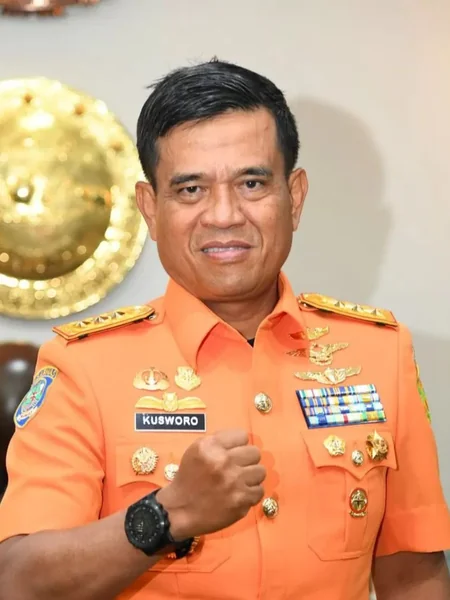
          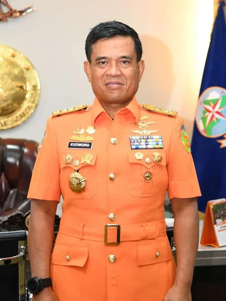
        

      

      

        <h3 class="rabuan-topic">
          <a href="2026-06-22-kusworo-crisis-leadership" class="internal">Crisis Leadership: Leading Under Pressure — Decide Fast, Act Right, Save Lives</a>
        </h3>
        

          <a href="../entities/kusworo" class="internal">Marsdya TNI (Purn) Kusworo, S.E., M.M.</a>
        

        
Kepala Badan Nasional Pencarian dan Pertolongan (Kabasarnas 2023–2026)

        

          Fase I &middot; Kodiklat TNI
          <a href="../concepts/crisis-leadership-framework" class="rabuan-theme-tag internal">Decision Tree</a>
          Hexagon of Chaos
          True North
        

      

    

    

      <a href="2026-06-22-kusworo-crisis-leadership" class="internal">
        Buka Sesi Crisis Leadership
        <svg xmlns="http://www.w3.org/2000/svg" width="14" height="14" viewBox="0 0 24 24" fill="none" stroke="currentColor" stroke-width="2.5" stroke-linecap="round" stroke-linejoin="round" aria-hidden="true"><line x1="5" y1="12" x2="19" y2="12"></line><polyline points="12 5 19 12 12 19"></polyline></svg>
      </a>
    

  

  <!-- Special Foundation Plenary: Dony Oskaria -->
  

    

      Danantara &middot; BP BUMN &middot; Kodiklat TNI
      TUE &middot; 09 JUN 2026
    

    

      

        

          

            <svg class="rabuan-portrait-svg" viewBox="0 0 90 120" fill="none" xmlns="http://www.w3.org/2000/svg" aria-hidden="true">
              <circle cx="45" cy="38" r="18" fill="currentColor" fill-opacity="0.16"/>
              <path d="M15 108C15 80 27 66 45 66C63 66 75 80 75 108" stroke="currentColor" stroke-width="4" stroke-linecap="round" fill="currentColor" fill-opacity="0.10"/>
            </svg>
            DO
          

        

      

      

        <h3 class="rabuan-topic">
          <a href="2026-06-09-oskaria-bumn-transformation-danantara" class="internal">Transformasi Total BUMN &amp; Arsitektur Tata Kelola BPI Danantara</a>
        </h3>
        

          <a href="../entities/dony-oskaria" class="internal">Dony Oskaria</a>
        

        
COO <a href="../entities/danantara" class="internal">BPI Danantara</a> &amp; Kepala BP BUMN

        

          Fase I &middot; Kodiklat TNI
          Reconstructed Dossier
          1% Seri A vs 99% Seri B
          <a href="../concepts/pso-commercial-duality" class="rabuan-theme-tag internal">PSO Duality</a>
        

      

    

    

      <a href="2026-06-09-oskaria-bumn-transformation-danantara" class="internal">
        Buka Sesi Transformasi BUMN
        <svg xmlns="http://www.w3.org/2000/svg" width="14" height="14" viewBox="0 0 24 24" fill="none" stroke="currentColor" stroke-width="2.5" stroke-linecap="round" stroke-linejoin="round" aria-hidden="true"><line x1="5" y1="12" x2="19" y2="12"></line><polyline points="12 5 19 12 12 19"></polyline></svg>
      </a>
    

  

  
Executive Pipeline &amp; Synthesis

  <h2 class="rabuan-section-title">Masterclass Pipeline: In-Progress Dossiers &amp; Forthcoming Series</h2>
  
Plenary masterclasses convened and scheduled across the cohort journey. Delivered sessions are currently undergoing editorial synthesis, transcript processing, and academic framework alignment before archival; forthcoming sessions remain scheduled on the synchronization calendar.

  <!-- Pipeline: 04 Nov 2026 - Jenderal Polisi Dr. (H.C.) Suyudi Ario Seto -->
  

    

      Polri &middot; Mabes
      WED &middot; 04 NOV 2026
    

    

      

        

          

            <svg class="rabuan-portrait-svg" viewBox="0 0 90 120" fill="none" xmlns="http://www.w3.org/2000/svg" aria-hidden="true">
              <circle cx="45" cy="38" r="18" fill="currentColor" fill-opacity="0.16"/>
              <path d="M15 108C15 80 27 66 45 66C63 66 75 80 75 108" stroke="currentColor" stroke-width="4" stroke-linecap="round" fill="currentColor" fill-opacity="0.10"/>
            </svg>
            POL
          

        

      

      

        <h3 class="rabuan-topic">Kepemimpinan Berbasis Kepercayaan Publik: Dari Integritas ke Dampak</h3>
        
Jenderal Polisi Dr. (H.C.) Suyudi Ario Seto, S.I.K., S.H., M.Si.

        
Kepala Kepolisian Negara Republik Indonesia

        

          Transformasi institusi kepolisian, kepemimpinan etik, membangun kepercayaan publik di era transparansi digital, dan translasi integritas personal menjadi dampak institusional yang terukur.
        

        

          Kepercayaan Publik
          Integritas Kepemimpinan
          Reformasi Kelembagaan
          Public Accountability
        

      

    

    

      Delivered &middot; Dossier in Preparation
    

  

  <!-- Pipeline: 04 Nov 2026 - Prof. Yassierli -->
  

    

      Kemnaker RI &middot; ITB
      WED &middot; 04 NOV 2026
    

    

      

        

          

            <svg class="rabuan-portrait-svg" viewBox="0 0 90 120" fill="none" xmlns="http://www.w3.org/2000/svg" aria-hidden="true">
              <circle cx="45" cy="38" r="18" fill="currentColor" fill-opacity="0.16"/>
              <path d="M15 108C15 80 27 66 45 66C63 66 75 80 75 108" stroke="currentColor" stroke-width="4" stroke-linecap="round" fill="currentColor" fill-opacity="0.10"/>
            </svg>
            MEN
          

        

      

      

        <h3 class="rabuan-topic">Pemimpin Masa Depan di Tengah Perubahan Dunia Kerja: Kompetensi, Adaptasi, dan Daya Saing</h3>
        
Prof. Yassierli, Ph.D.

        
Menteri Ketenagakerjaan Republik Indonesia &amp; Guru Besar Ergonomi &amp; Rekayasa Kerja ITB

        

          Antisipasi megatren disrupsi otomasi, AI, transisi demografi dan ketenagakerjaan hijau; perumusan kompetensi esensial pemimpin masa depan, reskilling/upskilling nasional, dan daya saing talenta Indonesia.
        

        

          Masa Depan Kerja
          Kompetensi Pemimpin
          Daya Saing Talenta
          Adaptabilitas Organisasi
        

      

    

    

      Delivered &middot; Dossier in Preparation
    

  

  <!-- Pipeline: 04 Nov 2026 - Bapak Angga Raka Prabowo -->
  

    

      Kemenkomdigi RI
      WED &middot; 04 NOV 2026
    

    

      

        

          

            <svg class="rabuan-portrait-svg" viewBox="0 0 90 120" fill="none" xmlns="http://www.w3.org/2000/svg" aria-hidden="true">
              <circle cx="45" cy="38" r="18" fill="currentColor" fill-opacity="0.16"/>
              <path d="M15 108C15 80 27 66 45 66C63 66 75 80 75 108" stroke="currentColor" stroke-width="4" stroke-linecap="round" fill="currentColor" fill-opacity="0.10"/>
            </svg>
            KMD
          

        

      

      

        <h3 class="rabuan-topic">Kepemimpinan di Era Digital</h3>
        
Bapak Angga Raka Prabowo

        
Wakil Menteri Komunikasi dan Digital Republik Indonesia

        

          Kepemimpinan strategis dalam akselerasi transformasi digital nasional, tata kelola ruang siber, kedaulatan data dan infrastruktur konektivitas publik, serta kepemimpinan adaptif di tengah perkembangan kecerdasan buatan.
        

        

          Transformasi Digital
          Kedaulatan Digital
          Kepemimpinan Adaptif
          Tata Kelola Siber
        

      

    

    

      Delivered &middot; Dossier in Preparation
    

  

  <!-- Pipeline: 28 Oct 2026 - Bpk. Ryan Manafe -->
  

    

      PT Agrinas
      WED &middot; 28 OCT 2026
    

    

      

        

          

            <svg class="rabuan-portrait-svg" viewBox="0 0 90 120" fill="none" xmlns="http://www.w3.org/2000/svg" aria-hidden="true">
              <circle cx="45" cy="38" r="18" fill="currentColor" fill-opacity="0.16"/>
              <path d="M15 108C15 80 27 66 45 66C63 66 75 80 75 108" stroke="currentColor" stroke-width="4" stroke-linecap="round" fill="currentColor" fill-opacity="0.10"/>
            </svg>
            AGR
          

        

      

      

        <h3 class="rabuan-topic">Transformasi Digital Rantai Pasok: Implementasi KDKMP pada Proses Produksi</h3>
        
Bpk. Ryan Manafe

        
Director of Business Development and IT, PT Agrinas

        

          Digitalisasi rantai pasok agribisnis hulu-hilir, implementasi KDKMP (Koperasi Desa Korporasi Merah Putih) pada proses produksi pangan, serta efisiensi operasional terdistribusi.
        

        

          Supply Chain Tech
          KDKMP Implementation
          Ketahanan Pangan
          Digital Operations
        

      

    

    

      Delivered &middot; Dossier in Preparation
    

  

  <!-- Pipeline: 28 Oct 2026 - Ibu Febryani Eddy -->
  

    

      Danantara Asset Mgmt
      WED &middot; 28 OCT 2026
    

    

      

        

          

            <svg class="rabuan-portrait-svg" viewBox="0 0 90 120" fill="none" xmlns="http://www.w3.org/2000/svg" aria-hidden="true">
              <circle cx="45" cy="38" r="18" fill="currentColor" fill-opacity="0.16"/>
              <path d="M15 108C15 80 27 66 45 66C63 66 75 80 75 108" stroke="currentColor" stroke-width="4" stroke-linecap="round" fill="currentColor" fill-opacity="0.10"/>
            </svg>
            DAN
          

        

      

      

        <h3 class="rabuan-topic">Berstandar Global, Berjiwa Indonesia: Membawa Kepemimpinan Kelas Dunia untuk Membangun Negeri</h3>
        
Ibu Febryani Eddy

        
Managing Director Business 3, <a href="../entities/danantara" class="internal">Danantara Asset Management</a>

        

          Penerapan tata kelola standar global di industri strategis nasional, kepemimpinan berwawasan kebangsaan, dan orkestrasi nilai tambah sumber daya strategis negara.
        

        

          Global Leadership
          Danantara Stewardship
          Tata Kelola Korporasi
          Value Creation
        

      

    

    

      Delivered &middot; Dossier in Preparation
    

  

  <!-- Pipeline: 28 Oct 2026 - Business Immersion PT SIG -->
  

    

      Semen Indonesia (SIG)
      WED &middot; 28 OCT 2026
    

    

      

        

          

            <svg class="rabuan-portrait-svg" viewBox="0 0 90 120" fill="none" xmlns="http://www.w3.org/2000/svg" aria-hidden="true">
              <circle cx="45" cy="38" r="18" fill="currentColor" fill-opacity="0.16"/>
              <path d="M15 108C15 80 27 66 45 66C63 66 75 80 75 108" stroke="currentColor" stroke-width="4" stroke-linecap="round" fill="currentColor" fill-opacity="0.10"/>
            </svg>
            SIG
          

        

      

      

        <h3 class="rabuan-topic">Business Immersion &amp; Industrial Diagnostic: Dekarbonisasi dan Rantai Pasok Semen Nasional</h3>
        
<a href="../entities/pt-semen-indonesia" class="internal">PT Semen Indonesia (Persero) Tbk</a>

        
Sesi Kunjungan Lapangan &amp; Diagnostik Manufaktur Berat BUMN

        

          Observasi langsung operasi manufaktur skala besar, integrasi rantai pasok material bangunan nasional, teknologi transisi semen hijau rendah karbon, dan navigasi overkapasitas industri semen.
        

        

          Business Immersion
          Green Cement
          Industrial Decarbonization
          Supply Chain Logistics
        

      

    

    

      Delivered &middot; Dossier in Preparation
    

  

  <!-- Pipeline: 20 Oct 2026 - Prof. Sarjono Putro -->
  

    

      SBM ITB
      TUE &middot; 20 OCT 2026
    

    

      

        

          

            <svg class="rabuan-portrait-svg" viewBox="0 0 90 120" fill="none" xmlns="http://www.w3.org/2000/svg" aria-hidden="true">
              <circle cx="45" cy="38" r="18" fill="currentColor" fill-opacity="0.16"/>
              <path d="M15 108C15 80 27 66 45 66C63 66 75 80 75 108" stroke="currentColor" stroke-width="4" stroke-linecap="round" fill="currentColor" fill-opacity="0.10"/>
            </svg>
            ITB
          

        

      

      

        <h3 class="rabuan-topic">Penerapan Theory U (Level of Listening) dalam Pengambilan Keputusan Pemimpin</h3>
        
Bapak Prof. Sarjono Putro

        
Ketua Kelompok Keahlian Pengambilan Keputusan dan Negosiasi Strategis, SBM ITB

        

          Kerangka Otto Scharmer's Theory U, 4 tingkatan mendengar (Downloading, Factual, Empathic, Generative), dan dampaknya terhadap ketajaman kepemimpinan dalam menavigasi disrupsi kompleksitas tinggi.
        

        

          Theory U
          Four Levels of Listening
          Strategic Decision Making
          Generative Presence
        

      

    

    

      Delivered &middot; Dossier in Preparation
    

  

  <!-- Pipeline: 20 Oct 2026 - Bapak Setyanto Hantoro -->
  

    

      Danantara Asset Mgmt
      TUE &middot; 20 OCT 2026
    

    

      

        

          

            <svg class="rabuan-portrait-svg" viewBox="0 0 90 120" fill="none" xmlns="http://www.w3.org/2000/svg" aria-hidden="true">
              <circle cx="45" cy="38" r="18" fill="currentColor" fill-opacity="0.16"/>
              <path d="M15 108C15 80 27 66 45 66C63 66 75 80 75 108" stroke="currentColor" stroke-width="4" stroke-linecap="round" fill="currentColor" fill-opacity="0.10"/>
            </svg>
            DAM
          

        

      

      

        <h3 class="rabuan-topic">Capital Allocation for BUMN Leaders: Setiap Rupiah Harus Menciptakan Nilai</h3>
        
Bapak Setyanto Hantoro

        
Managing Director Business 2, <a href="../entities/danantara" class="internal">PT Danantara Asset Management</a>

        

          Prinsip alokasi kapital disiplin bagi eksekutif BUMN, mitigasi sunk cost fallacy, optimasi ROIC di atas biaya modal (WACC), serta arsitektur portofolio investasi pencipta nilai ekonomi jangka panjang.
        

        

          Capital Allocation
          Value Creation
          Disiplin Kapital BUMN
          ROIC vs WACC
        

      

    

    

      Delivered &middot; Dossier in Preparation
    

  

  <!-- Pipeline: 20 Oct 2026 - Business Immersion -->
  

    

      Business Immersion
      TUE &middot; 20 OCT 2026
    

    

      

        

          

            <svg class="rabuan-portrait-svg" viewBox="0 0 90 120" fill="none" xmlns="http://www.w3.org/2000/svg" aria-hidden="true">
              <circle cx="45" cy="38" r="18" fill="currentColor" fill-opacity="0.16"/>
              <path d="M15 108C15 80 27 66 45 66C63 66 75 80 75 108" stroke="currentColor" stroke-width="4" stroke-linecap="round" fill="currentColor" fill-opacity="0.10"/>
            </svg>
            IMM
          

        

      

      

        <h3 class="rabuan-topic">Business Immersion: Diagnostik Ekosistem &amp; Observasi Lapangan Praktisi BUMN</h3>
        
BUMN Immersion Cohort Track

        
Sesi Penajaman Lapangan &amp; Verifikasi Diagnostik Praktisi

        

          Sesi penajaman lapangan peserta didik P3MD untuk menguji keselarasan antara kerangka teoritis tata kelola strategis dengan realitas operasional badan usaha milik negara.
        

        

          Business Immersion
          Field Diagnostic
          BUMN Realpolitik
        

      

    

    

      Delivered &middot; Dossier in Preparation
    

  

  <!-- Pipeline: 14 Oct 2026 - Dr. H. Agus Harimurti Yudhoyono -->
  

    

      Kemenko Infrastruktur
      WED &middot; 14 OCT 2026
    

    

      

        

          

            <svg class="rabuan-portrait-svg" viewBox="0 0 90 120" fill="none" xmlns="http://www.w3.org/2000/svg" aria-hidden="true">
              <circle cx="45" cy="38" r="18" fill="currentColor" fill-opacity="0.16"/>
              <path d="M15 108C15 80 27 66 45 66C63 66 75 80 75 108" stroke="currentColor" stroke-width="4" stroke-linecap="round" fill="currentColor" fill-opacity="0.10"/>
            </svg>
            AHY
          

        

      

      

        <h3 class="rabuan-topic">Infrastruktur dan Pembangunan Kewilayahan: Menghubungkan Simpul Pertumbuhan Nasional</h3>
        
Dr. H. Agus Harimurti Yudhoyono, M.Sc., M.P.A., M.A.

        
Menteri Koordinator Bidang Infrastruktur dan Pembangunan Kewilayahan Republik Indonesia

        

          Visi orkestrasi konektivitas multisektoral, pemerataan pertumbuhan ekonomi antarwilayah timur-barat, optimalisasi belanja modal infrastruktur terintegrasi, dan sinergi lintas kementerian serta BUMN.
        

        

          Infrastruktur Nasional
          Pembangunan Kewilayahan
          Konektivitas Multimoda
          Sovereign Capital
        

      

    

    

      Delivered &middot; Dossier in Preparation
    

  

  <!-- Pipeline: 14 Oct 2026 - Business Immersion BRI -->
  

    

      Bank BRI
      WED &middot; 14 OCT 2026
    

    

      

        

          

            <svg class="rabuan-portrait-svg" viewBox="0 0 90 120" fill="none" xmlns="http://www.w3.org/2000/svg" aria-hidden="true">
              <circle cx="45" cy="38" r="18" fill="currentColor" fill-opacity="0.16"/>
              <path d="M15 108C15 80 27 66 45 66C63 66 75 80 75 108" stroke="currentColor" stroke-width="4" stroke-linecap="round" fill="currentColor" fill-opacity="0.10"/>
            </svg>
            BRI
          

        

      

      

        <h3 class="rabuan-topic">Business Immersion BRI: Arsitektur Pembiayaan UMKM, Inklusi Keuangan &amp; Transformasi Digital</h3>
        
<a href="../entities/pt-bank-rakyat-indonesia" class="internal">PT Bank Rakyat Indonesia (Persero) Tbk</a>

        
Sesi Business Immersion &amp; Penugasan Refleksi Lapangan

        

          Pembedahan model bisnis inklusi mikro BRI, jejaring agen BRILink, digitalisasi pembiayaan ultra mikro (Holding UMi), dan manajemen risiko portofolio kredit berskala masif. Sesi paralel Dr. Ric Roi (IMD) telah diarsipkan pada <a href="2026-10-14-ric-roi-impact-career" class="internal">Sesi 7</a>.
        

        

          Business Immersion BRI
          Inklusi Keuangan
          Microfinance Ecosystem
          Digital Banking
        

      

    

    

      Delivered &middot; Dossier in Preparation
    

  

  <!-- Upcoming 1 -->
  

    

      Scheduled &middot; Forthcoming
      Q4 2026
    

    

      

        

          

            <svg class="rabuan-portrait-svg" viewBox="0 0 90 120" fill="none" xmlns="http://www.w3.org/2000/svg" aria-hidden="true">
              <circle cx="45" cy="38" r="18" fill="currentColor" fill-opacity="0.16"/>
              <path d="M15 108C15 80 27 66 45 66C63 66 75 80 75 108" stroke="currentColor" stroke-width="4" stroke-linecap="round" fill="currentColor" fill-opacity="0.10"/>
            </svg>
            CEO
          

        

      

      

        <h3 class="rabuan-topic">National Strategic Projects, Sovereign Balance Sheets &amp; Energy Transition</h3>
        
BUMN Chief Executive Officers

        
Executive Leadership of Strategic State-Owned Holdings

        

          Deep dive into sovereign capital mobilization, energy decarbonization roadmaps, and balance sheet orchestration across tier-1 national enterprises.
        

      

    

    

      Briefing published post-session
    

  

  <!-- Upcoming 2 -->
  

    

      Scheduled &middot; Forthcoming
      Q4 2026
    

    

      

        

          

            <svg class="rabuan-portrait-svg" viewBox="0 0 90 120" fill="none" xmlns="http://www.w3.org/2000/svg" aria-hidden="true">
              <circle cx="45" cy="38" r="18" fill="currentColor" fill-opacity="0.16"/>
              <path d="M15 108C15 80 27 66 45 66C63 66 75 80 75 108" stroke="currentColor" stroke-width="4" stroke-linecap="round" fill="currentColor" fill-opacity="0.10"/>
            </svg>
            GOV
          

        

      

      

        <h3 class="rabuan-topic">Geopolitics, State Sovereignty &amp; Critical Supply Chain Resilience</h3>
        
National Security &amp; Economic Planners

        
Policy Architects &amp; Strategic Defense Economists

        

          Analysis of geopolitical shifts, defense-industrial autonomy, food and energy security nexus, and state enterprise resilience in contested environments.
        

      

    

    

      Briefing published post-session
    

  

  
Pedagogical Framework

  <h2 class="rabuan-section-title">Pedagogical Distinction: Core Academic vs. Rabuan</h2>
  
How plenary guest lectures interface with the structured academic curriculum.

  

    

      <h3 class="rabuan-contrast-title">Core Academic Courses (MK 1 &ndash; MK 6)</h3>
    

    <ul class="rabuan-contrast-list">
      <li><strong>Structured 14-Week Journey:</strong> Progressive mastery of business disciplines engineered by SBM ITB.</li>
      <li><strong>Academic Rigor:</strong> Quantitative models, Harvard Business School case studies, simulation games, and written examinations.</li>
      <li><strong>Capstone Delivery:</strong> Continuous alignment with the Action Learning Project (ALP) milestones across 10 partner BUMNs.</li>
    </ul>
  

  

    

      <h3 class="rabuan-contrast-title">Rabuan Executive Plenary Series</h3>
    

    <ul class="rabuan-contrast-list">
      <li><strong>Dynamic Executive Realpolitik:</strong> High-stakes dilemmas directly from state enterprise boardrooms and cabinet rooms.</li>
      <li><strong>Heuristic Mastery:</strong> Unfiltered decision principles, capital allocation war stories, and crisis leadership frameworks.</li>
      <li><strong>National Alignment:</strong> Bridging foundational theory to state sovereignty, BUMN transformation, and the Golden Indonesia 2045 horizon.</li>
    </ul>
  

  
Cohort Navigation

  <h2 class="rabuan-section-title">Navigation &amp; Cross-References</h2>

- Explore the **[[concepts/index|Knowledge Matrix (Core Business Concepts)]]**
- Browse **[[courses/index|Core Academic Curriculum (MK 1 &ndash; MK 6)]]**
- Consult the **[[program/academic-calendar|Academic & Synchronization Calendar]]** for guest lecture timings
- Return to **[[index|P3MD MBA Cohort Portal Home]]**

